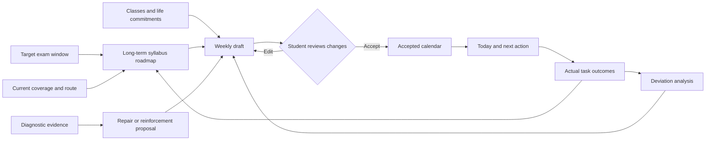

# Roadmap Calendar System — End-to-End Product Plan

**Status:** Product and build source of truth for the calendar reset  
**Date:** 7 September 2026  
**Scope:** CFA Level I from 2027 onward  
**Immediate purpose:** Agree on the product behavior before rebuilding the calendar UI or planner

---

## 1. Executive decision

The current Week page should not be improved incrementally. It should be replaced by a real calendar system backed by a new planning model.

Roadmap is not a content-teaching app and it is not a generic calendar. It is a competitive-exam planning and evidence system that answers five questions:

1. Where am I in the CFA Level I syllabus?
2. What should I work on next, and why?
3. Where can that work realistically fit around classes and life?
4. What did my diagnostics prove or disprove?
5. How should the next week change without destroying the longer-term plan?

The product should use three different planning horizons:

- **Roadmap horizon:** exam window to today; topic and module milestones, not hourly promises.
- **Weekly horizon:** a seven-day draft that the student reviews and accepts.
- **Execution horizon:** the next task, today’s changes, and what was actually completed.

The long-term roadmap sets direction. The weekly plan makes commitments. The calendar executes them. Diagnostic evidence changes future drafts through proposals.

---

## 2. Honest audit of the current build

### 2.1 What works

- Authentication, server rendering, and the current routes compile successfully.
- TypeScript and the production Next.js build complete without errors.
- The database design has started separating plan drafts, planning cycles, task placement, task execution, commitments, task events, diagnostic attempts, evidence, and Coach proposals.
- Plan acceptance has been moved into a database function, which is the correct direction for atomic acceptance.
- The diagnostic UI avoids sending the declared key through its item-delivery endpoint.
- The numerical verification experiment is a useful proof that arithmetic can be checked by code rather than trusted solely to an LLM.

### 2.2 What the current calendar really is

The current `/app/week` route is a chronological list of cards split into “Scheduled” and “Floating Tasks.” It has no time axis, day columns, current-time marker, drag or resize behavior, conflict editor, draft comparison, task details, recurrence handling, or meaningful empty-state setup.

In the live signed-in account, the page currently displays only “No active plan was found” and links back to onboarding. This confirms that it is not yet a usable planning surface.

### 2.3 Why onboarding does not create a real calendar

- “Suggest times” is offered, but onboarding does not collect exact start and end windows.
- The day-part grid records preferences such as Monday evening, not actual available intervals.
- Commitments are captured as free text and are not converted into calendar events.
- Source setup and file upload occupy a complete onboarding step even though neither is necessary to create a core plan.
- The first plan is generated before there is a curriculum roadmap, current coverage map, or class syllabus.
- The exam target accepts any month instead of presenting the CFA Level I February, May, August, and November window choices.

### 2.4 Why the current planner is not an adaptive planning engine

- It generates only a small set of generic tasks from a weekly-goal label.
- It does not use the full syllabus graph, prerequisites, topic status, diagnostic evidence, class coverage, overdue repairs, or the exam horizon.
- It does not verify that a task fits inside the selected window.
- It treats local clock values as UTC and plan acceptance hardcodes UTC.
- It loads every active commitment rather than only commitments intersecting the week.
- It can create another active cycle without explicitly closing or revising the current one.
- It cannot move or resize timed work through the task endpoint.
- Home-page “Start Now” and “Defer” controls are visually present but not connected.

### 2.5 Diagnostic walkthrough verification

The walkthrough is directionally correct but materially overstates the implementation.

| Walkthrough claim | Verified reality |
|---|---|
| Generator creates numerical CFA-style drafts | A generator exists, but it is fixed to one FSA income-statement calculation pattern and has no curriculum retrieval or schema validation. |
| Deterministic verifier independently validates math | `mathjs` executes an LLM-produced formula, but the same draft remains the source of all facts. This checks internal numerical consistency, not independent curriculum correctness. |
| Secure sandbox | A direct `mathjs.evaluate` call is used without a strict symbol/function allowlist, expression-complexity limit, or execution guard. It should not yet be described as a secure sandbox. |
| Key and distractors are verified | The key formula is compared; distractor formulas are calculated but their results are not checked. Unique-key, rounding, unit, percent, comma, and option-equivalence checks are absent. |
| Twenty-item pilot | The current script target is one passed item, not twenty. It increments “passed” before confirming the database insert. |
| Valid curriculum mapping | The pilot uses a fixed module and placeholder concept identifier rather than a verified end-to-end mapping. |
| Model deprecation is the only blocker | The configured model may require replacement, but model access is only one issue. Content grounding, safety, scoring, database policies, and frontend contracts also block a reliable pilot. |

Additional diagnostic gaps found in the connected flow:

- The item-selection query is a simple database limit, not adaptive, unseen-item, balanced, or target-randomized selection.
- Response scoring infers correctness from feedback text beginning with “Correct.” instead of using a protected answer key.
- Assessment-item feedback is readable under a broad public-read policy, which can reveal the answer clue to a direct client query.
- The client sends confidence as `low`, `medium`, or `high`, while the stored field expects a numeric 1–5 value.
- The attempt API returns `answered_count`; the test UI reads `answeredItems`.
- “Challenge Item” is not connected.
- A repair proposal uses a task type that is not in the current planner task-type contract.
- No accepted proposal currently creates or revises a calendar task.
- The Sunday-test-to-next-week rule is not encoded.

Therefore, the diagnostic work should continue as an isolated pipeline, but calendar development must use a stable integration contract rather than its current database side effects.

### 2.6 Immediate security and operations issue

Legacy database helper scripts contain a database password directly in source. The credential should be rotated, removed from the repository, and replaced with environment-only configuration before production work continues. Build success does not prove that the migration chain is deployed or safe; the live database schema must be verified separately.

---

## 3. Product boundaries

### Roadmap will do

- Graph the CFA Level I syllabus as topics, modules, learning outcomes, dependencies, and evidence states.
- Build and revise a long-term scope roadmap toward a selected exam window.
- Build a reviewable weekly plan around real classes, commitments, and usable time windows.
- Place accepted tasks into a proper calendar.
- Generate and assess diagnostics within verified curriculum capabilities.
- Identify strengths, weaknesses, opportunities, and threats from evidence.
- Propose repair, reinforcement, review, or replanning actions.
- Explain where and how to study a topic using a source pointer and an approach.
- Track plan changes, actual execution, and deviations without shame or false precision.

### Roadmap will not do

- Teach an entire subject or chapter from scratch.
- Replace the student’s curriculum, teacher, coaching provider, or question bank.
- Guarantee exam success or claim readiness from activity alone.
- Fill all free time or prescribe a universal number of weekly study hours.
- Treat missing data as free time, failure, or mastery.
- Automatically overwrite an accepted calendar because an LLM suggested a change.
- Train a commercial model on copyrighted Schweser content without the required rights.

### Material policy

Core Roadmap must work without uploads. Its base planning and diagnostics use Roadmap’s verified, rights-cleared curriculum manifest and original assessment content.

- **Core:** students select the source they use and add a module, lesson, page, video, class, or portal pointer.
- **Premium:** private file upload, OCR, semantic mapping, source search, and personal-source pointers inside tasks.
- **Inaccessible portals:** the student records the portal, lesson name, class date, teacher reference, or screenshot/page pointer. Roadmap plans against the pointer without pretending it can read inaccessible content.
- **Publisher materials:** a production ingestion or training program requires explicit licensing or a publisher partnership.

Uploads should be removed from core onboarding and moved to Settings → Sources as a premium enhancement.

---

## 4. The product model

The graph has one crucial rule: **evidence and AI recommendations may create drafts or proposals, but only accepted changes enter the calendar.**

---

## 5. Recommended page architecture

### Primary navigation

1. **Home** — what matters now.
2. **Calendar** — accepted week, draft changes, commitments, and execution.
3. **Curriculum** — long-term roadmap, syllabus graph, coverage, and evidence.
4. **Tests** — diagnostics, results, evidence, and rechecks.
5. **Coach** — explanation and proposal interface across the system.

### Secondary navigation

- Settings
- Sources
- Notifications
- Account and subscription
- Data and privacy

### Route recommendation

- Replace the Week navigation label with **Calendar**.
- Make `/app/calendar` canonical.
- Keep `/app/week` as a redirect so existing links do not break.
- Keep the long-term roadmap within Curriculum rather than forcing month-scale syllabus strategy into a weekly time grid.

---

## 6. Onboarding changes that directly serve planning

Onboarding should collect enough information to create a useful first roadmap and first-week draft. It should not collect sources or ask the student to design the plan.

### Step 1 — Target

- CFA Level I exam year.
- One of four window choices: February, May, August, November.
- Registered or tentative.

The app should maintain a versioned exam-window catalogue because exact dates and availability can change. The student selects a month-window; Roadmap updates exact dates from the catalogue when available. A student is never denied access because registration is tentative or the official schedule is incomplete.

### Step 2 — Preparation route

- Self-study.
- Coaching/classes.
- Hybrid.
- Current stage: not started, underway, revision, retaker.

Branch only where needed:

- Self-study: current syllabus coverage and preferred starting strategy.
- Coaching/hybrid: provider label, recurring class days/times, and the next known class topic if available.

### Step 3 — Current position

- Topic/module status through a fast curriculum map: not started, learning, practiced, revising, uncertain.
- Current or most recently completed module.
- Any known test or mock history, optional.

Do not ask the student to estimate mastery as a percentage. Treat all self-reports as context until diagnostics provide evidence.

### Step 4 — Real week

- Fixed classes with start and end times.
- Fixed work, college, travel, or personal commitments with start and end times.
- Exact study windows the student is willing to make available.
- Comfortable maximum sitting length.
- Preferred weekly review/check-in day.

Timezone is device-detected, shown unobtrusively, and editable in Settings. It is not an onboarding question.

### Step 5 — First proposal

Show two separate drafts:

- Long-term milestones to the chosen exam window.
- The first seven-day plan with exact assumptions and unresolved items.

The student can make the week lighter, change placement, keep tasks floating, or accept it. Entering the app is always allowed.

---

## 7. Long-term syllabus roadmap

### 7.1 Roadmap phases

1. **First pass:** learn and verify the full curriculum once.
2. **Consolidation:** revisit weak connections, inter-topic dependencies, and stale evidence.
3. **Revision and mixed practice:** cumulative checks across topics.
4. **Final eight weeks:** mocks, exam-condition practice, repair, formula/process checks, and final review.

If a student has nine months, the first complete pass should finish within seven months and the final eight weeks remain protected. If the student has more time, Roadmap may add consolidation and additional revision cycles. If the student joins with fewer than eight weeks remaining, the app immediately enters a transparent compressed final-preparation mode; it does not reject the student or fabricate an impossible first pass.

### 7.2 What gets planned

Each curriculum node needs:

- Stable topic, module, and learning-outcome identifiers.
- Dependencies and useful sequencing relationships.
- Approximate effort band, stored as a planning estimate rather than a promise.
- Current coverage state.
- Latest valid diagnostic evidence and its age.
- Relevant class event or source pointer.
- Next appropriate action: learn, consolidate, diagnose, repair, recheck, mixed review, or mock.

Long-term planning allocates **scope to weeks**, not hours to every day. The weekly composer turns near-term scope into tasks only after it sees the real week.

### 7.3 Self-study sequencing

For self-study students, the system should:

1. Reserve the final eight weeks.
2. Calculate the number of usable roadmap weeks before that boundary.
3. Build a topic/module sequence from curriculum dependencies, exam relevance, difficulty, and the student’s current position.
4. Create milestone ranges rather than false exact completion dates.
5. Add cumulative retrieval and diagnostics throughout the first pass, not only after it.
6. Re-estimate future milestone ranges from actual completion and evidence.

### 7.4 Coaching-led sequencing

For coaching students, class order is the main learning anchor:

- Optional pre-class orientation where useful.
- Protected class event.
- Post-class consolidation task.
- Module-appropriate diagnostic after the student has had time to review.
- Evidence-backed repair or reinforcement.
- Cumulative review so earlier topics do not disappear while coaching moves forward.

The app should record what the class was expected to cover and what was actually covered. A cancelled, shortened, or changed class produces a plan proposal, not silent rescheduling.

---

## 8. Calendar page: desired user experience

### 8.1 First impression

The default page is a real seven-day time grid. It should immediately answer:

- What is fixed?
- What is planned?
- What is flexible?
- What changed?
- What is next?

### 8.2 Desktop anatomy

- Top controls: Today, previous/next week, date range, Week/Agenda switch, and “Review changes.”
- Seven day columns with an hourly time axis and current-time marker.
- All-day row for milestones, deadlines, and exam events.
- Floating-task tray beside the calendar.
- Filters for Study, Class, Diagnostic, Repair, Mock, and Life commitments.
- Small phase indicator linking to the long-term Curriculum roadmap.

The system should avoid a dashboard made of decorative cards. The calendar grid is the dominant surface.

### 8.3 Mobile anatomy

- Today/Agenda is the default mobile view.
- Horizontal day switcher for the week.
- Floating-task drawer.
- Large actions for complete, partial, move, and defer.
- Week overview available without rendering seven unusably narrow columns.

### 8.4 Calendar layers

- **Protected life commitment:** fixed unless the student edits it.
- **Class:** fixed learning event; can include expected syllabus scope.
- **Timed study task:** exact accepted start and duration.
- **Day-preferred task:** assigned to a day, not a false time.
- **Floating task:** belongs to the week and can be pulled into a real slot.
- **Diagnostic:** scheduled assessment with scope and expected duration.
- **Repair/recheck:** evidence-linked follow-up.
- **Milestone:** long-term scope boundary; not a timed event.

Color must never be the only distinction. Every type also has a clear label or icon.

### 8.5 Task detail drawer

Opening a task should show:

- What to do.
- Why it is in this week.
- Topic, module, and learning outcome.
- Suggested approach.
- Source or class pointer.
- What completion means.
- What evidence will follow.
- Dependencies.
- Plan origin: roadmap, class, diagnostic, student, or Coach.
- Actions: start, complete, partial, move, split, defer, replace, or add note.

### 8.6 Editing rules

- Dragging changes placement, not meaning.
- Resizing changes estimated session length, not syllabus scope, unless the student explicitly chooses “Reduce scope.”
- “Make this week lighter” removes or defers scope through a visible proposal.
- “Shorter sessions” splits tasks while preserving scope and dependencies.
- “Move this task” changes only placement.
- Conflicts show an explanation and suggested options; the system does not overlap protected events.
- Every accepted change creates a task event so later analysis knows what changed and why.

### 8.7 Draft versus accepted calendar

The page must visibly distinguish:

- Accepted plan.
- Proposed additions.
- Proposed moves.
- Proposed removals or deferrals.
- Student edits not yet saved.

The student reviews a human-readable difference, for example:

> Move Quantitative Methods review from Wednesday 7:00 PM to Thursday 7:30 PM because Wednesday’s class now ends later. Add a 20-minute FSA revenue-recognition repair on Saturday afternoon based on Sunday’s diagnostic.

No AI or Coach action silently mutates the accepted week.

---

## 9. Weekly planning logic

### 9.1 Inputs

- Active long-term phase and milestone.
- Current syllabus coverage.
- Class schedule and expected coverage.
- Exact available windows and flexible preferences.
- Protected commitments and exceptions.
- Maximum comfortable sitting length.
- Incomplete, partial, or deferred tasks.
- Diagnostic evidence, evidence age, and repair queue.
- Upcoming mocks and exam-window boundary.
- Student-requested changes for this week.

### 9.2 Prioritization order

1. Fixed classes, life commitments, and externally fixed events.
2. Time-sensitive diagnostic follow-ups and rechecks.
3. Prerequisite work blocking the current roadmap milestone.
4. Current class consolidation.
5. First-pass or revision scope from the active milestone.
6. Spaced cumulative review.
7. Optional reinforcement.

### 9.3 Placement rules

- Exact timestamps require an exact student-provided or confirmed window.
- A task must fit inside the window after commitments are subtracted.
- Day-part preferences may create day-preferred work, never invented clock times.
- Missing commitments are unknown, not free time.
- The planner may leave work floating.
- Rest and life events are not study capacity.
- Optional work is the first scope removed when the week becomes constrained.
- The engine never tries to fill every available minute.

### 9.4 Weekly review loop

At the chosen check-in:

1. Summarize completed, partial, moved, deferred, and unreported work.
2. Ask only for genuinely missing context.
3. Show evidence changes from diagnostics.
4. Compare actual scope to the roadmap milestone.
5. Generate next week’s draft.
6. Explain the important differences.
7. Let the student edit and accept.

No log is treated as “unknown,” not “failed.” Partial work preserves completed scope.

---

## 10. Diagnostic-to-calendar contract

The Tests system may emit only a structured result and a proposal request. It must not insert plan blocks directly.

Required output:

- Attempt identifier.
- Curriculum manifest version.
- Tested topic/module/learning-outcome identifiers.
- Validity and challenge state.
- Evidence state: insufficient, needs repair, unstable, or supported.
- Named error or misconception where supported.
- Confidence/evidence mismatch.
- Suggested action type.
- Earliest appropriate date.
- Retest spacing requirement.
- Source pointer or “source unresolved.”
- Explanation safe to show to the student.

### Sunday rule

If a diagnostic is completed on the final day of the active weekly cycle, its repair and recheck work enters the next week’s draft. It is not inserted retrospectively or forced into the remaining hours of Sunday. If the test occurs earlier and there is a genuine available window, Roadmap may propose a same-week repair, but the student still accepts the change.

### Sampling-bias protection

Every diagnostic blueprint must vary its targets within the requested scope while satisfying explicit coverage constraints. The selector should consider:

- Concepts not recently tested.
- Misconceptions not recently sampled.
- Cognitive process mix.
- Direct, scenario, calculation, exception, and integrated item forms.
- Difficulty mix appropriate to purpose.
- Exposure limits and prior item history.
- Coverage of easy-to-miss qualifiers and indirect application.
- Randomization only after all validity constraints are satisfied.

Randomness is not the strategy. A blueprint is the strategy; randomization prevents predictable repetition inside that blueprint.

---

## 11. Deviation mapping

Deviation is not simply “ahead” or “behind.” The system should diagnose what changed.

### Example: planned FSA in three weeks; student completes FSA and Corporate Issuers

Roadmap should show three options:

1. **Advance the roadmap:** pull the next dependency-ready topic forward.
2. **Use the gain for consolidation:** keep the original milestone boundary and strengthen weak or stale evidence.
3. **Reclaim time:** preserve the long-term plan and reduce next month’s load.

### Example: class order changes

- Keep unrelated self-study tasks if still useful.
- Replace only tasks whose rationale depended on the old class topic.
- Preserve diagnostic repairs already justified by evidence.
- Show the change as a proposal.

### Example: student studies less than planned

- Preserve partial completion.
- Identify whether the issue was scope, session length, placement, an unexpected commitment, or avoidance of a difficult/test task.
- Do not duplicate all missed work into the next week.
- Offer reduce scope, split, move, change method, or revise the roadmap milestone.
- Protect the final eight-week phase by default; show the consequence before borrowing from it.

### Example: student studies more than planned

- Do not automatically increase every future week.
- Ask whether the extra pace is repeatable, exceptional, or intentional.
- Learn from repeated behavior, not one unusually strong week.

---

## 12. Evidence-based SWOT

SWOT should be a periodically generated planning view, not motivational filler.

- **Strengths:** concepts supported across multiple valid attempts or consistently executed study behaviors.
- **Weaknesses:** repeated, curriculum-specific evidence gaps or unstable recall.
- **Opportunities:** efficient next actions, nearby prerequisite connections, usable future windows, or upcoming class alignment.
- **Threats:** stale evidence, repeated avoidance, unresolved repair queues, schedule conflicts, unrealistic milestone compression, or too little mock exposure.

Every statement needs an evidence link and a confidence label. The system should never infer personality, intelligence, discipline, or exam outcome from sparse behavior.

---

## 13. Coach role in the calendar

The Coach is the conversational control layer for the same planning system. It does not maintain a separate plan.

### In scope

- “What should I do today?”
- “Why is this task here?”
- “Make Wednesday lighter.”
- “My class moved to Sunday.”
- “I finished FSA earlier than expected.”
- “I missed this week. What changes?”
- “Where should I review this LOS?”
- “What are my current strengths, weaknesses, opportunities, and threats?”
- “Schedule the repair suggested by my diagnostic.”

### Response structure

1. State the observed context.
2. Separate facts, inferences, and unknowns.
3. Recommend the smallest useful change.
4. Explain the effect on this week and the long-term roadmap.
5. Produce a previewable proposal when a calendar mutation is requested.
6. Ask for confirmation only when the change is ready to apply.

The LLM interprets language and explains tradeoffs. A deterministic policy engine validates dates, conflicts, permissions, state transitions, curriculum identifiers, and proposal application.

---

## 14. AI and machine-learning strategy

“Train the AI” should be divided into four concrete programs.

### Program A — Prompted specialist roles now

- Curriculum mapper.
- Long-term plan proposer.
- Weekly scope composer.
- Diagnostic blueprint planner.
- Item writer.
- Independent solver and numerical verifier.
- Diagnostic analyst.
- SWOT analyst.
- Coach response planner.

Each role has a structured output contract, capability boundaries, and an evaluation set.

### Program B — Retrieval now

Use a versioned, rights-cleared curriculum graph and source-reference catalogue. Retrieval supplies approved scope and pointers; it does not give the model unlimited access to arbitrary uploaded material.

### Program C — Fine-tuning later

Fine-tune only when Roadmap has enough high-quality, rights-cleared, human-reviewed examples. Suitable datasets include:

- Original diagnostic items with defect labels and reviewer outcomes.
- Approved Coach responses and proposal decisions.
- Original plan cases with expert corrections.
- De-identified execution patterns with explicit consent and governance.

Model-generated content is not automatically training truth.

### Program D — Predictive ML later

After sufficient real usage data, ML may estimate:

- Task-duration ranges.
- Probability a placement will be completed.
- Useful recheck spacing.
- Which task form a student tends to execute reliably.
- Likely roadmap deviation.

These estimates advise the deterministic planner. They do not secretly assign study hours, label readiness, or override the student.

---

## 15. Required planning states

Keep these independent:

- **Plan state:** preparing, ready, accepted, superseded, discarded, failed.
- **Task type:** study, review, class consolidation, diagnostic, repair, recheck, mock, administration.
- **Priority:** core, optional.
- **Placement:** timed, day-preferred, floating.
- **Execution:** not started, in progress, partial, completed, skipped, deferred.
- **Evidence:** insufficient, needs repair, unstable, supported.
- **Proposal:** pending, accepted, rejected, stale, executed, failed.
- **Commitment:** active, changed, cancelled, archived.

A completed study task does not automatically create supported evidence. A diagnostic miss does not mark a study task incomplete. A moved task does not become deferred. These distinctions are necessary for trustworthy analysis.

---

## 16. Data capabilities the new calendar needs

This is a product capability list, not a final schema prescription:

- Exam-window catalogue and student target.
- Curriculum manifests, nodes, dependencies, and versioning.
- Student curriculum-state history.
- Long-term roadmap and phases.
- Roadmap milestones with scope ranges.
- Weekly planning cycles and revisions.
- Drafts and accepted versions.
- Tasks separate from their calendar placements.
- Recurring commitments and per-date exceptions.
- Availability windows and per-week overrides.
- Task-event history and actual-duration evidence.
- Diagnostic evidence and follow-up requirements.
- Coach proposals and atomic execution.
- Source pointers and premium private materials.

Separating a task from its placement is important: the student can move “FSA revenue-recognition repair” without changing what the task means or why it exists.

---

## 17. Calendar build phases

### Phase C0 — Contracts and safety foundation

**Goal:** Stop building UI on unstable states.

- Freeze the diagnostic-to-calendar contract.
- Verify the live database, migration ledger, field types, and row-level security.
- Remove and rotate hardcoded credentials.
- Define the exam-window catalogue.
- Define calendar, task, proposal, roadmap, and evidence states.
- Add deterministic date, timezone, overlap, and state-transition tests.
- Create seeded demo journeys independent of production data.

**User experience achieved:** none yet; this phase makes later behavior trustworthy.

**Exit test:** the same input always produces the same valid draft, and invalid or stale changes cannot mutate a plan.

### Phase C1 — Real calendar shell

**Goal:** Replace the card list with an actual calendar.

- Build desktop Week and mobile Agenda views.
- Render accepted timed, day-preferred, and floating tasks.
- Render protected commitments and classes.
- Add date navigation, today, current-time marker, filters, empty states, and task drawer.
- Make `/app/calendar` canonical and redirect `/app/week`.
- Connect Home’s next action to the accepted cycle.

**User experience achieved:** a student can finally see one truthful week.

**Exit test:** a week containing classes, life events, timed tasks, floating work, and a diagnostic is readable and usable on desktop and mobile.

### Phase C2 — Calendar editing and draft review

**Goal:** Let students safely shape the week.

- Create, move, resize, split, complete, partially complete, and defer tasks.
- Create and edit recurring commitments and one-off exceptions.
- Add collision handling and placement alternatives.
- Add unsaved changes, revision checks, and human-readable plan differences.
- Apply accepted drafts atomically.

**User experience achieved:** the calendar behaves like a planning tool, not a static schedule.

**Exit test:** two devices cannot silently overwrite each other, and every accepted change has a visible history.

### Phase C3 — Long-term curriculum roadmap

**Goal:** Give the calendar strategic direction.

- Add February, May, August, and November target windows.
- Build the versioned syllabus graph.
- Add first pass, consolidation, revision, and final-eight-week phases.
- Build self-study, coaching-led, and hybrid sequences.
- Show milestones and projected ranges in Curriculum.
- Feed only the near-term milestone into weekly planning.

**User experience achieved:** the student sees the path to the exam without receiving a brittle nine-month daily schedule.

**Exit test:** a nine-month self-study case completes first-pass scope within seven months and protects the last eight weeks.

### Phase C4 — Weekly composer and deviation engine

**Goal:** Turn strategy plus real life into a useful next week.

- Compose bounded weekly scope from roadmap, classes, commitments, and evidence.
- Fit only inside confirmed intervals.
- Carry partial work without duplication.
- Detect ahead, behind, changed class, missed week, exceptional week, and reduced-capacity cases.
- Offer transparent alternatives and show roadmap impact.

**User experience achieved:** plans adapt to what happened instead of punishing deviations.

**Exit test:** the FSA-plus-Corporate-Issuers example produces sensible advance, consolidate, and reclaim-time choices.

### Phase C5 — Diagnostics and calendar accountability

**Goal:** Make diagnostics change future action correctly.

- Consume validated diagnostic result contracts.
- Create repair and recheck proposals.
- Encode spacing and the Sunday next-cycle rule.
- Display evidence links in task drawers.
- Show pending diagnostic-driven changes before acceptance.
- Connect results, Curriculum evidence, Home, and Calendar.

**User experience achieved:** a test produces a precise learning consequence, not just a score.

**Exit test:** a Sunday diagnostic miss creates a targeted next-week proposal and never mutates the current accepted week silently.

### Phase C6 — Coach control layer

**Goal:** Make natural language a safe interface to planning.

- Add context retrieval across roadmap, week, tests, and task history.
- Implement proposal previews for schedule changes.
- Add evidence-based SWOT.
- Add “why,” “what changed,” and “what happens if” explanations.
- Enforce capability and mutation boundaries.

**User experience achieved:** the student can manage the system conversationally without losing control.

**Exit test:** “My Wednesday class moved to Sunday; make the week work” produces a correct, minimal, reviewable plan difference.

### Phase C7 — Premium sources and optional integrations

**Goal:** Enhance planning without making uploads a dependency.

- Premium private-material ingestion and source mapping.
- Portal and class-reference workflows where content cannot be fetched.
- Optional external calendar connection after native behavior is stable.
- Notification preferences and reminders.
- Consent, retention, export, and deletion controls.

**User experience achieved:** premium users get source-specific pointers and calendar convenience; core users retain the complete planning loop.

**Exit test:** removing a premium source never destroys curriculum history, diagnostic evidence, or the accepted plan.

---

## 18. Cross-page behavior

| Origin | Event | Destination effect |
|---|---|---|
| Onboarding | Student selects target, route, position, classes, commitments, windows | Creates long-term roadmap draft and first-week draft |
| Curriculum | Student changes module state or milestone | Re-composes future weekly draft; does not alter accepted tasks |
| Tests | Diagnostic is scored and validated | Creates evidence and repair/recheck proposal |
| Calendar | Task completed, partial, moved, or deferred | Updates execution history and future deviation analysis |
| Learning log | External class or study is recorded | Updates actual activity and may propose curriculum-state confirmation |
| Coach | Student asks for a change | Produces a proposal difference |
| Home | Student selects next action | Opens the accepted task or diagnostic |
| Weekly review | Cycle closes | Produces the next cycle draft and roadmap comparison |

---

## 19. Quality bar and success measures

### Product quality bar

- No generic AI study advice without curriculum and user context.
- No calendar timestamp invented from a day-part preference.
- No direct AI mutation of accepted plans.
- No false mastery from completion.
- No raw score presented as cross-form readiness.
- No inaccessible or unlicensed source presented as if Roadmap can read it.
- No empty page that sends a student back through the entire onboarding flow.
- No control that looks interactive but does nothing.

### Early product measures

- First accepted week rate.
- Percentage of accepted tasks with valid curriculum references.
- Percentage of timed tasks that fit without conflicts.
- Weekly review completion.
- Partial/deferred work successfully replanned without duplication.
- Diagnostic-to-repair proposal acceptance.
- Repair-to-recheck completion.
- Calendar change reversal/error rate.
- Student-reported usefulness of task rationale and suggested approach.
- Test avoidance trend, measured by voluntary diagnostic starts and completions rather than pressure tactics.

Do not optimize early for total scheduled hours, streak length, or raw task count. Those can reward overplanning rather than effective preparation.

---

## 20. Product decisions to lock before implementation

1. Calendar becomes the canonical name and `/app/calendar` the canonical route.
2. Curriculum owns the long-term roadmap; Calendar owns the accepted week.
3. The last eight weeks are protected for final preparation when the student’s horizon allows it.
4. The four onboarding exam-window choices are February, May, August, and November, stored with a year and tentative/registered state.
5. Core onboarding has no file upload or source-management step.
6. Private material ingestion is premium and optional.
7. Exact placement requires exact windows; preferences cannot create timestamps.
8. LLMs create interpretations and proposals; deterministic services validate and execute.
9. Tests create evidence and proposals, never direct calendar mutations.
10. Every diagnostic-driven repair includes curriculum scope, rationale, source pointer, and recheck logic.
11. Sunday end-of-cycle results feed the next week.
12. Missing logs remain unknown; partial work remains partial.
13. No user is denied access because their timeline, registration, context, or evidence is incomplete.

---

## 21. Immediate next build brief

Do not start with the weekly composer. Start with Phase C0 and C1 together:

1. Verify and stabilize the live data contracts.
2. Create realistic demo data for three journeys: self-study, coaching-led, and disrupted week.
3. Design the complete desktop Week view, mobile Agenda view, task drawer, empty setup state, and draft-change state before coding.
4. Obtain founder approval for the visual and interaction design.
5. Build a read-only real calendar against seeded data.
6. Connect live accepted cycles only after the visual and data models agree.

This sequence creates a visible 10× improvement without embedding the current planner’s incorrect assumptions into another UI.
