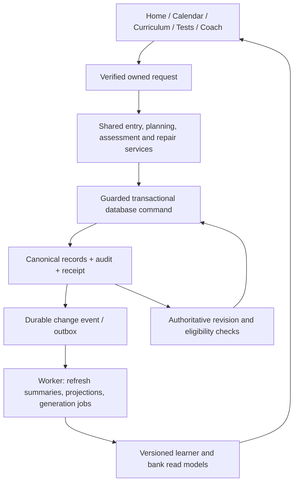

# Roadmap — adaptive entry to exam completion

**31 October 2026 · Proposed implementation sequence, not a completion claim**

## 1. The correction

The first week must mean **our first week with this candidate**, not their first week studying CFA. Calibration runs alongside useful work. It is not a compulsory beginner course or a series of chapter tests that must be completed before planning works.

The same product must support starting fresh, joining midway, finishing a first pass, returning after a break, retaking, preparing for a coaching mock, and joining shortly before the exam. It must also recover when the student works faster, works less, changes classes or moves their exam date.

There is no reliable “serious” versus “lazy” classification. Support observed behaviour: someone who wants structure, has limited energy, avoids tests, overestimates capacity, studies outside the app or repeatedly postpones work. Offer a manageable next action and honest consequences. Do not sell a low-effort guarantee of passing.

### Preserve the established rules

- Roadmap plans, organises, tests and analyses; it does not teach the curriculum.
- Verified identity and onboarding remain required; exam feasibility never determines product access.
- Self-study: Monday–Saturday learning/revision, Sunday paper/closure. Class-led cycles follow the class-boundary resolver. A scheduled mock can fulfil an appropriate weekly assessment obligation; do not stack a redundant weekly paper on top without reason.
- A completed block is activity, not demonstrated understanding. Prior coverage, reported confidence, test evidence, actual time and planning estimates remain separate.
- Only reviewed, eligible, unseen items may produce the relevant diagnostic evidence. Missing inventory stays visible. Rephrasing a seen question is not fresh independent evidence.
- Each paper stays at or below 90 questions. Do not change the current ordinary-paper minimum or enable automatic repair closure implicitly.
- Accepting a proposal changes the plan; opening a page does not. Preserve atomic commands, retries, task lineage and historical attribution already built.
- No student materials/source tab or uploads. Domain/OAuth/email enablement remains deferred until the owner resumes that release work.

## 2. What the current code actually supports

This plan follows source inspection and four read-only pure-planner probes on 31 October. It is **not** a new Browser/database audit of the whole app.

| Verified current behaviour | Why the next build is needed |
|---|---|
| `PositionStep` offers fresh/underway/most complete/revising/retaking and subject-level `current/recent` exposure. | It cannot express “covered, but shaky in these areas” separately from recency. A revising candidate must mark a topic, but cannot efficiently declare a whole completed first pass with exceptions. |
| `savePosition` persists stage and self-reported topic exposure. | The roadmap input/phase contract does not fully use entry stage and granular claimed coverage. Merely saving another onboarding answer would not fix planning. |
| `buildPhases` is largely based on time to exam. `skipFirstPass` is primarily used for completed class-led preparation. | Self-study candidates who already finished need to bypass first-pass scheduling too. Partial preparation needs remaining-scope planning, not a full restart. |
| Probe: a four-week horizon with `skipFirstPass:true` still returns `compressed:true`, entirely `final`. | A short horizon does not by itself establish that an already-prepared candidate is behind. Pressure must compare remaining work, evidence and commitments. |
| Probe: `allocateDay` in revision emits `Study: Previously studied reading`; final phase with no repairs emits no portions. | Revision and mock preparation need their own executable work, objectives and completion rules, not phase labels alone. This probe does not prove every other assessment branch is absent. |
| `priorCompletionRates` is still an empty array in weekly generation. | The intended week-one-to-week-two execution adaptation is not fully connected, even though observed study pace was improved. |
| Ordinary weekly scope comes from completed current-cycle work; baseline reading/subject checks are a separate opt-in path. | Prior study needs an explicit historical-scope/calibration contract. It must not require fake current-week completion logs or silently expand an ordinary weekly paper. |
| `getBankCoverage` groups `verified` with reviewed/approved and uses non-paginated item reads. | Its readiness totals cannot be treated as the actual evidence-grade, scope-safe inventory, especially once the bank exceeds 1,000 items. |
| Next route handlers, server services, Supabase and guarded Postgres commands already exist. | We need to consolidate and optimise this backend, not assume that a separate new API service will automatically fix performance. |

Read `MASTER-STATUS-AND-COMPLETION-PLAN.md` for the task, continuity, learning-log and repair work already verified. Preserve it. Recent recorded bank counts and the 55-migration checkpoint are dated facts, not fresh inventory results.

## 3. How the two examples should work

### Three subjects covered; one partly shaky, another mostly shaky

1. The candidate marks three subjects as first-pass covered, identifies the uncertain subjects and optionally a few readings. No need to enumerate every LOS.
2. Their prior study is recorded as a dated **entry claim**, with its scope and uncertainty. No historical Calendar sessions, actual hours, test answers or mastery are manufactured.
3. The first proposed week combines unfinished-syllabus progress, targeted work in the shakier subject and a small maintenance check on the stronger subject. Existing classes and an approaching mock take precedence over an arbitrary beginner sequence.
4. Offer one mixed calibration across the claimed-covered subjects. Proposed default: roughly 20–30 questions, bounded by available study time and supported inventory. This is an adjustable planning default, not a sufficient sample to certify every reading.
5. Weight the sample toward reported uncertainty, exam importance and under-sampled areas, while keeping enough breadth to avoid testing only the student's favourite topics. Page count breaks relevant ties; it cannot manufacture scope or evidence.
6. Correct, confident sampled answers can reduce immediate review priority for those concepts. They do not verify the entire subject. Incorrect/uncertain answers create or update the existing repair loop. Untested areas remain untested.
7. If the assessment is postponed or inventory is insufficient, useful planning continues from the claims with an explicit uncertainty label. Do not convert self-reported shakiness into a failed-test repair thread.

Example week, **illustrative ordering rather than required hours**: one task advancing an untouched topic; targeted revision in subject 2; a smaller subject-1 uncertainty block; one mixed paper; closure that chooses which findings displace next week's new work. Subject 3 gets maintenance, not a full restart. If a coaching mock is imminent, the week can instead focus on mock preparation and reuse its usable evidence.

### First pass complete; first mock about a month away

Enter revision/mock preparation immediately. Do not allocate a fresh first pass or 102 chapter diagnostics.

- **First week:** one broad mixed revision check, or use a recent compatible Roadmap result. Proposed default: 45–60 questions where the bank supports breadth. Skip a redundant check if a suitable scored rehearsal is imminent.
- **Following weeks:** targeted repair, mixed retrieval across subjects, spaced checks and a rehearsal sized to the available calendar. Reserve time for analysing each paper before scheduling another.
- **Mock week:** protect the mock appointment, preparation and analysis time. Avoid adding a duplicate Sunday paper that asks the same question of the same evidence.
- **After the mock:** separate concept gaps, timing issues, confidence mismatches, omissions and unanswered questions. Schedule the highest-value repairs that actually fit, then test whether they held.

An external coaching mock can inform planning from a manually entered overall/subject summary. Label it external/self-reported. A percentage alone cannot create precise LOS evidence or close concept repairs. Exact question analysis is optional and only possible when the necessary supported information exists; no portal scraping/upload requirement.

## 4. Entry capture: few questions, useful consequences

Keep the existing five-step shell. Improve the questions rather than adding a compulsory long questionnaire.

| Step | Essential capture | Downstream use |
|---|---|---|
| Exam | Target sitting/year; booked date if known; next mock date or “not scheduled” as an optional checkpoint | Horizon, fixed exam/mock commitments, countdown and preparation boundaries |
| Learning arrangement | Self-study/coaching/hybrid; recurring or variable class commitments | Operational cycle and class consolidation |
| Starting position | Fresh/part-way/first pass complete/revision or mocks/retake; bulk subject coverage with exceptions; optional uncertain subjects/readings | Remaining scope, starting phase, calibration scope and targeted review |
| Real week | Unavailable commitments, usable windows, maximum sitting; optional temporary exception | Actual placement capacity, not prescribed weekly hours |
| Review | Starting strategy, first useful actions, assumptions, assessment choice and limitations | Accepted first week and a clear Home next action |

Use chips, bulk selection and progressive disclosure. “Covered” and “how secure does it feel?” are separate inputs. “Not reported” is not the same as “not started.” Offer “all first pass complete” with editable exceptions. Prior exam attempts and recent-paper summaries are optional context, not an extra onboarding gate.

Existing users can update this context from Settings/Curriculum without repeating onboarding or losing history. Changing a claim or target previews future-plan effects; it never rewrites finished weeks or automatically changes a started paper.

## 5. The planning model

Resolve each week from five inputs: **remaining learning scope, current evidence, upcoming checkpoints, real capacity, and observed execution**. Calendar remains an accepted short-term plan; the long-term roadmap is a projection that can change.

Use separate planning lanes:

1. Protected life/class/mock/exam commitments.
2. Accepted continuing work and ready repair/re-check obligations.
3. New learning still needed.
4. Targeted revision of reported or demonstrated uncertainty.
5. Mixed retrieval and maintenance of older covered material.
6. Mock preparation, rehearsal and analysis.

There is no permanently fixed percentage for these lanes. Their proposed balance depends on the candidate's stage, deadlines and evidence; show the resulting trade-offs. A reported weak area creates a **review recommendation**; a valid diagnostic miss creates a **repair obligation**. Keep the provenance distinction.

Priority combines urgency, valid gaps, curriculum importance, prerequisites, evidence freshness, under-sampled coverage and the next checkpoint. Use a documented deterministic rule initially, with explicit tie-breaks. Timing concerns should usually change practice format; they must not automatically imply a conceptual failure.

Do not require completing every LOS diagnostic to enter revision. Protect broad maintenance so repeatedly repairing one subject does not erase all others from the plan. Retention checks use different questions; do not repeatedly ask a concept merely because the bank has inventory for it.

The first-week estimate is provisional. Learn activity-specific durations from reported work: reading pace is not mock-analysis pace. Unknown minutes remain unknown. Use rolling evidence, a minimum meaningful sample and transparent defaults; do not multiply claimed study hours or one unusually bad week into a permanent capacity judgment.

For a long preparation horizon, propose finishing first pass before the protected final preparation period. For someone joining inside that period, use the time that remains; do not invent eight new weeks, force a beginner plan or infer they should defer the exam. Incomplete scope still receives honest pressure warnings and choices. Exact trade-offs are reviewed with the student.

## 6. Implementation sequence and exit criteria

The **content-bank work starts with Phase 0 and runs in parallel**. Planning must remain useful during shortages, but a full diagnostic/mock promise cannot ship without the corresponding usable bank.

### Phase 0 — one baseline and a scenario contract

Inventory routes, schema, consumers, policies and effective database privileges. Reconcile active documents and preserve existing uncommitted work. Record source-backed defects, not a claim that everything needs replacing.

Create controlled fixtures for the scenarios in §10. Define the distinctions between prior claim, current activity, reported confidence, valid assessment evidence and unresolved scope. Freeze these contracts before adding fields or changing scoring. Confirm the current approved-item definition and all assessment writers.

**Exit:** a route/state ownership map, a genuine bank-capability matrix and reproducible failures for the high-risk scenarios. No fabricated learner history, no migration edits to already-applied files.

### Phase 1 — complete the shared backend foundation

Retain one Next/TypeScript application with domain services and Supabase/Postgres. Put authentication/ownership, validation, planning, scoring and transitions on the server. The browser collects input and displays accepted server state; it cannot author its own paper, evidence or completed proposal.

- Finish transactional assessment start for ordinary papers: blueprint, form, items, attempt, scope snapshot and task link succeed together or leave no orphan records.
- Trace and replace direct student assessment writes before revoking them; consolidate legacy/current assessment and challenge paths without breaking live callers.
- Move repair timing/dependency enforcement into guarded database commands, including concurrent changes. Complete multi-task Coach deferral transactions and receipts.
- Reuse the operating-state contract. Do not create a competing `OperatingStateV3` just to serve this plan.
- Deduplicate request-scoped reads, paginate all large bank/history queries, add measured indexes and return bounded page-specific data.
- Introduce versioned per-user summaries only where profiling proves repeated work. Keep authoritative commands fresh; caches never decide ownership or whether acceptance is valid.
- Use a durable job/outbox mechanism for expensive recomputation, item generation and long-running analysis. Start with one worker and the existing database; do not add microservices or a separate machine-learning stack without evidence of need.
- Make jobs idempotent, retryable and observable. Supersede stale generation jobs; a background job cannot accept a plan for the student. A failed summary refresh must not lose a committed task update.

**Exit:** role/transaction/concurrency tests; data isolation; bounded query counts on long-lived accounts; measured page/start latency under representative load. Report baselines and agreed targets rather than inventing a scalability claim.

### Phase 2 — adaptive entry and useful first week

Extend the current position contract and roadmap inputs, not just the form. Model entry claims with current curriculum version, scope, source, recorded date and uncertainty. Bulk claims require a clear preview of what is being asserted. A topic claim is not silently converted into per-concept verified evidence.

Support first-pass-complete self-study, partial coverage, retakes and recent external-paper summaries. Add optional mock checkpoints. Build an entry strategy that selects useful work immediately and offers calibration without making it an access requirement.

Preserve the scope distinction: ordinary weekly papers use eligible completed weekly work; a historical-scope calibration is explicitly reviewed/opted into and labelled. Do not implement it by manufacturing completed Calendar tasks.

**Exit:** fresh, three-subject midway and full-first-pass near-mock fixtures produce different appropriate plans. Resume/back/edit/bulk-exception behaviour works. No user needs to log invented past hours.

### Phase 3 — phase-aware Calendar and deviations

Make actual task semantics match their phase: learn, class consolidation, retrieval, targeted review, repair, spaced verification, mock, mock analysis and final check. Give each task an objective, approach, source/LOS pointer, estimate, completion meaning and exact downstream connection.

Replace date-only phase selection and generic revision “Study” blocks. Connect observed execution to weekly composition. Respect dependencies, sitting lengths, breaks, elapsed local time, protected commitments, one-off classes and paper duration. Day-preferred work must not be presented as a reserved clock slot.

Integrate waiting re-checks into next-week preview/acceptance rather than relying on result-page button hunting. Preserve the existing continuation model. Missed work is reviewed, not endlessly added as debt; completed work elsewhere can displace equivalent new scope without changing old weeks.

Handle early completion, changing weekly capacity, breaks, moved/cancelled classes and changed mock/exam dates. Show what moves and why; require acceptance. A fixed mock remains fixed until the student changes it. Full days retain visible waiting work rather than generating overlaps.

**Exit:** Calendar accurately represents each entry scenario and deviation; capacity and history are conserved; no duplicate repair/check/paper is created by rollover or retries.

### Phase 4 — efficient assessments and consistent evidence

Use a shared preflight/blueprint policy for calibration, weekly, reading, subject, repair and mock sessions. Preview, Start buttons and actual start must agree; start rechecks authoritative state and resumes open attempts appropriately.

- Build bounded mixed entry checks across claimed-covered scope, with transparent sampling and visible unsampled areas.
- Prioritise breadth, exam importance and uncertainty without selecting only known weak areas. Maintain coverage debt/recency so omitted areas are considered in later checks.
- Preserve exact scope, concept/item-family novelty, time budgets and confidence. Timing is interpreted alongside question type and interruption information.
- Keep sample-size limits on every inference. One right question is not a strong subject; one wrong question does not justify redoing a whole subject.
- Unify scoring, concept summaries, challenge resolution and result links. Resolve only the concepts actually assessed under the approved policy; newer valid misses and invalidations must be respected.
- Complete Browser-tested challenge submission/reviewer recovery without automatically voiding a merely challenged item.

**Exit:** the full first-pass candidate gets a useful mixed assessment and a scoped revision plan without a chapter marathon. Every result has an executable or explicitly waiting next action. Automatic repair closure remains disabled until its policy is expressly approved.

### Phase 5 — revision after first pass

Build a persistent revision queue driven by reported coverage, valid concept evidence, retrieval recency, maintenance needs and upcoming checkpoints. A new candidate can enter it immediately; an existing candidate can transition into it without losing their roadmap.

First pass completion does not require every concept to be mastered, and it does not imply mastery. Conversely, “unverified” must not cause endless re-reading of already-covered material. Assessment changes priority/depth; it does not erase coverage history.

Mix subjects, revisit stale strengths, repair demonstrated gaps and include untested-but-covered areas. Rebalance when work exceeds capacity. A skipped check stays unassessed, not failed. Maintenance and mock preparation must still exist when there are no open repairs.

**Exit:** several consecutive revision weeks produce purposeful, varied work; weak areas improve or remain honestly unresolved; strong areas are maintained without repeated identical checks.

### Phase 6 — mocks, rehearsal analysis and the final exam stretch

Support fixed internal/external mock appointments and an optional preferred start of the mock phase. Internal sessions need a genuinely viable held-out blueprint, not just 90 items somewhere in the bank. Preview subject balance and scope limitations.

A linked multi-session full rehearsal is a proposed extension, with each paper ≤90 questions. Confirm the intended current exam format and commercial promise before enabling it; do not silently label one 90-question session a complete exam rehearsal.

Schedule preparation, the session, a break where appropriate, analysis, a small prioritised repair set and a later check. An external summary affects planning with its provenance label; it does not invent unseen item responses. Submitted internal sessions can substitute for redundant weekly checks when scope and timing justify it; closure must recognise that explicitly.

In the final week, keep the plan light and specific: highest-value unresolved issues, familiar retrieval, selected timing/routine checks and an exam logistics checklist. Avoid introducing a large new subject or stacking full rehearsals as the default. Respect work/travel/rest commitments and show exceptions as choices. Never promise that this strategy guarantees a pass.

After the exam, stop future study generation, offer a user-confirmed completion/archive state, retain/export history and allow a retake/new target later without overwriting the previous attempt.

**Exit:** a candidate can go from first pass through mocks to exam completion with clear Calendar actions and no stranded repairs, duplicate papers or retrospective history changes.

### Phase 7 — make every page useful and simple

| Page | Required role and cross-page loop |
|---|---|
| Landing/authentication | Accurate supported promise, safe auth/recovery, verified identity → onboarding; external provider/domain enablement stays a later owner-controlled release step |
| Home | One next justified action; short Today list; one decision area; quick logging; concise separate exposure/evidence/execution/confidence signals |
| Calendar | Week/day/agenda, protected commitments, actionable task drawer, mock appointments, waiting work, class log, previewed replanning and historical continuity |
| Curriculum | Prior claimed versus newly recorded coverage, reported uncertainty, tested/untested concepts, next review/repair/check, roadmap that matches the accepted week |
| Tests | Appropriate next paper; exact scope/novelty/availability; resume; results → follow-up; external-result summary capture without uploads |
| Coach | Explains the current strategy and trade-offs; links to exact scope/results; uses the same proposal commands; no lessons or independent task writer |
| Settings | Entry-position corrections, targets/checkpoints, classes/availability, reminder preferences, account/export/deletion and privacy; edits preview future effects |
| Review week | A contextual flow, not a sidebar tab; resolve outstanding logs, distinguish unknown/partial/missed, review mock/test evidence and accept the next week |
| Staff tools | Reviewed-content workflow, bank/curriculum capability, challenge resolution, controlled support diagnostics and audit trail |
| Public demo | Isolated read-only example of the complete loop; no shared real learner or fake mutation success |

Use progressive disclosure, accessible controls, explicit saves and recoverable errors. Support in-app reminders first; external notifications follow only when delivery setup is resumed and preferences exist. Do not add permanent navigation tabs for each internal queue or engine. Retire duplicate legacy routes with deliberate redirects/retired API responses after migrating callers.

**Exit:** a first-time candidate can explain what each page does and reach the next relevant action without hunting or reading a dashboard full of metrics. Desktop and actual mobile/tablet dimensions are verified, not assumed.

### Phase 8 — full scenario audit, cleanup and production gate

Run the matrix in §10 against each page and service. Audit feature by feature: trigger, inputs, validation, provenance, command, visible outcome, next link, retry, stale state, ownership, failure recovery and later-cycle consequence.

Complete security/role review, load tests with 20,000+ items and long learner histories, migration rehearsal/rollback strategy, restore testing, backups, job failure recovery, monitoring and cost controls. Remove dead/demo state, duplicate readers/writers, stale scripts, placeholder copy and test credentials. Rotate any previously exposed credential before sharing/deploying; confirm removal from history through the appropriate repository process.

External auth/domain/email, payment/entitlement decisions, launch legal/privacy review and deployment configuration remain explicit release gates when the owner resumes them. A development server and passing suite are not a production-ready service.

**Exit:** all critical journeys work, integrity/access defects are resolved, content limitations match the launch promise, and remaining lower-risk gaps are documented with owners. Do not market a full-syllabus diagnostic/mock product while its bank remains partial.

## 7. Parallel content track: finish a usable bank, then scale it

**B0 — trustworthy inventory.** Unify trust-tier definitions with the actual assembler. Report reviewed usable items and independent families per concept/LOS, not reviewed-plus-verified totals. Paginate, check manifest/mapping validity, quantify candidate-specific unseen supply, and expose ambiguity/structure-pending areas. Fix the current minimum-viable test so it checks each required outcome's real minimum, not an aggregate reading count plus one item per outcome.

**B1 — breadth across all ten subjects.** Create small reviewed vertical slices across the curriculum before expanding only the existing two subjects. Prioritise the scope needed for onboarding/calibration, ordinary weekly work, repair checks and revision. Every advertised workflow needs enough distinct inventory for that journey.

**B2 — controlled authoring.** Use authorised 2027 curriculum references/LOS and original CFA-style items. Track source pointers for reviewers without reproducing provider passages to students. Pipeline: blueprint → original draft → exact LOS/concept check → independent solving/numerical checks → ambiguity/distractor/originality review → named approval → versioned publication. Test known-wrong items and adversarial cases; a calculation verifier cannot establish conceptual correctness.

**B3 — repeat-use depth and held-out mocks.** Budget inventory for the candidate's initial exposure, later checks, spacing, retirements and held-out mock forms. Count related variants as a family; changing numbers/wording does not automatically restore novelty. Keep mock hold-outs out of routine diagnostics. Test subject-weight balance, question type/difficulty mix and parallel-form fairness without claiming psychometric calibration that has not been demonstrated.

**B4 — scale toward 20,000.** This is a reviewed-content target, not a raw generation counter. Track production yield, review time, cost, defects/challenges and replacement capacity. Human review is real operational work; name its owner and throughput. Do not promise an overnight 20,000-item bank or substitute LLM fine-tuning for independent content validation.

Use prompt engineering, retrieval from controlled curriculum knowledge and evaluation first. Fine-tuning, if later justified by a labelled dataset and measured improvement, is a separate gated task. Planning/evidence decisions remain deterministic and inspectable. Verify the configured model's actual access/capabilities before generation; do not guess a replacement model ID.

## 8. Backend data flow and performance contract

Use existing tables/contracts where they fit. Add only missing concepts: entry claims with explicit scope/provenance, upcoming checkpoints, versioned assessment intent and durable job/summary state. No second student calendar, repair queue or mastery score.

Keep immediate command receipts/task status accurate after writes. Background projections may be labelled updating/stale and reconciled; they never turn a failed read into 0% or “no weaknesses.” Invalidate only affected learner/domain views. Correct evidence validity, curriculum version and source changes invalidate dependent summaries. Never share a learner cache across accounts.

Measure server queries, payload size, rendering, cold/warm latency, worker lag, database contention and model spend separately. A read-only page should not scan every question or replay a learner's entire history on each visit. Realtime is a refresh mechanism, not a second source of truth. Apply limits to expensive requests/jobs without preventing ordinary study access when model generation is unavailable.

## 9. Route and contract map

Keep the existing primary pages. Proposed additions below are contracts to design, **not routes already implemented**.

| Existing route | Required change |
|---|---|
| `/onboarding/[step]`, `/api/onboarding/[step]` | Extend exam/position/week payloads with compatible versioning and useful conditional fields |
| `/api/onboarding/state`, `/api/onboarding/plan/preview`, `/confirm` | Resume context, derive entry-specific strategy, accept exactly the preview |
| `/api/profile`, `/api/roadmap`, `/api/curriculum/coverage` | Reuse/update future entry context and roadmap; keep historical claims distinct from new study evidence |
| `/app/calendar`, `/api/tasks/[id]`, `/api/commitments/*`, `/api/class-log/*` | Real phase-specific tasks, checkpoints and dependency-safe deviations |
| `/api/log-learning`, `/api/tests/scope/confirm` | Preserve one sitting/nullable time/exact outcome semantics; never fake historical entry through logs |
| `/api/tests/scope`, `/api/tests/preflight`, `/api/tests/start` | Shared policy for all paper types, explicitly reviewed historical calibration scope and frozen attempts |
| `/api/tests/attempt/[id]/*` | Consistent confidence, timing, resume, transactional submit/evidence and result integrity |
| `/api/diagnostic/repair/{preview,accept,check}` | Preserve saved-preview acceptance and link waiting checks through actual completion/next-week placement |
| `/app/review-week`, `/api/weekly-review/{state,preview,accept}` | Bring all outstanding work, supported assessment substitutes and waiting obligations into the next accepted week |
| `/api/signals`, operating-state/Coach services | Bounded shared learner state, provenance and freshness, rather than independent frontend calculations |
| `/app/tests/review`, `/app/tests/manifest`, reviewer APIs | Real capability reporting, content QA and challenge control |

Proposed additions: a checkpoint command under `/api/checkpoints`; a controlled external-result-summary command under `/api/tests/external-results`; and a grouped rehearsal route under `/app/tests/rehearsals/[id]` only if that format is approved. Prefer extending an existing compatible command over implementing competing route families.

## 10. Stress-test matrix and release evidence

These are **required future acceptance scenarios**, not cases claimed passed by drafting this document. Use synthetic labelled fixtures, then owned-account API and real Browser journeys; never reset a shared learner.

| Scenario | Expected plan / behaviour | Must not happen |
|---|---|---|
| Fresh candidate, nine months | First pass + classes, early verification, realistic later revision/mock space | Immediate full-syllabus test or a mandatory hours quota |
| Three subjects covered; two shaky | Remaining learning + targeted review + bounded mixed calibration | Restart all three or pretend the strong subject is verified |
| Three covered; no clear weak areas | Breadth sample + progress on the rest | Tests drawn only from a favourite/easy subject |
| All first pass complete; mocks in a month | Revision, maintenance, mixed assessment and rehearsal analysis | A week of chapter-by-chapter intake diagnostics |
| All covered; recent suitable Roadmap paper | Reuse the evidence and plan gaps | Force another near-identical baseline |
| Recent external mock summary only | Plan from labelled coarse evidence | Invent question-level mistakes or concept mastery |
| Exam in three weeks; first pass complete | Targeted final preparation and realistic pressure | “Full first pass impossible” as a verdict about this candidate |
| Exam in three weeks; major scope unfinished | Explicit trade-offs; useful plan and visible gaps | Deny access, guarantee recovery or fill every free hour |
| Retaker or long study break | Preserve prior claim/history; fresh sampling of relevant scope | Import an old score as current mastery |
| Coaching/class schedule changes | Class-led cycle proposal + consolidation, historical weeks fixed | Quietly move a scored paper or finished week |
| Variable classes not yet known | Useful self-directed work and explicit class-context gap | Empty app or imaginary class dates |
| Repeated postponement/test avoidance | Smaller actionable plan, supportive reminders and visible unknowns | Shame, infinite debt or easier fake evidence |
| Finishes two subjects ahead of plan | Confirm scope, deduplicate future work, preview the gain | Shift old minutes into the current week |
| Capacity drops for two weeks | Protect commitments; prioritise/defer with choices | Same volume squeezed into shorter windows |
| Missed repair, due re-check | Continue remaining work; delay dependent check | Test before completion/spacing or close the gap from activity |
| Bank supports only part of scope | Exact capability/untested labels and useful study continuation | Borrow unstudied topics or promote unchecked items |
| Bank exhausted after several weeks | Resume existing papers; future checks wait or use valid alternative scope | Rephrase seen items and call them fresh mastery evidence |
| Mock moved/cancelled | Preview future changes and re-balance analysis/repairs | Leave stranded preparation tasks or duplicate papers |
| Unanswered mock section / interruption | Distinguish unknown, omitted, timing and valid incorrect responses | Treat every omission as a diagnosed concept miss |
| Challenged question later voided | Recompute only dependent evidence/obligations; keep audit | Delete unrelated repairs or completed effort |
| Return after weeks away | One recovery week; retain relevant obligations | Generate backdated ghost weeks or forced backlog completion |
| Two devices / lost response / midnight | One receipt, fresh revision check, correct local dates | Duplicate attempts/plans or stale acceptance |
| First pass complete and no repairs | Maintenance, mixed practice and mock preparation remain useful | An empty Calendar because there are no gaps to repair |
| Exam finished / next sitting chosen | Stop/ archive or start a new attempt history explicitly | Keep sending old study tasks or overwrite the old attempt |

For each, verify the relevant pages, exact saved records, access rules, degraded/offline states and consequences one or more cycles later. Test desktop, an actually measured phone viewport and tablet Calendar. Include keyboard/focus/contrast checks and a small novice usability pilot, not just component assertions.

Maintain one audit register: scenario → failing behaviour → evidence → owner → fix → automated proof → Browser proof → remaining limit. Run targeted tests as each change lands; run broad regressions at integration/release checkpoints, not after every text edit.

## 11. What to build first

Start with **Phase 0 + Phase 1's integrity/read-contract work + bank B0**, then land **Phase 2 and the Phase 3 entry-aware composer as one vertical slice**. Prove these three journeys before broad UI work:

1. Fresh student → useful accepted week.
2. Midway student with three completed subjects and uneven confidence → remaining learning plus targeted review.
3. Full-first-pass student near mocks → revision/mock preparation with no beginner restart.

Next connect bounded mixed assessment, real revision and mock analysis, then finish the cross-page experience and full release audit. Content breadth/depth progresses throughout. Do not wait for 20,000 questions to discover a broken planner, and do not call a planner fully diagnostic-capable merely because its UI works.

Open product decisions are limited: repair-resolution criteria, whether/how to offer full linked mock rehearsals, and the reviewed-bank launch promise/reviewer capacity. The proposed calibration lengths are defaults to validate, not a new compulsory testing gate. No delivery date or full-syllabus capability is promised before the capability and review work is measured.
