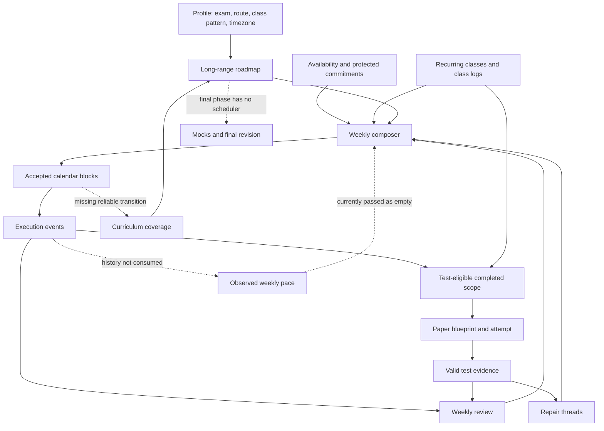

# Roadmap — Current-State Audit and End-to-End User Flow

**Date:** 26 September 2026  
**Scope:** Product, user flow, routes, state ownership and cross-feature connections  
**Purpose:** Establish one honest baseline before page-by-page enhancement work begins. This is an audit and flow map, not a redesign specification.

---

## 1. Product definition used for this audit

Roadmap is a CFA Level I learning-control system. It does not replace a teacher, course, textbook or question provider. It should:

- turn the full curriculum and exam horizon into a practical roadmap;
- build one manageable study cycle at a time around classes and real availability;
- capture what the candidate actually studied, missed, postponed or revised;
- test only eligible completed scope;
- convert test evidence into weaknesses, repairs and future scheduling decisions;
- adapt the plan as actual pace becomes known;
- manage first pass, consolidation, revision, mocks and the final exam phase;
- provide a planning Coach that explains evidence and proposes changes without teaching curriculum content;
- preserve calm, choice and auditability when a plan moves off course.

For self-study candidates, study runs Monday through Saturday and the weekly paper is on Sunday. For class-led and hybrid candidates, the recurring class pattern defines the cycle, and the closing paper is placed before the next class cycle.

---

## 2. Executive verdict

The application has moved well beyond a visual prototype. Authentication, mandatory onboarding, a real calendar, curriculum tracking, a test runner, result analysis, weekly closure and a bounded Coach all exist. The route graph is also internally clean: the automated route audit found 80 routes and all 171 internal links resolved.

The product is not yet an end-to-end adaptive system, however. It currently behaves like several connected subsystems whose most important feedback connections are incomplete.

The five highest-impact gaps are:

1. **Actual execution does not reliably advance the roadmap.** Completing a calendar study task records execution and makes it test-eligible, but it does not update the curriculum coverage state used by roadmap progress. Manual curriculum updates and the separate Log Learning flow do update coverage. This creates competing truths.
2. **The planner does not yet learn from completed weeks.** The weekly composer has a pacing function, but the live generator always passes an empty completion-history array. The first-week conservative factor therefore continues beyond week one instead of being replaced by observed capacity.
3. **The final exam phase is structurally empty.** The roadmap reserves eight final weeks, but the weekly generator explicitly stops new content in the final phase and has no mock cadence, mock repair loop, formula/recall rotation or exam-week taper to replace it.
4. **The test system is more developed than its bank.** The testing logic is thoughtful, but the approved bank currently contains 262 of the 20,000 target items. Eighty of 102 readings and 254 of 343 outcomes have no approved item. Only Ethics and FSA currently have approved coverage.
5. **Home’s canonical state is partly real and partly placeholder.** Papers and signals are bridged in, but milestone, projection, trajectory, closure readiness, stale-state detection and cross-page integrity are still null, unknown or hardcoded. This can hide a valid weekly-review action even when the underlying review service is ready.

The right next move is not another broad visual rebuild. It is to make the lifecycle below authoritative, then enhance each page against the same state transitions.

---

## 3. Verification performed

### Automated verification

- Full project verification passed, including TypeScript and the current unit/logic test suite.
- Route audit passed: **80 routes**, **171 internal links**, no unresolved internal link.
- Current question-bank audit:
  - 262 approved items of a 20,000-item target;
  - 80 of 102 readings have no approved item;
  - 254 of 343 outcomes have no approved item;
  - 8 of 102 readings meet the minimum of three approved items per outcome;
  - Ethics: 99 approved items;
  - FSA: 163 approved items;
  - all other subjects: zero approved items.

### Live browser verification

- The landing page renders and links to Sign in, Create account, Terms and Privacy.
- Direct access to `/app` correctly redirects an unauthenticated user to `/login?next=%2Fapp`.
- The login page presents Google, email/password, recovery and sign-up entry points.
- The development-only “Preview guided setup” link currently redirects to authenticated onboarding and therefore behaves like a sign-in loop for a logged-out reviewer. It is not a usable demo preview.

### Test limitation

The Playwright suite could not run because its Chromium executable is not installed locally. More importantly, two of the three current browser test cases are empty placeholders. The only substantive browser assertion currently checks that unauthenticated `/app` access redirects to login. Passing unit tests therefore must not be interpreted as verified end-to-end user behavior.

---

## 4. Current route and feature inventory

### Public and account routes

| User need | Route | Current role |
|---|---|---|
| Understand product | `/` | Product promise and acquisition entry |
| Create account | `/signup` | Email/password or Google sign-up |
| Sign in | `/login` | Email/password or Google sign-in |
| Verify email/session | `/auth/confirm`, `/auth/callback` | Supabase confirmation and OAuth callback |
| Recover account | `/forgot-password`, `/update-password` | Password recovery flow |
| Handle auth error | `/auth/error` | Expired or invalid-link state |
| Legal | `/terms`, `/privacy` | Public legal documents |

### Mandatory onboarding routes

| Step | Route | Inputs captured | Intended downstream use |
|---|---|---|---|
| Exam | `/onboarding/exam` | Sitting, registration state, exact booked date when registered, automatic timezone | Roadmap horizon, phase dates, countdown and calendar boundaries |
| Preparation route | `/onboarding/route` | Self-study, self-paced, live classes or hybrid; class pattern; recurring class slots | Topic-order ownership and class-defined study-cycle boundary |
| Starting position | `/onboarding/position` | Broad preparation stage and topic recency | First roadmap starting context only; never proof of understanding |
| Real week | `/onboarding/week` | Protected commitments, study windows, maximum sitting length | Placement constraints and first-week capacity boundary |
| Weekly checkpoint | `/onboarding/checkpoint` | No input; explains derived cycle ending | Explains when the weekly paper and rollover occur |
| First plan | `/onboarding/plan` | Review and confirmation | Atomically activates roadmap, cycle and first plan blocks |

Onboarding is correctly enforced as an access gate by `/app/layout.tsx`: authenticated users whose `onboarding_status` is not `complete` are redirected to onboarding. It is a setup gate, not an eligibility gate.

### Primary application routes

| Page | Route | Current function |
|---|---|---|
| Home | `/app` | Next action, today, attention, paper/closure, four preparation signals, roadmap summary and Coach entry |
| Calendar | `/app/calendar` | Current/other study weeks, timed and day-preferred blocks, commitments, task actions, paper status and class-log entry |
| Class log | `/app/calendar/log-class` | Record class date, type and LOS/outcome coverage; preview and confirm generated consolidation work |
| Curriculum | `/app/curriculum` | Curriculum overview, evidence/readiness view and long-range roadmap |
| Subject | `/app/curriculum/[subject]` | Subject readings and progress |
| Reading | `/app/curriculum/[subject]/[reading]` | LOS-level confidence, notes, marks and assessment entry |
| Flashcards | `/app/curriculum/flashcards` | Candidate-created recall cards and due reviews |
| Tests | `/app/tests` | Weekly paper, reading/subject diagnostics, repair checks, mocks, evidence and attempt history |
| Test attempt | `/app/tests/[attemptId]` | Timed/untimed runner, mandatory confidence, pause, flag and challenge |
| Test result | `/app/tests/[attemptId]/result` | Accuracy, uncertainty, timing, confidence calibration, scope coverage, SWOT, repairs and next-week preview |
| Weekly review | `/app/review-week` | Resolve open logs, inspect carryover, preview and atomically open the next cycle |
| Coach | `/app/coach` | Evidence-grounded planning conversation and confirmation-gated calendar proposals |
| Settings | `/app/settings` | Review and reopen onboarding assumptions; account recovery/deletion |
| Log Learning | `/app/log` | Record external class/study/practice with optional curriculum mapping |

### Internal or legacy routes

- `/app/week` and `/app/syllabus` are legacy redirect pages and should not be treated as product destinations.
- `/app/tests/review` and `/app/tests/manifest` are internal question-bank/reviewer surfaces, not candidate navigation.
- `/check/result` is a redirect stub.
- `/api/diagnostic/*` and `/api/tests/*` coexist. The student experience predominantly uses the newer `/api/tests/*` stack, while the older diagnostic routes remain as technical surface area that should eventually be retired or explicitly assigned.

---

## 5. Current end-to-end route graph

```mermaid
flowchart TD
    A[Landing /] --> B[Sign up /signup]
    A --> C[Sign in /login]
    B --> D[Email confirmation or Google callback]
    C --> D
    D --> E{Onboarding complete?}
    E -- No --> O1[/onboarding/exam]
    O1 --> O2[/onboarding/route]
    O2 --> O3[/onboarding/position]
    O3 --> O4[/onboarding/week]
    O4 --> O5[/onboarding/checkpoint]
    O5 --> O6[/onboarding/plan]
    O6 -->|Confirm atomically| H[/app Home]
    E -- Yes --> H

    H --> CAL[/app/calendar]
    H --> CUR[/app/curriculum]
    H --> TEST[/app/tests]
    H --> COACH[/app/coach]
    H --> WR[/app/review-week]

    CAL --> TASK[Move, split, start, complete, skip or defer task]
    CAL --> CLASS[/app/calendar/log-class]
    CAL --> COMMIT[Add protected commitment]
    CAL --> TEST

    CUR --> SUB[/app/curriculum/subject]
    SUB --> READ[/app/curriculum/subject/reading]
    READ --> TEST
    READ --> COACH

    CLASS -->|Confirmed outcomes| PLAN[Add consolidation/revision blocks]
    TASK --> SCOPE[Completed and mapped weekly scope]
    PLAN --> SCOPE
    SCOPE --> TEST

    TEST --> ATTEMPT[/app/tests/attempt]
    ATTEMPT --> RESULT[/app/tests/attempt/result]
    RESULT --> EVIDENCE[Evidence events and repair threads]
    RESULT --> COACH
    RESULT --> WR

    COACH --> PROPOSAL[Previewable calendar proposal]
    PROPOSAL -->|Student confirms| TASK

    WR -->|Resolve every due task| NEXT[Preview next cycle]
    EVIDENCE --> NEXT
    NEXT -->|Confirm atomically| CAL

    SETTINGS[/app/settings] --> O1
    SETTINGS --> O2
    SETTINGS --> O3
    SETTINGS --> O4
    SETTINGS --> O5
```

This is the intended shape of the current implementation. The broken or partial feedback paths are documented below.

---

## 6. Candidate lifecycle graph: first login to exam completion

Legend: green is substantially implemented, amber is partial, red is missing as a complete product loop.

```mermaid
flowchart LR
    ACQ[Discover and create account]:::built --> ONB[Mandatory setup]:::built
    ONB --> W1[Week 1 baseline plan]:::partial
    W1 --> EXEC[Daily execution and logging]:::partial
    EXEC --> PAPER[Diagnostic, revisionary or mixed paper]:::partial
    PAPER --> ANALYSIS[Evidence, SWOT and repair priorities]:::built
    ANALYSIS --> CLOSE[Weekly review and next-week acceptance]:::partial
    CLOSE --> LOOP[Adaptive weekly loop]:::partial
    LOOP --> FIRST[Complete first curriculum pass]:::partial
    FIRST --> CONS[Consolidation and spaced revision]:::partial
    CONS --> FINAL[Final 8 weeks: mocks, repair cycles and taper]:::missing
    FINAL --> EXAM[Exam-day preparation and sitting]:::missing
    EXAM --> OUTCOME{Result}
    OUTCOME -->|Passed| ARCHIVE[Close plan, preserve record and next credential path]:::missing
    OUTCOME -->|Retake| RETAKE[Retake diagnosis and rebuilt horizon]:::missing
    RETAKE --> LOOP

    classDef built fill:#daf5df,stroke:#287a3d,color:#16351f;
    classDef partial fill:#fff0c2,stroke:#a46b00,color:#4b3500;
    classDef missing fill:#ffd9d5,stroke:#b33a2b,color:#4f1710;
```



### What “baseline week” should mean

The current first week is generated from self-reported availability and a conservative default pace. The product vision requires it to become an explicit calibration period:

- onboarding supplies hypotheses: available windows, maximum sitting length, starting position and class pattern;
- week one observes actual start/completion behavior, actual duration, postponement, class coverage and first paper evidence;
- the first closure compares stated capacity with observed capacity without shaming the candidate;
- week two replaces defaults with a bounded observed range;
- later weeks use a rolling history and distinguish a one-off bad week from a persistent capacity mismatch.

The data collection pieces exist, but this calibration contract is not yet implemented end to end.

---

## 7. Cross-feature truth graph



The dotted connections are the main architectural work ahead. They are more important than adding new cards or pages.

---

## 8. Page-by-page current-state assessment

### 8.1 Landing and authentication

**Working now**

- Clear non-teaching, adaptive-planner positioning.
- Email/password and Google authentication paths.
- Safe redirect handling.
- Verification, password recovery and mandatory onboarding gate.

**Gaps or decisions**

- The development preview link is not a real preview for logged-out users.
- The future paywall point is not represented in the lifecycle yet: verified account before onboarding is established, but entitlement and trial states are not.
- Auth browser tests do not cover email confirmation, Google cancellation, expired links, reset completion, duplicate accounts or cross-device sessions.

### 8.2 Onboarding

**Working now**

- Inputs are mostly structured rather than free text.
- CFA sittings are selected from exam windows.
- Unregistered candidates can plan to a tentative sitting; registered candidates provide an exact date.
- Timezone is detected rather than visibly asked.
- Class-led and self-study routes derive different study-cycle boundaries.
- Protected commitments, availability windows and maximum sitting length affect the first plan.
- Confirmation is transactional and idempotent.

**Gaps or contradictions**

- The checkpoint is a full sixth-step screen with no input. It may be useful explanation, but it is not information capture.
- Copy still says the app avoids “re-teaching” known work. Roadmap should never imply it teaches.
- The first week is shown as a plan, not explicitly explained as a baseline calibration experiment.
- The flow captures ordinary recurring availability but does not capture known near-term exceptions such as travel, exams, work deadlines or a one-off missed class before first activation.
- Changing from registered to unregistered does not explicitly clear a previously stored exact exam date. Because roadmap loading prioritizes `exam_date`, a stale booked date can continue to control the plan.
- Onboarding mutations update context version, but there is no single candidate-facing explanation of what happens to an already active roadmap and week when a setup assumption changes.
- Variable-class candidates are told they will be prompted weekly, but that explicit weekly class-sync experience is not yet present.

### 8.3 Home

**Working now**

- Action-first structure.
- Today’s sequence, paper state, attention queue, four signals, roadmap summary and contextual Coach links.
- Partial-service failures are disclosed instead of being silently rendered as zero.

**Gaps**

- The operating-state service still supplies hardcoded or empty values for roadmap milestone, trajectory, projection, data version, stale state and cross-page integrity.
- An active cycle is always mapped as `active`; actual closure readiness is computed elsewhere but not merged into `cycle.closureState`. Home can therefore fail to surface “close the week” as the dominant action.
- The next-action selector can describe recovery/conflict states that are never actually detected.
- There is no first-week calibration card comparing stated and observed capacity.
- There is no long-horizon phase transition card when first pass is complete, revision begins, mocks begin or the exam is imminent.
- Quick learning capture is not present on Home even though `/app/log` exists.

### 8.4 Calendar

**Working now**

- Real time-grid and agenda presentation.
- Current, past and future study-cycle navigation.
- Timed, day-preferred and floating work.
- Move, resize, split, complete, partial, skip, defer and undo behavior.
- Protected-commitment collision checks.
- Class logging and commitment quick-add.
- Weekly paper strip and links to Tests and weekly review.

**Gaps**

- Completing a study block does not update the curriculum coverage state that the roadmap uses. The same work can look completed in Calendar and incomplete in Curriculum/Roadmap.
- Small automatic redistribution uses a placeholder daily capacity of 9,999 minutes rather than re-reading real remaining capacity. It lengthens existing blocks instead of transparently moving a defined remainder.
- Large deviations return a technical “cannot apply” condition but are not yet a calm decision surface with choices such as protect the goal, reduce scope, use buffer or revise the milestone.
- Partial completion records the task as partial but does not create a precise remaining-scope object. A later week can therefore repeat a full reading rather than only the unfinished portion.
- Variable classes are not synced as a required start-of-cycle input.
- Historical weeks are viewable, but there is no clear audit timeline explaining why a block moved, which test created a repair, or which weekly review accepted the change.
- The final phase produces repair/recheck work only; it does not place mocks or final revision work.

### 8.5 Curriculum and roadmap

**Working now**

- A 2027 curriculum spine with subjects, readings and LOS/outcomes.
- Separate self-report, class exposure and test-evidence concepts.
- Topic/readings pages, confidence marks, notes and flashcards.
- Long-range phases for first pass, consolidation, revision and final eight weeks.
- Planned-versus-actual progress uses effort rather than raw module count.

**Gaps**

- Coverage is written by curriculum self-report and Log Learning, but not by ordinary Calendar completion. This is the largest state-ownership defect.
- “Verified” is used as the only fully completed roadmap state. That can keep already-studied but not-yet-testable material in the pending pool and cause repeated scheduling.
- Consolidation is currently a simple ranking of high-weight/high-difficulty topics, one per week.
- Revision is currently one broad sweep that spreads topics across available revision weeks. It is not a spaced, evidence-driven revision model.
- There is no retention/decay scheduler based on time since exposure, test stability and confidence mismatch.
- The final phase has no milestone content.
- Candidate notes and flashcard performance do not currently influence scheduling or Coach context.
- Ethics and any readings with pending structure require explicit handling so the UI never implies complete LOS precision where the data is incomplete.

### 8.6 Tests and diagnostics

**Working now**

- Weekly paper scope comes from work actually marked completed and mapped.
- New work becomes diagnostic scope; revisited work becomes revisionary scope; mixed weeks create mixed papers.
- Allocation uses subject weights, completed reading pages, outcome breadth and a 90-question hard ceiling.
- Questions are unseen per user; approved tiers and bank sufficiency are checked.
- Mandatory confidence, active-time tracking, pause, flag, challenge and timed mock behavior.
- Results include uncertainty ranges, timing, calibration, error patterns, tested/untested scope, SWOT, ordered repairs and next-week preview.
- Question challenges can invalidate evidence rather than leaving a false signal in the product.

**Gaps**

- Bank coverage prevents the engine from working across the full CFA Level I curriculum today.
- A 20,000-item target is an editorial and validation programme, not simply a generation task. Provenance, duplication, leakage, difficulty calibration, distractor quality, item exposure and retirement policy need operational ownership.
- Weekly paper generation has a minimum of five deliverable questions. Many legitimate completed scopes will currently reach an honest no-paper closure.
- Reading, subject and mock entry points exist, but longitudinal rules for when they should be offered are not yet unified with the roadmap phase.
- The result screen proposes repairs, but the full repair lifecycle—study, re-check, stability, decay and closure—needs one visible timeline.
- The current “preparedness” band is curriculum-wide even when bank coverage is concentrated in two subjects. The disclosure is better than a fake percentage, but it still needs explicit representativeness limits.
- There is no psychometric calibration loop yet: item difficulty is metadata rather than an observed statistic across sufficient users.

### 8.7 Weekly review

**Working now**

- A scored weekly paper is the normal closure gate.
- Honest no-paper closure is allowed when scope/bank cannot support a paper.
- Every due task must be resolved as completed, skipped, deferred or unknown.
- Repairs and next-week preview are shown before acceptance.
- Closing the current cycle and opening the next is atomic and idempotent.

**Gaps**

- Unlogged class days are shown but do not block the next-week preview or acceptance, despite class logs defining what must be planned and tested.
- The preview is built before the user’s final task resolutions are applied. A last-minute “completed” or “skipped” answer can therefore be semantically important without being reflected in the shown next week.
- Closed-cycle completion rates are not fed into the weekly envelope.
- There is no explicit comparison of planned time, actual time, completion behavior and the candidate’s initial capacity hypothesis.
- There is no choice surface for sustained overload, rapid progress, holidays or a changed exam target.

### 8.8 Coach

**Working now**

- The Coach is clearly bounded as a planner and evidence interpreter, not a tutor.
- It reads plan, test, repair and signal context without exposing answer keys.
- Deterministic quick intents work without an LLM.
- Calendar changes are proposals and require confirmation.
- Executed suggestions share Calendar task services and preserve history.

**Gaps**

- The Coach can currently execute only two action families: defer today’s open work and add one re-check block.
- It cannot yet propose a whole-week rebalance, move a block, split work, update a class, handle travel, protect a mock, change an exam target or compare recovery options.
- Free-form intent classification is keyword-led and narrow.
- There is a dead legacy adapter that fabricates a zero readiness percentage. It is unused, but should not remain as an attractive future dependency.
- Coach prompt/version/evaluation governance is not exposed: there is no regression suite proving it consistently refuses teaching while producing correct, grounded planning responses.

### 8.9 Settings and account lifecycle

**Working now**

- Every onboarding assumption is reviewable and editable.
- Password recovery and account deletion are present.
- Sources/material upload has been removed from primary product flow.

**Gaps**

- Editing setup reuses onboarding screens, but the consequences for an active week are not previewed before saving.
- There is no notification/reminder control, calendar integration control, privacy/export control or data-retention explanation.
- There is no registration-status update workflow dedicated to adding the exact booked exam date later.
- There is no exam-complete, pass, fail, defer or retake state.

---

## 9. The missing revision model after first pass

The current roadmap contains labels for consolidation and revision, but not a complete revision operating model. The required model should eventually work at three levels:

1. **Outcome-level memory maintenance**
   - Each LOS/outcome carries last exposure, last valid test, stability, confidence mismatch and error type.
   - A revision need is created by elapsed time, weak/unstable evidence, repeated misconception or prerequisite risk.
   - Revision is verified by unseen questions; merely opening notes does not close it.

2. **Weekly revision composition**
   - New learning, due spaced revision, repair work and mocks compete for a bounded weekly envelope.
   - The mix changes by phase: first pass is new-learning heavy; consolidation increases cumulative retrieval; revision becomes mixed-subject; final phase becomes mock-and-repair led.
   - High-weight subjects matter, but no subject is allowed to decay invisibly.

3. **Final eight-week control system**
   - Mock cadence and rest days.
   - Post-mock analysis before another mock is scheduled.
   - Error taxonomy converted into repair blocks.
   - Re-checks to confirm that repair held.
   - Formula, Ethics and mixed-retrieval rotations.
   - Declining new scope, increasing full-paper simulation and a final taper.
   - Exam-week logistics and a no-panic “what not to change now” state.

This should be designed as its own phase, not added as a few more Calendar task types.

---

## 10. Recommended phase order for the enhancement programme

### Phase 0 — Canonical truth and lifecycle invariants

Resolve which event owns coverage, how completion becomes exposure, how diagnostics become verified evidence, and how active-cycle closure appears everywhere. Remove or isolate duplicate/legacy state paths. Add a multi-week simulation covering at least twelve cycles.

### Phase 1 — Authentication and onboarding calibration

Keep onboarding mandatory, reduce non-decision screens, add near-term exceptions, explain week one as calibration, fix exam-date transitions and define what happens when settings change an active plan.

### Phase 2 — Calendar execution and deviation management

Make completion update the canonical learning state, model partial scope, replace placeholder redistribution capacity, create calm choice-based deviation handling, and complete variable-class sync.

### Phase 3 — Diagnostic engine and bank operations

Expand bank coverage subject by subject, establish content/editorial QA, add observed item statistics, unify test offers with roadmap phase, and prove evidence invalidation and repair deduplication over time.

### Phase 4 — Weekly adaptation loop

Use actual durations and closed-week completion rates, enforce class-log completeness, recompute the preview after resolutions, distinguish anomalous and persistent weeks, and expose the reason every next-week change occurred.

### Phase 5 — Curriculum, consolidation and revision

Build the post-first-pass state machine, spaced revision queues, cumulative topic mixing, decay and re-verification rules, and candidate-facing phase transitions.

### Phase 6 — Coach orchestration

Give the Coach more typed, previewable actions; add prompt/version governance and non-teaching evaluations; ensure every response is grounded in the same operating state used by Home.

### Phase 7 — Final eight weeks, exam and retake lifecycle

Build mock scheduling, post-mock repair cycles, exam-week taper, exam completion, archive/export and retake re-entry.

### Phase 8 — Reliability, integrations and commercial readiness

Complete browser E2E, mobile/accessibility QA, observability, notifications, calendar integrations, entitlement/paywall states, privacy/export/deletion and product analytics.

---

## 11. Questions to resolve page by page

These are deliberately held as decisions rather than silently changing current behavior.

### Onboarding

1. Should the no-input checkpoint remain a separate screen, or become an explanation inside the plan review?
2. Should known exceptions in the next two weeks be captured before the first plan, or added immediately after activation on Calendar?
3. When a completed user edits exam, classes or availability, should the change affect the current accepted week, the next week only, or offer both choices?

### Calendar and execution

4. When a candidate marks a reading block complete, should the entire reading become “studied,” or must they confirm the LOS/outcomes actually covered?
5. How should partial completion be captured: percentage, minutes remaining, LOS selection, or a simple smaller/larger remainder?
6. For a large deviation, which candidate choices should be standard: preserve exam date, preserve weekly load, reduce current scope, use a buffer week, or reconsider the exam sitting?

### Tests

7. Should a weekly paper be allowed with fewer than five questions when the completed scope itself is genuinely small, or should it remain an explicit no-paper week?
8. What editorial review standard is required before an AI-generated item can influence understanding, repairs or roadmap decisions?
9. Should routine reading/subject diagnostics consume scarce unseen items that would otherwise be available for future weekly papers?

### Revision and final phase

10. Should the eight-week final phase be fixed for every candidate, or adapt within guarded minimum and maximum boundaries?
11. What mock sources may Roadmap use, and which results can candidates manually import without copyrighted question content?
12. What exact state closes an outcome repair: one correct re-check, repeated correctness, or repeated correctness plus confidence calibration?

### Coach

13. Which calendar changes may the Coach propose in version one beyond defer-today and add-recheck?
14. Should the Coach ever recommend an exam-window change, or only surface it as one of several transparent trade-offs?

### End of journey

15. What happens after the exam is taken but before results arrive?
16. On pass or fail, what data should remain visible, be archived, or seed the next credential/retake plan?

---

## 12. Definition of a genuinely connected first release

The first release is connected only when the following full path works with one candidate account across multiple weeks:

1. The candidate authenticates and must complete onboarding.
2. Onboarding creates a transparent first-week baseline plan.
3. Calendar actions record actual execution and update the one canonical curriculum state.
4. Completed mapped work becomes eligible for the correct paper type.
5. The paper records mandatory confidence, timing and valid concept evidence.
6. Results create deduplicated repairs and clearly disclose untested scope.
7. The weekly review refuses to guess around unresolved work or unlogged classes.
8. The next week is recomputed from final execution, test evidence, open repairs, actual pace, class changes and real availability.
9. Home, Calendar, Curriculum, Tests and Coach all explain the same state and the same next action.
10. The process changes coherently after first pass, during revision, through mocks and into exam week.
11. Every automatic change is explainable, reversible where appropriate and never presented as a moral judgement.

That connected lifecycle—not the number of visible features—is the standard against which every page-by-page enhancement should now be judged.
