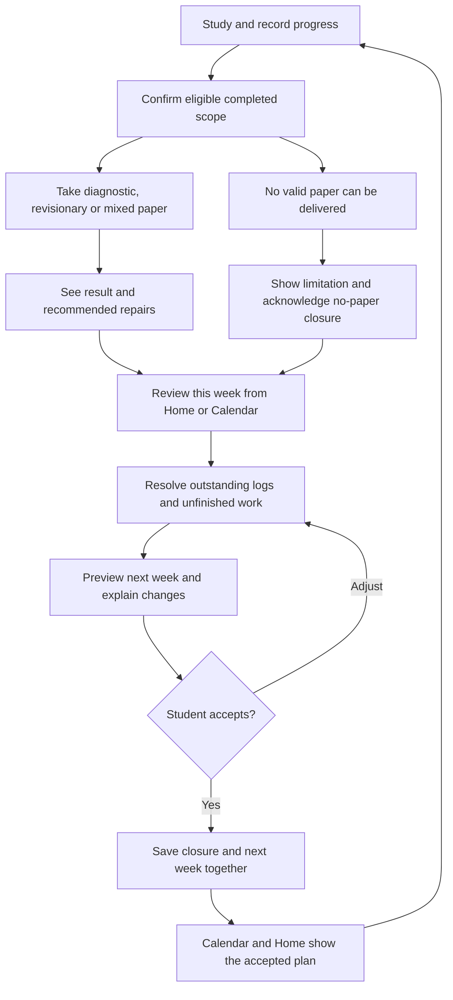

# Next build — finish one week and start the next without losing work

**Date:** 29 October 2026  
**Status:** proposed implementation plan; no application changes in this document-only step.  
**Scope:** weekly closure, unfinished-work continuity, next-week preview and acceptance, and the connected Home / Calendar / Curriculum / Tests / Coach experience.

**W1 design decision:** use continuation tasks (Option B in the W0 audit). Stable logical work and preserved history are requirements; retaining the same database task ID across weeks is not. This supersedes the earlier same-row transfer proposal.

## 1. Outcome

A student can finish a week, see what actually happened, decide what to do with unfinished work, and approve a realistic next week. Nothing disappears, appears twice, becomes falsely completed, or changes silently.

This is the next slice of the existing master completion plan, not a new product direction. The previous slice made new splits and partial-progress logging safer within a cycle. It did not fix the transition into the next cycle.

**Student journey:**

The app remains a planner and accountability system. This slice does not introduce teaching, uploads, a new weekly-review navigation tab, an opaque readiness score, or compulsory weekly study hours.

## 2. Verified gaps

| Current location | Problem | Consequence |
|---|---|---|
| `weeklyReview/service.ts` | Open-task filter requires a date before cycle end. | Floating work can be absent from closure. |
| Same service | Carryover currently lists repair threads, not ordinary study remainder. | Unfinished study can vanish from the next Calendar. |
| Same service | Preview is generated before submitted task resolutions are applied; acceptance regenerates it again. | What the student chose and what the accepted draft contains can diverge. |
| `accept_weekly_review` RPC | New rows omit outcome mapping, split group and detailed task semantics. | Continuity and curriculum/test scope can be lost. |
| Same RPC | Closure resolutions update tasks without corresponding task events. | Execution history cannot fully explain the change. |
| Review page and RPC | A next week with zero tasks cannot be accepted. | Planned breaks and zero-availability weeks become dead ends. |
| Weekly-review endpoints | They currently check login, rather than the shared verified-email/setup guard. | API access rules differ from the intended app rules. |
| `roadmapService.ts` | Observed pace uses planned task duration and can count a module's effort repeatedly. | Apparent adaptation can be based on fabricated observations. |

The current fingerprint covers a limited generated-task projection. It is not a complete revision guard for tasks, logs, commitments, scope confirmations and evidence.

## 3. Product rules to preserve

- Self-study: Monday–Saturday learning/revision; Sunday verification and closure.
- Classes define class-led cycle boundaries; papers are before the relevant next class. Reuse the canonical cycle resolver. Do not change the irregular-class fallback policy in this slice.
- A next week is proposed, then accepted. Opening a page never changes Calendar.
- An accepted future plan must not masquerade as today's active work before its start date.
- Unknown activity stays unknown. Skipped, deferred and untested are distinct from incorrect answers.
- Partial learning only enters Tests through the existing explicit scope-confirmation rules. Remaining work does not enter a paper merely because it was scheduled.
- Existing scored papers retain their original scope and evidence. Late logs are not retroactively added to their score.
- Calm pressure explanations offer choices; they do not judge eligibility or deny app access.
- Repairs reference curriculum objectives and study approaches; Coach does not teach the chapter.

## 4. Student experience

### A. Before the paper

Tests already has completed-scope confirmation. Make the entry points clearly distinguish **recording learning**, **confirming test scope**, and **starting the paper**. Link missing class/study logs to their existing quick-capture forms with a return destination.

The student can record an outcome as completed without entering minutes. Duration remains optional. A confidence choice or a completed block is not a test result.

### B. After the paper

Results provide **Review this week**, also surfaced on Home and Calendar. The short review contains:

1. **This week:** finished, partial, moved/later and unreported work; reported time with explicit unknowns; relevant paper result.
2. **Anything to resolve?** Only outstanding study/class logs and work needing a disposition. Already resolved items are collapsed.
3. **Next week:** a readable daily preview plus visible unplaced/later work and a short explanation of changes.

Reuse the Calendar task drawer and quick logging controls instead of introducing another competing completion form. Persist a user's review choices so refresh or switching devices does not erase the draft.

### C. Choices for unfinished work

Separate **what happened** from **what happens next**.

| Question | Choices and effect |
|---|---|
| What happened? | Done; partly done; not done; not sure. Preserve existing actual-time observations. Do not overwrite a partial record with a generic unknown state. |
| What next? | Continue next week; keep for later; remove from the plan. Default suggestions are visible and editable. |
| Class attendance or coverage missing? | Attended / did not attend / unknown; confirm covered scope only when known. Do not carry an old class as a new attendance occurrence. |

“Remove from the plan” cancels future intent with an audit record. It does not delete historical learning or imply the curriculum outcome is complete. “Keep for later” stays visible in Calendar's backlog; it is not silently scheduled next week.

Unknown work can remain visible as **progress needs confirmation**. The preview explains any conservative assumption; it cannot claim remaining scope is known or exclude it permanently. Do not force the student to guess merely to close a week.

For a partial task, optionally ask **About how much time do you need to finish?** with short choices and **Not sure**. Time spent is not automatically subtracted from the original estimate: 20 minutes studied does not prove 20 minutes of curriculum effort was completed. Label any reused estimate as provisional.

### D. Next-week preview

Show four compact groups:

- Continuing work, with the original curriculum scope and progress.
- Existing accepted repairs/re-checks and newly proposed repair work, without duplicate threads.
- New work that fits after commitments and accepted continuing work.
- Work kept for later or awaiting a place, with a reason and a resolution action.

Explain changes in ordinary language: “One unfinished sitting is continuing. New reading has moved back. Your classes and protected commitments stay in place.”

Check conflicts, sitting limits, breaks and actual available windows using the existing calendar constraints. Do not fill every free minute or apply a new hidden percentage. Make planned load and spare windows visible. If the plan does not fit, offer less new scope, different placement, later work or accepted unplaced work. Do not erase the work or silently extend the final preparation period.

The next weekly paper is a scheduling reservation. Its actual questions and scope are determined from eligible completed learning when the student starts it; planned work is not guaranteed paper scope.

The composer must reserve commitments first, respect prerequisites and due verification, and avoid scheduling a re-check before its repair. Continuing work should displace equivalent new work rather than simply adding to the old load. An overdue repair can outrank ordinary carryover; explain such decisions. Deduplicate by task/repair identity and learning scope, not matching titles. Any larger scope change remains a student-approved trade-off.

If learning is logged after the closing paper, label it **recorded, not verified by this paper**. Preserve it as untested scope for a later eligible paper; do not require an unapproved extra paper or silently drop it. A bank shortage prevents unsupported testing, not access to Calendar or the rest of the app.

### E. Accept and return

Button: **Save review and open next week**. Successful acceptance leads to `/app/calendar` showing the accepted cycle and a short change summary. Home points to the next justified action.

If the next cycle has not started, label it **Next week — accepted**. If the student is away for several weeks, offer one current recovery plan and preserve the gap as unreported; do not manufacture several completed or failed intervening weeks.

A deliberately empty or unavailable week is valid. Explain why it has no scheduled study, retain later work, and provide **Update availability** / **Place work** actions. Zero generated rows must not trap the student.

## 5. Data and command design

### Preserve logical work through continuation tasks

Use the W0 audit's Option B. The prior proposal to move the same row and add closing snapshots/handoff tables is superseded:

- Leave the original task in its original cycle. Explicit closure answers may update its execution with events before the review is committed; creating a continuation must not rewrite its past observations or pretend it was completed.
- Create a new task with `continued_from_task_id` pointing to the previous occurrence. Enforce at most one direct successor, same owner, valid forward lineage, and server-controlled creation. Repeated rollover forms a chain; a genuine split remains a separate operation.
- Copy planning semantics: `scope_group_id`, reading/LOS pointers, objective, method, completion meaning, provenance and repair link. Store the accepted remaining-work estimate, labelled provisional where necessary.
- Do not copy execution events, actual minutes, scope confirmations, scores, attempts or demonstrated-understanding evidence. The new occurrence starts unstarted; prior progress is shown separately through its lineage. It requires new activity/confirmation before becoming eligible for a new paper.
- For reading-level work, previously confirmed outcomes are historical context, not automatically confirmed remaining scope. If what remains cannot be identified, ask for scope confirmation rather than claiming the full reading is newly learned.
- A continuation replaces its predecessor as the actionable occurrence. Reject move/split/complete/ordinary undo commands on superseded predecessors; any later correction needs an explicit audited amendment path. Do not resurrect one through deletion, cancellation or a broken link.
- Scope-group completion operates on effective logical parts: collapse continuation chains, retain genuine split siblings, and increment `expected_parts` only for genuine splits. Missing/cancelled terminal work does not count as completed.
- Preserve event-to-original-task attribution for weekly minutes. For lifetime pace, evaluate logical chain completion and sum each actual-time observation once across its occurrences; an old partial predecessor must not permanently disqualify a now-finished module. Preserve unknown-time exclusions.
- The old `/app/calendar?task=<id>` opens its historical occurrence even outside the active cycle, with **Continued as…** linking forward. The new occurrence shows **Continued from…** and separates earlier progress from this week's progress. Keep closed-review recaps and submitted paper scopes historical.
- Reuse the existing immutable review record, durable proposal and command receipt; do not add snapshot/handoff tables merely to preserve a stable row ID. Add further fields only where the required invariants cannot be enforced with the lineage and existing records.

This is a smaller change than transferring rows, not a one-reader change. Update scope reduction, observed pace, task mutation guards, task deep links and composer deduplication together. Continuation creation must be in the same guarded acceptance transaction as cycle closure. Do not backfill unsupported historical lineage.

### Durable server-owned preview

Extend/reuse the existing draft mechanism if it supports the required contract; otherwise add a weekly-transition draft. It stores:

- Owner, closing cycle, target boundaries, version/status and expiry.
- Resolved log/disposition choices and explicit remaining-time assumptions.
- Source revision manifest: cycle, affected tasks, commitments, relevant scope/evidence/repair state and roadmap/settings inputs.
- Proposed continuing tasks, new tasks, repairs, placements, later work and explanations.
- A hash of the complete canonical proposal, not just titles and minutes.

Preview calculation is deterministic. Coach can explain or propose edits through the same draft contract. No LLM call occurs inside a database transaction. Accepting one draft supersedes competing drafts for the same transition.

### One atomic acceptance

Use a request-scoped, verified/setup-guarded RPC with consistent ownership enforcement. It must:

1. Validate identity and return a matching prior command receipt on an exact retry.
2. Lock the closing cycle, draft and affected tasks in a consistent order.
3. Validate all relevant source revisions, cycle dates, task ownership, gate and paper state. Serialize conflicting planning commands or use a shared revision/lock protocol so new conflicting work cannot slip between checks.
4. Refuse stale proposals with a conflict response and preserve the student's choices for rebuilding.
5. Save explicit log changes with task events, continuation links/placements and newly accepted work. Preserve predecessor history and prevent duplicate successors.
6. Close the prior cycle, persist the next-cycle state, accepted draft/review and command receipt together.

All steps succeed or all roll back. No model or network request is performed while locks are held. Reject arbitrary client task rows; accept a server-owned draft ID and revision. Direct authenticated RPC callers must not bypass proposal validation.

A lost response is **Save not confirmed — check the current week**, not “nothing changed.” Retrying the same command cannot create another week, task, event or duration observation. Reusing its command ID with different content is a conflict.

### Correct observed pace before using it

- Use deduplicated reported actual-time observations; retain zero and unknown correctly.
- Do not label planned durations as observed time.
- Do not count an entire module's effort for every sitting or split part.
- Count effort only where covered scope can be supported. Partial/unknown scope is not a full module observation.
- First-week or sparse evidence remains provisional; missing time does not mean zero capacity.
- If the current data cannot support a calibrated pace estimate, return **insufficient observations** and use transparent planning assumptions. Do not invent a learning rate.

## 6. Routes, links and shared state

| Surface / route | Responsibility and connection |
|---|---|
| `/app` | One contextual review/next-week action; current-cycle status, not another large dashboard section. |
| `/app/calendar` | Current/accepted next cycle, task drawers, continuing/unplaced/later work; review entry. |
| `/app/calendar?task=<id>` | Open that owned historical/current occurrence; show forward/backward continuation links and distinguish earlier progress from this week's activity. |
| `/app/calendar/log-class` | Resolve class attendance/coverage and return to review; no duplicate class occurrence. |
| `/app/curriculum` | Keep exposed/completed/verified distinctions; show continuing scope and existing learning history once. |
| `/app/tests` and `/app/tests/<attemptId>/result` | Confirm eligible learning, take paper, then link to review. Preserve historical paper scope and results. |
| `/app/review-week` | Short recap → unresolved logs/dispositions → next-week preview → explicit acceptance. No sidebar tab. |
| `/app/coach` | Explain changes or request recovery; open the same draft for review, never silently execute a second plan. |
| `GET /api/weekly-review/state` | Read-only state, outstanding work and existing saved draft; distinguish unavailable data from an empty week. |
| **New:** `POST /api/weekly-review/preview` | Validate/save choices and build a server-owned proposal; creates a draft only, not scheduled work. |
| `POST /api/weekly-review/accept` | Accept draft ID/revision + idempotency command ID; respond with next-cycle ID and Calendar destination. |
| Existing `/api/tasks/<id>` and scope-confirmation API | Record actual execution/scope. Invalidate dependent draft revisions. No parallel closure-only interpretation. |
| `/api/commitments`, `/api/commitments/<id>`, `/api/profile`, existing onboarding/settings writers | Changes to commitments, availability, exam target or class pattern invalidate affected proposals. Inventory the actual availability writer in W0 and reuse or repair it; do not create a duplicate settings API by assumption. |

The shared operating-state service must consume the canonical closure result and accepted cycle. Revalidate Home, Calendar, Tests, Curriculum, Coach and review data after relevant commands. An open second tab must detect a stale draft, not overwrite a newer plan.

## 7. Build order

| Step | Deliverable | Completion condition |
|---|---|---|
| W0 — contracts and failing cases | Inventory all cycle/task/scope/time readers; define dispositions, attribution, continuation lineage and empty/future-cycle states. Add regression scenarios for verified failures. | A concrete split/partial/deferred/unknown example has an agreed expected result across all pages. |
| W1 — truthful records | Additive continuation migration, chain-aware scope/pace, durable draft/receipt contract and guarded atomic acceptance. Retain the W0 observed-time fix. | Rollback, retry, concurrency and cross-user checks pass in isolated Postgres. Historical readers remain correct after continuation. |
| W2 — next-week composer | Compose from proposed resolutions, existing work, accepted constraints and supported repairs; retain unplaced/later work. | Preview and persisted acceptance match; no duplicate task/scope/minutes, invented completion or placement conflict. |
| W3 — connected experience | Replace the review form, wire Home/Calendar/Tests/Curriculum and Coach context. Add honest loading, empty, stale and failure states. | One student can resolve the week, adjust a preview and accept using desktop or phone without losing choices. |
| W4 — development rehearsal | Apply tested additive migration to the already-authorised disposable development project; run real Auth/API and Browser journeys. | Checks below pass, own dummy data is removed, screenshots and actual limitations recorded in the master status document. |

No parallel calendar rewrite, onboarding redesign or question-bank expansion is included. Necessary read-model fixes are included because continuity cannot work without them. Broader Coach command atomicity and full assessment-engine rebuild remain separate work.

## 8. Acceptance scenarios

The minimum release checks are:

1. **Split across weeks:** one 90-minute task split into 45 + 45; first finished, second floating. The second is present in review and appears exactly once next week. Shared scope stays incomplete until genuinely finished or explicitly confirmed. First-week history remains intact.
2. **Partial with known/unknown time:** preserve earlier observations, allow an honest remaining estimate, and never infer remaining effort by simple subtraction.
3. **Deferred / skipped / unknown:** next-week vs later vs removed intent is visible; unknown is not counted as done or missed. Repeated carryover explains pressure without punishment.
4. **Scope after continuation:** previously confirmed learning is not duplicated; a new unstarted occurrence adds no paper scope; new eligible activity can verify the remaining objective; a scored paper never changes. Repeat across at least three cycles and split a continuation to verify logical-part counting.
5. **Repair collisions:** repeat misses preserve the same repair thread; continuing repair/re-check work is not recreated by the composer. A result arriving during preview makes it stale.
6. **Class-led and self-study:** Monday–Saturday/Sunday boundaries hold; fixed/variable class logs and explicit class changes use the current resolver and preserve prior weeks.
7. **No capacity / no work / long absence:** no blocked closure or ghost catch-up weeks; later work remains accessible and an empty/recovery plan is explained.
8. **Stale edits and retries:** change a task, class, availability or exam target in a second tab; acceptance refuses the old proposal. Duplicate acceptance and response loss still produce one closure/next cycle.
9. **Database failures and access:** force failure after continuation creation begins; everything rolls back. Unverified, incomplete-onboarding and other-user requests fail at API and RPC boundaries. No second successor, lineage cycle or wrong-owner link can be created; historical ancestors cannot be reactivated or deleted into apparent completion.
10. **Cross-page consistency:** Home → Calendar → Tests → result → review → next Calendar → Curriculum → Coach agrees on task identity, group progress, paper state and learning/evidence distinctions.

Run existing verification/build/route checks, meaningful reducer tests, isolated transaction tests and real hosted Auth/API tests. Use the Browser plugin for desktop and phone: navigation, task drawers, scope confirmation, review edits, acceptance, refresh/back, second-tab conflict, empty/error states and console checks. Verify historical recap accuracy before and after another rollover. Clean up only owned fixtures.

Add a pace regression: an occurrence has 20 reported minutes and remains historically partial; its continuation finishes with 25 newly reported minutes. The logical work has 45 reported minutes, attributed 20/25 to the respective weeks. When enough valid modules exist, pace can use the finished chain without counting its module effort twice. If either occurrence has unknown duration, do not invent its time. Any 85-minute fallback remains an explicitly labelled planning assumption, not observed pace.

## 9. Done means

The student can answer four questions without interpreting internal terminology:

1. What did I actually finish this week?
2. What still needs work, and where did it go?
3. Why does next week look different?
4. What should I do next?

All four answers must remain true after refresh, retries, a second tab, another week and a partial network failure. Full revision/mocks/final-week planning and a complete diagnostic bank are not claimed by this slice. They follow once weekly continuity is proven.
