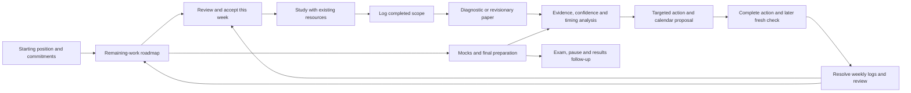

# Roadmap — full diagnostic private beta, 30 November 2026

Prepared 3 November 2026. This is a product concept and proposed delivery contract, not a claim that the features below are already built. It consolidates the next work; it does not replace founder decisions or authorise application changes.

**Founder clarification:** 30 November means a full-feature private beta, ready for reviewers to use, before payments open. Human review is not assumed to have finished before that date. The earlier Phase E prompt has not been reported complete.

## 1. The product we are building

**Roadmap helps CFA Level I candidates decide how to study, when to study, and what to change when the evidence or real life changes.**

The student brings their classes, books and existing preparation. Roadmap organises the preparation, checks selected completed learning, identifies gaps, proposes a practical response, places accepted actions in the calendar and checks again later.

The promise is a useful next action with a reason and a realistic place in the student's week. The app must still identify the relevant curriculum scope; “not what to study” means that we do not sell another set of lessons or teach chapters from scratch.

Suggested public wording: **“How to study. When to study. A plan that responds to your progress.”** Supporting explanation: “Keep your course. Build your week, check your understanding, and know what to do next.” These are proposed positioning lines, not approved claims of efficacy.

The buyer is the individual candidate. A coaching institute is an existing part of that candidate's life, not a prerequisite, customer administrator or required integration. B2B dashboards, faculty reporting and institute onboarding are outside this release.

## 2. What is actually distinctive

Scheduling, questions and analytics already exist elsewhere. UWorld describes adaptive planning, missed-session redistribution and performance analytics. CFA Institute includes a planner, questions and mocks in its Learning Ecosystem. AnalystPrep offers a question bank and analytics. Preparoo presents mocks, topic practice and analytics. These are vendor descriptions, not independently tested comparisons. Sources: [UWorld planner](https://finance.uworld.com/cfa/study-planner/), [CFA Learning Ecosystem](https://www.cfainstitute.org/programs/cfa-program/learning-ecosystem), [AnalystPrep](https://analystprep.com/cfa-level-1/), [Preparoo](https://fin.preparoo.app/).

Our proposed advantage is the quality of the connections, not a claim to have invented any individual feature:

| Candidate problem | Roadmap's proposed response | Evidence needed before claiming an advantage |
|---|---|---|
| “My score is low. Now what?” | A traceable gap → method → accepted study block → later check. | Students can follow this without translating a report into a plan themselves. |
| “I got it right, but guessed.” | Confidence separates fragile correct answers from well-supported understanding. | Repeated fresh checks substantiate the distinction. |
| “My coaching and work keep changing.” | Classes and commitments shape the week; changes produce a reviewable revision. | Real schedule changes recover without overlaps or lost work. |
| “I joined after finishing half the course.” | Remaining-work entry, not a compulsory beginner sequence. | Midway and near-mock users receive different useful weeks. |
| “I missed several days and now avoid opening the planner.” | A short recovery choice that preserves progress and shows what waits. | Returning users resume work instead of receiving a wall of overdue tasks. |
| “I remember the answer, not the concept.” | Question-family tracking and fresh transfer checks distinguish repetition from new evidence. | Related variants do not count as independent novel proof. |
| “There are too many dashboards.” | One main action, one short explanation, details on demand. | New users can identify their next action without coaching from the founder. |

Call these hypotheses to validate, not “features nobody else has.” Roadmap complements tuition and books, but it still competes for the candidate's time and budget.

## 3. One complete product loop

Every arrow is an acceptance test. A dashboard card without a working next action is not a completed feature.

## 4. The experiences that must work

| Situation | Plan and assessment reaction | Must never happen |
|---|---|---|
| Fresh self-study candidate, nine months | Remaining first pass plus light maintenance; Mon–Sat work and Sunday assessment where supported. | Arbitrary minimum-hours prescription or a diagnostic before any eligible work. |
| Three subjects covered, two shaky | Preserve covered scope, target reported uncertainty, rotate maintenance and advance unfinished subjects. | Restart those subjects or call the reported uncertainty a demonstrated miss. |
| First pass complete, mock in a month | Begin revision and rehearsal preparation immediately; use a representative check if needed and supported. | A chapter-by-chapter intake test marathon. |
| Classes on several days | Place consolidation after actual coverage; assessment follows the established class-cycle boundary. | Assume attendance means the student understands or ignore changed classes. |
| Variable class announced late | Log the class, reconcile capacity and preview affected work. | Silently move accepted commitments or count future teaching as completed learning. |
| FSA and Corporate Finance finished earlier than expected | Reduce remaining first-pass work and update the future projection; maintain revision. | Rewrite the original plan to make its execution statistics look better. |
| Work emergency, illness or family event | Offer a lighter week, explicit waiting work and a realistic restart. | Infer laziness, lower concept understanding or produce a punitive backlog. |
| Many tasks marked done quickly | Accept the report as activity; tests separately check understanding. | Punish speed automatically or mark mastery from checkboxes. |
| Almost no logs for two weeks | Show incomplete information and offer one quick reconciliation/restart. | Treat missing minutes as zero or require dozens of historical entries to return. |
| High confidence, wrong answer | Show the valid question/error pattern and propose a targeted check or revision. | Diagnose a misconception with certainty from one distractor choice. |
| Low confidence, correct answer | Label the evidence fragile/provisional and revisit with a fresh question later. | Call it a failure or a secure strength automatically. |
| Correct but slow | Track repeated timing patterns separately; offer timed practice when justified. | Lower accuracy because a concept is difficult or a browser tab was inactive. |
| Completed scope exceeds one paper | Keep an explicit pending assessment scope and partition linked papers, each ≤90 questions. | Claim all scope was tested or silently drop manually confirmed material. |
| Bank supports only part of the scope | Name the supported and untested areas; planning continues. | Fill the gap with unrelated questions or unreviewed items. |
| Student disputes a defective item | Preserve the attempt, review the item, invalidate affected evidence when warranted and reconcile dependent work. | Count the disputed item as certain evidence indefinitely or delete history. |
| External coaching mock | Record the external outcome and self-reported areas; allow planning from that report. | Invent question-level evidence or close concept repairs from an overall percentage. |
| Exam moved or postponed | Keep history and present a changed future roadmap, assessment calendar and entitlement implications later. | Erase progress or charge automatically. |
| Final week, still some unfinished syllabus | Show explicit prioritisation choices, targeted checks and exam logistics. | Promise that compressing every outstanding task into seven days makes the candidate ready. |
| Exam finished | Pause study reminders, offer a short retrospective and allow archive/result follow-up. | Keep sending overdue study warnings or infer official results. |

## 5. Pages and the minimum useful experience

Keep the existing shell: Home, Calendar, Curriculum, Tests and Coach, with Settings outside primary study navigation. No Materials tab and no separate permanent weekly-review tab.

| Page | Main job and action | Connections and boundaries |
|---|---|---|
| Landing | Explain the loop, who it helps and actual beta capabilities. | Sign-in/request-access links work; no payment buttons in the private beta. No pass guarantees. |
| Authentication | Verified account, recovery, safe redirects and resumed sessions. | Email access must work for invited reviewers/candidates. Google can wait. |
| Onboarding | Existing five steps capture exam target, route/classes, covered/uncertain scope and real availability. | Useful first week; optional context stays optional. No repeated redesign. |
| `/app` | “What should I do next?” with the accepted action, reason and quick log. | One upcoming assessment/review and a compact preparation outlook; detailed statistics stay elsewhere. |
| `/app/calendar` | A readable week with work, classes, commitments, tests, mock events and unplaced work. | Task drawer explains purpose, method and completion. Changes are previewed; protected events stay protected. |
| Curriculum | Remaining coverage, confirmed activity, evidence and revision rotation by topic/reading. | Log scope or open its Calendar action/test. No lesson library. Verify the actual current route before adding links. |
| `/app/tests` | Upcoming paper, supported scope, purpose, expected time and assessment history. | Diagnostic/new learning; revisionary/revisited learning; mixed sections; scoped repair checks; linked mock sessions. |
| Taking flow | Stable attempt, three options, mandatory confidence for answered questions, reliable clock, save/resume and submission. | No answer key before completion; server validates ownership, clock and item versions. |
| Result | What was tested, what the evidence says, what remains unknown and what to do next. | Topic/reading detail, cautious SWOT, challenge action and Calendar proposal. |
| `/app/review-week` | Resolve unfinished logs, inspect evidence, compare next-week changes and accept once. | Home/Tests/Calendar entry points; no sidebar tab. |
| `/app/coach` | Explain priorities and propose supported planning actions. | Uses current owned state and curriculum identifiers. Cannot teach a chapter or execute an unconfirmed change. |
| Settings | Edit setup, reminders, data export/deletion and privacy preferences. | Changes preserve unrelated fields and invalidate affected drafts. Account deletion is confirmed and auditable. |
| Reviewer workspace | Review curriculum mappings, questions, variants, proofs and student challenges. | Separate privileged workflow; draft preview cannot update student evidence. |

Home should answer three questions immediately: **What next? Why this? What needs my decision?** Daily logging should take seconds when the mapping already exists. Test these as usability goals; do not add data-entry fields just to make a report more complete.

## 6. The diagnostic engine is a measurement-and-action system

### Before a paper

Create a versioned blueprint from the candidate's explicitly confirmed scope. Scheduling or reporting historical coverage alone is insufficient. Distinguish planned reservation from actual scope at start.

Allocate coverage first, then question counts: include relevant breadth, topic importance, objective size, concept variety and previous evidence. Page count is only a secondary size signal when edition-specific metadata is known; otherwise use a labelled effort assumption. It must not override unsupported scope or let one long reading consume the paper.

Maintain a sampling ledger so successive diagnostics cover neglected concepts rather than repeatedly taking whichever questions exist. Store why each item was selected. Balance answer positions without compromising valid quantitative or grammatical option ordering.

No paper exceeds 90 questions. If the confirmed scope cannot fit, show the assessment series and pending scope. The student can schedule additional papers or leave named areas pending; neither is disguised as completed verification. Broad intake checks sample representative covered scope and do not claim chapter-complete certification.

### During a paper

Capture answer, confidence, first-answer/changes, active interaction timing, interruption signals and item/family version. Confidence is mandatory for answered items under the founder's policy; timeout must not manufacture confidence for unanswered or unfinished responses.

Use one-tap confidence choices with keyboard support. Track the confidence interaction separately so its overhead is visible. A mock's continuous server clock must not pause invisibly to collect confidence; disclose the additional Roadmap interaction rather than claiming an identical official interface.

Clock mode is part of the attempt: ordinary diagnostic/practice may support disclosed pauses; a timed mock preserves its continuous clock and recorded interruptions. Resume and double-submit are safe.

### After a paper

Persist scoring, immutable response evidence and related receipts atomically. Results disclose invalidated/unscored items, unseen versus repeated families, scope tested and scope not tested.

Use response patterns cautiously:

| Pattern | Useful interpretation | Planning response |
|---|---|---|
| Correct, confident, repeated across fresh checks | Increasingly supported scope | Normal maintenance; do not exclude forever. |
| Correct, uncertain | Fragile evidence | Fresh verification and a short targeted activity. |
| Incorrect, confident | Possible misconception or interpretation issue | Inspect the valid item and error pattern; prioritise targeted work. |
| Incorrect, uncertain | Current gap or incomplete recall | Focused revisit and later check. |
| Accurate, repeatedly slow | Potential timing/fluency issue | Timed application practice, separately from concept accuracy. |
| Unanswered at time limit | Omission/timing evidence | Do not assume the precise conceptual reason. |

Distractor diagnoses describe what an answer is consistent with, not what the student certainly thought. Brief answer-specific feedback is in scope; chapter-length tutoring is not.

## 7. SWOT and preparation outlook

Keep the founder's SWOT structure, but distinguish evidence from inference:

- **Strengths:** the actually tested scope that is supported; a single correct answer is provisional.
- **Weaknesses:** valid observed misses/unstable scope, with sample size and recency.
- **Opportunities:** related application or prerequisite areas worth checking next, from a verified relationship graph. They are not automatically strengths.
- **Threats / watch next:** dependent areas potentially affected by a gap, stale evidence or an approaching deadline. They are risks to inspect, not fabricated wrong answers.

No LLM-invented correlation edges. Keep an evidence link, relationship type and proposed next action with each inference. Avoid a huge four-quadrant wall of text: show the leading actionable finding in each group and expand the rest.

Do not blend time management into conceptual correctness. Present a compact **Preparation Outlook** with three possible states—insufficient evidence, needs attention, progressing—plus a plain reason. It is a workflow summary, not a probability of passing.

Its expandable components are: remaining coverage; demonstrated understanding and untested scope; execution/capacity; assessment freshness and rehearsal evidence. Missing blocks affect execution/projection, not past correct answers. Thin evidence prevents an overall reassuring claim. No official passing-score equivalence or “82% ready” without an independently justified model.

## 8. How study guidance earns its place

Each block has scope, objective, activity, reason, estimate provenance and completion meaning. Offer a small set of actions: first exposure using the candidate's course; retrieval from memory; targeted revisit; practice application; timed fluency; repair; re-check; mock analysis.

The tactic should respond to the issue. Example: “Your recent questions suggest difficulty distinguishing recognition from cash collection. Revisit that LOS in your existing course, compare the two treatments in your own notes, attempt practice without notes, then record the scope you worked.” This is organisation and method guidance, not a replacement lesson.

Measure whether the subsequent check improves before claiming a tactic works for that person. Do not infer a fixed visual/auditory learning style or prescribe generic motivational scripts.

Coach intents for the beta: explain today's priority; prepare/review a week; explain a result/SWOT; recover a missed session; change availability; prepare for an upcoming mock; interpret a projection; show current limitations; route to a known learning location using curriculum identifiers. Unsupported requests receive a short boundary and a relevant action.

Tools return typed proposals. Deterministic services enforce scope, capacity, ownership and acceptance. Prose generation cannot authorise database changes.

## 9. Question content, rights and the reviewer beta

The latest reported inventory is 19 eligible reviewed questions in FSA. This is a dated handoff, not a fresh live count. Verified/draft totals are not interchangeable with reviewed evidence-grade inventory.

The deadline is now a reviewer-ready private beta, not a requirement to approve thousands of questions before reviewers can enter. Build two strictly separated modes:

1. **Student mode:** evidence-moving assessments use only permitted, eligible reviewed items.
2. **Reviewer preview/sandbox:** authorised users exercise full paper/result/repair journeys with explicitly labelled draft content and isolated disposable learner data. Draft outputs cannot update genuine student readiness, evidence or repair history. Candidate accounts cannot unlock this mode.

This allows all workflows to be usable by 30 November while review begins on that date. It does not make a full-syllabus student diagnostic promise true until the content gate passes.

### Source rights must be established

Do not treat possession of the uploaded Schweser PDFs as permission to train, ground or commercialise their content. Do not use “no matching sentence” as a rights clearance. CFA Institute's current website terms explicitly restrict AI training and grounding on site material; that is a concrete constraint, not an assumption that public access grants reuse. Source: [CFA Institute terms, updated 15 October 2026](https://www.cfainstitute.org/about/governance/policies/terms-conditions).

Maintain a rights register covering book/source edition, owner, permitted commercial uses, AI processing permissions, access controls and retention. Use licensed material or original company-owned concept/item specifications with an appropriate rights basis. Have qualified advice resolve uncertain uses. Do not scrape portals or copy provider questions. The specific terms governing each uploaded book require separate confirmation; the CFA website terms do not establish Kaplan's license terms.

### What an item contains

Curriculum/version identity; primary concept/outcome and secondary mappings; question family; original scenario; three options; key; solution/proof; distractor diagnoses; intended cognitive demand and timing; provenance; author/model/prompt version; verification results; review record; exposure and hold-out status. Author difficulty labels are nominal until response data supports calibration.

Families are versioned reasoning structures, not just text hashes. Changing names, numbers or wording does not automatically produce independent new evidence. Student-time personalisation selects a reviewed blueprint; unconstrained live rephrasing is not evidence-grade generation.

### Production pipeline

Owned/licensed specification → constrained authoring → schema/format checks → independent solution and numeric checks → scope/ambiguity/originality screening → human review → versioned publication → monitored use → challenge/correction/retirement.

Numeric computation verifies a calculation, not the correctness of the chosen accounting/financial model. Sandbox formula evaluation with bounded allowed operations. Model disagreement is a review signal. Do not repeatedly rerun unchanged failures until they pass.

Reviewer tools need batch filtering, full proof, exact mappings, family comparison, edit/reverify, approve/reject/return, history and an item challenge queue. A changed key or material meaning creates a new version; old attempts remain reproducible and defective evidence can be invalidated.

### November content targets

First measure generation throughput, failure yield and API costs on 100 candidate items balanced across all ten topics. No human approval is implied.

For 30 November, target a reviewable candidate inventory covering every verified canonical outcome at least once, deeper candidate families for the intended beta journeys, and two candidate full-mock forms. A provisional planning range is **1,500–2,500 draft/automatically checked candidates**, to be revised after the measured batch; it is not an approved-content promise. All unresolved gaps remain visible.

Do not hardcode historical counts of 102 readings/343 outcomes into acceptance. Reconcile the active manifest first. Current official 2027 names and topic weights differ from 2026; the repository already contains a migration for those changes, so verify the applied values rather than rebuilding them blindly. Sources: [2027 outline](https://www.cfainstitute.org/sites/default/files/2027levelitopicoutline_online.pdf), [exam guide](https://www.cfainstitute.org/programs/cfa-program/candidate-resources/level-i-exam).

Before paid all-subject launch, reviewed inventory must pass scenario-based assembly and repeat-use checks, including re-check depth and unseen held-out mocks. Item counts alone do not prove this. For scale: 2,000 approved items at an illustrative effective 8–12 review minutes each requires approximately 267–400 reviewer hours, including whatever rework is covered by that assumed rate. Measure the actual rate before promising review completion. 20,000 stays a later scale target.

## 10. Mocks, final preparation and exam completion

Build the complete software flow for two linked papers of 90 questions, each with its own 135-minute clock, plus a combined result. This matches the current official two-session structure while respecting the founder's 90-question ceiling per paper. Source: [CFA Level I format](https://www.cfainstitute.org/programs/cfa-program/candidate-resources/level-i-exam).

Support more than one planned mock appointment so the student can see a rehearsal sequence, not only the next date. Carry the existing checkpoint and its history into that extension safely. Use one canonical appointment model; any profile-level “next mock” value must be a derived compatibility projection, not a second independently editable schedule. Each full mock owns its linked sessions. Keep the beta to two internal candidate forms plus external appointments rather than promising unlimited novel mocks.

A mock form has an immutable version, session-appropriate topic allocation, genuine hold-out families, continuous timing, interruption history and resumable recovery without extending the official clock. It cannot use arbitrary questions from completed weekly scope and call that a balanced rehearsal.

Student mock entry requires actual form capability. Reviewer sandbox can preview candidate forms with an explicit watermark. An interrupted or incomplete session remains distinct; a combined percentage must not pretend both sessions were completed.

After a mock, prioritise a small number of supported concept gaps, timing patterns and fragile areas. Preview analysis and repair blocks within real capacity. Avoid creating one calendar block for every wrong answer. Re-check with non-held-out fresh families so remaining mock forms stay protected.

Keep the founder's normal final-eight-week revision/mock preference for long horizons, but recover gracefully for late entrants. Final-week mode emphasises targeted review, selected checks, rehearsal debrief and logistics rather than dumping the entire backlog. Let the student choose trade-offs.

Include a small Practical Skills Module reminder/status—not lessons or integration. CFA Institute requires PSM completion for result release; the app should not describe sitting the exam as the only remaining administrative step. Source: [PSM requirements](https://www.cfainstitute.org/programs/cfa-program/candidate-resources/practical-skills-modules).

After the exam, pause study nudges, archive the accepted plan and offer voluntary result/retake context. Never infer an official pass from internal scores.

## 11. Backend and AI approach

Keep Next.js server services and Supabase/Postgres. Do not move everything to another backend framework. Reuse the verified command patterns, request-owned reads and transactional draft acceptance.

Introduce durable background work only for actual long-running tasks: item generation/verification, bulk assembly preparation, reports and reminder dispatch. Jobs need persisted status, idempotency, bounded retries, progress, cancellation where supported and failure reasons. Never run bulk authoring in a browser request.

Maintain clear records for candidate context, accepted execution, confirmed scope, response evidence, repair obligations, revision selection, checkpoint history and reviewer decisions. Prefer derived summaries where truthful; keep durable snapshots for attempts, accepted plans and receipts.

Use immutable item/form versions, server-owned scores, RLS/command permissions, reviewer isolation, pagination, measured indexes, rate limits, health checks and redacted logs. Sensitive answer keys stay server-side until authorised feedback.

Measure load at the intended beta cohort size with headroom: page reads, preview generation, answer saves, submission and concurrent background jobs. Record latency and failure budgets before release; fix measured bottlenecks. API/provider outages must not lose answers, duplicate scoring or block ordinary Calendar reads. Do not convert disposable reviewer fixtures into genuine approved inventory while testing publication.

Prompt engineering and evaluations are the immediate AI work. Store company-owned examples for Coach boundaries, interpretation and action proposals; maintain adversarial cases, numeric traps and known-defective items. Test semantic accuracy, unsupported claims, tutor refusal, tool selection and stale-state behaviour. Probe actual model access and fallback behaviour; do not rely on a September model-availability comment.

Fine-tuning is not a November dependency. It cannot replace source rights, item review, deterministic mathematics or sufficient response data. Later fine-tuning/ML requires a justified task, owned/licensed training examples, a hold-out evaluation and a measured improvement over the prompt-based baseline. No model-training claim before that work actually occurs.

## 12. B2C beta operations

Recruit individuals with different starting positions, not only people who follow the founder's own study pattern. Proposed initial group: 15–25 candidates plus reviewers, expanded only when support capacity permits. This is a recruitment target, not a forecast.

Measure onboarding completion, first useful accepted week, logging burden, assessment start/finish, unsupported scope, result-to-action conversion, repair/re-check follow-through, weekly return, rescheduling friction and content challenges. Use private feedback rather than public rankings or streak penalties. Do not make a pass-rate claim from a small self-selected beta.

Reminders are configurable: upcoming accepted work, a due assessment, a result with an unresolved action and one return/recovery prompt. Respect timezone, quiet periods, pause/exam-complete status and opt-out. No daily guilt cascade when work is overdue.

For 30 November: verified email access/recovery, invitation handling, working support channel, error monitoring, backup/restore rehearsal, export/deletion, privacy/terms, content/version audit and consent for beta analytics. Separate development fixtures from beta accounts and review the earlier credential-rotation requirement before sharing/deployment.

Payments do not block this private beta. Do not build multiple plans or a fake checkout. After beta evidence, test one simple individual offer—monthly or exam-window access—with explicit content capabilities and usage terms. INR/UPI is relevant for India; select and onboard the provider when payments resume. Razorpay documents hosted checkout and subscription options, but account eligibility and live activation still require verification. Sources: [checkout integration](https://razorpay.com/docs/payments/payment-gateway/web-integration/standard/integration-steps), [subscriptions](https://razorpay.com/subscriptions/).

## 13. Delivery plan: 3–30 November

There are three workstreams: product integration, assessment/content tooling, and beta operations. They can be separate contributors or scheduled blocks for one builder. This plan does not assume an undisclosed team or reviewer availability. If one builder cannot sustain the combined work, escalate by 6 November; do not hide it through repeated “almost complete” reports.

| Dates | Work package | Concrete exit |
|---|---|---|
| 3–5 Nov | Freeze this beta contract; reconcile current status, rights basis and curriculum manifest; measure the 100-item pipeline; preserve a reviewed code checkpoint. | One release checklist, actual throughput/error data and explicit unsupported content. No new general audit. |
| 4–10 Nov | Finish the reduced Phase E: closed-week history, reported-time pace, overload/ahead recovery and reviewable next week. | Fresh/midway/first-pass-complete candidates survive several cycles; unknown time stays unknown; accepted history is intact. |
| 4–12 Nov | Complete reviewer workspace, item families/versioning, generation jobs and preview isolation. | A reviewer can inspect, edit, reverify and publish; a draft cannot enter a student's evidence path. |
| 8–17 Nov | Unify paper preflight/blueprints, novelty tracking, confidence/timing interpretation, actionable results and cautious SWOT. | Selected scope → valid paper → evidence → repair proposal → calendar → later check works with stable versions. |
| 8–24 Nov | Produce the review candidate inventory in measured batches; reserve candidate mock families. | All canonical outcomes have visible candidate coverage or a named gap; draft/reviewed counts and job failures are explicit. |
| 13–20 Nov | Connect Coach tactics, method cards and recovery to the same services. | Supported intents produce correct previews and links; no tutoring or unconfirmed changes. No new chat platform. |
| 16–24 Nov | Multiple mock appointments, linked sessions, debrief planning, final-week and exam-complete modes. | Full rehearsal software works in reviewer sandbox; student start is gated by reviewed content capability, not preparation worthiness. |
| 12–25 Nov | Beta deployment, email access, reminders, account operations, monitoring and restore checks. | Invited people can access and recover accounts without builder intervention; failures are observable. Payments remain off. |
| 25 Nov | Feature freeze. | Only release-blocking fixes after this date. Missing stretch features are not disguised as built. |
| 25–28 Nov | Whole-journey and novice usability tests on the frozen release. | Desktop/mobile evidence across entry, disruption, tests, repair, revision, mock and post-exam. Reviewer/data separation tested. |
| 29 Nov | Release decision and rehearsal. | Known blockers resolved or beta invitation delayed honestly; rollback and support owner identified. |
| 30 Nov | Full-feature private beta opens to invited reviewers/candidates. | Real student mode for approved content; reviewer/sandbox mode for draft review; accurate capability labels everywhere. |

Work may overlap, but integration remains owned. Do not let multiple agents rewrite the same planner/state file simultaneously. Use small reviewable changes and one source of route/state ownership. Each handoff contains implemented behaviour, exact tests, browser coverage and remaining limits; it does not introduce another overlapping master plan.

## 14. Release gates

**Gate A — safe reviewer beta:** all owned workflows, durable jobs, content previews, review/publish, challenge handling, permission separation and account access work. No reviewer approval is fabricated. This is the 30 November target.

**Gate B — genuine all-subject diagnostics:** reviewed, rights-cleared inventory assembles the declared weekly/reading/subject checks and subsequent fresh checks across all ten topics. Unsupported outcomes are named; scope and novelty guarantees are exercised. Opening reviewer beta does not certify Gate B.

**Gate C — genuine mock offering:** held-out reviewed forms pass topic/session constraints, independent key checks and the full taking/debrief journey. Until then, internal mocks stay reviewer previews; external mock planning works normally.

**Gate D — paid B2C opening:** Gates B/C match the exact marketed offer, plus billing, entitlements, support, refund terms and operating readiness. Payments are not scheduled for 30 November under the founder's clarification.

Do not quietly replace the founder's target with a planner-only pilot. Build the full beta software. Equally, do not call draft content full diagnostic readiness merely because every button works.

## 15. Decisions and risks to resolve without another redesign

| Decision | Proposed approach | When |
|---|---|---|
| Content rights | Establish permitted sources and original company-owned authoring inputs; quarantine uncertain provenance from publication. | 3–5 Nov |
| Builder/integration capacity | Name the integration owner and actual contributors; reduce stretch inventory, not safety checks, if capacity is limited. | By 5 Nov |
| Review after beta | Name reviewers and measure effective approvals/hour once they begin; no assumed pre-beta availability. | Invite planning by 20 Nov; measurement from beta |
| Repair resolution | Existing no-automatic-closure policy remains. Propose a separately approved evidence-backed reviewer resolution flow for beta; never add “mark mastered” from self-report. | Founder decision before implementing resolution |
| Confidence in full mocks | Preserve mandatory confidence for answered items and disclose interaction overhead; do not secretly pause the mock clock. | Before taking-flow work |
| Candidate counts | Use the measured batch and active outcome inventory to set a feasible draft target; 20,000 is not a November requirement. | By 6 Nov |
| Payments | Off for private beta. Decide offer only after capability and usage evidence. | After 30 Nov |

The calendar endpoint, task creation and scoring commands must be safe under retries, concurrent devices, stale previews and network failures. A green rerun does not explain an earlier failure. Transport/process incidents remain visible with captured evidence.

## 16. Definition of useful, not just built

By the end of the beta's first use, a candidate should be able to say:

1. “It understood where I was starting.”
2. “I know what activity to do next and why.”
3. “The plan fits around my actual life.”
4. “The test checked work I really completed.”
5. “It distinguishes a guess, a gap and an untested area.”
6. “The result gave me a manageable action, not just a score.”
7. “Missing a day did not destroy my plan.”
8. “After finishing the syllabus, it still gave me a useful revision/mock path.”

Those are the product acceptance criteria. The 30 November deliverable is a complete, honestly labelled private beta ready for reviewers—not 20,000 approved questions, a fine-tuned foundation model or proof of improved pass rates.
