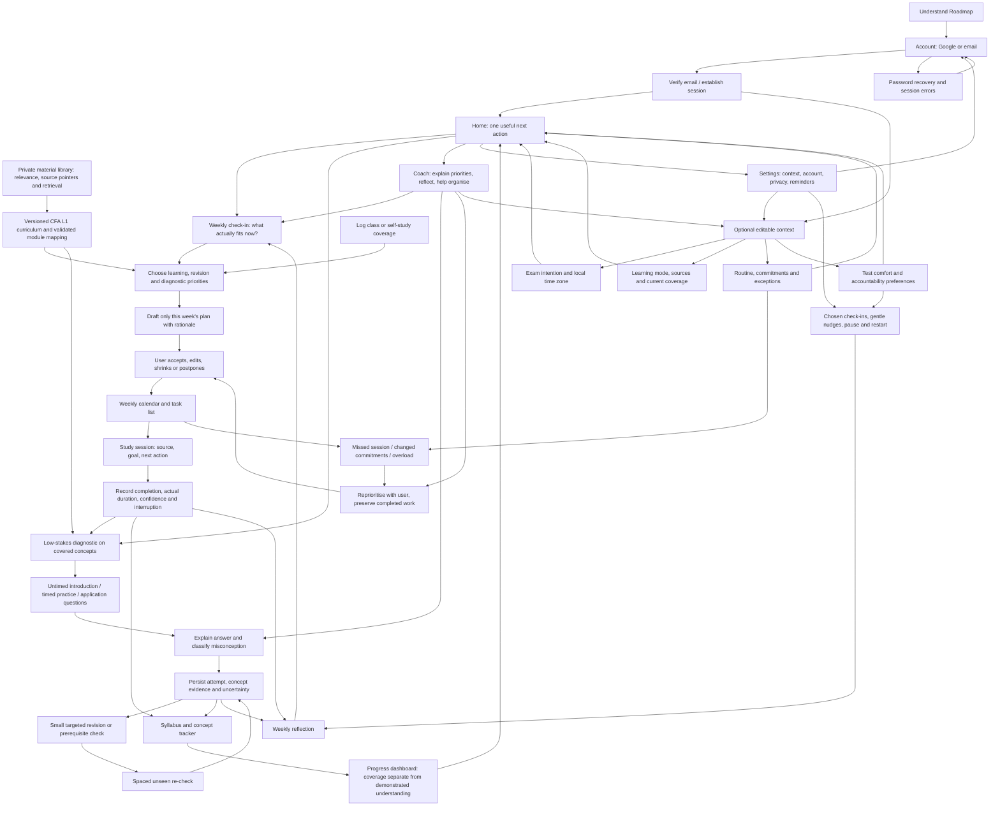

# Roadmap: context-first onboarding and the weekly product loop

Implementation snapshot: 4 September 2026. This is an implementation/context document and phased product discussion, not a claim that the entire MVP is complete.

## 1. What the product is now

Roadmap is a competitive-exam study planner, initially for CFA Level I candidates targeting 2027 onward. Its job is to help someone decide what to do this week, organise real-life commitments, practise with diagnostics, reflect without shame and adjust the following week. It is not a substitute for a course, an admission committee, or a predictor of whether somebody deserves to attempt an exam.

The software must not infer that three months, one year, a particular background or an answer about capacity makes success impossible. It can expose a conflict between tasks and a particular week's available space, ask what to change, and offer alternatives. It must not convert that conflict into a denial of access or a fixed study-hour prescription.

Context is a starting hypothesis. Completed work, actual time, confidence, diagnostic responses and changing commitments gradually make it more useful. The user remains in control of accepting, moving, shrinking, pausing or rejecting suggested work.

## 2. Audit: what existed and what changed

| Area | Finding | Current disposition |
| --- | --- | --- |
| Entry and screening | Pre-signup questions calculated required/available lifetime hours and feasibility verdicts. | Screening form removed; landing offers account creation/sign-in. Feasibility API returns 410 without collecting data. |
| Access routing | Root middleware redirected authenticated people with incomplete context or no plan away from the app. A blocked page refused planning. | Root legacy middleware removed. One Next.js proxy protects accounts, not readiness. Blocked/plan legacy URLs redirect to the app. |
| Setup | Required capacity and calendar answers, calculated workload, and review verdict. Styling and step count were inconsistent. | Replaced with a responsive five-section optional context flow. No workload arithmetic. |
| Persistence | Setup deleted/recreated availability, commitments and material rows, with schema drift and multiple independent writes. | v4 stores a validated JSON context envelope in onboarding_sessions. It does not delete plans, sources or commitments. |
| Plan transition | Completing setup forced the user through automatic plan generation. | Save enters the dashboard. No planner request occurs in onboarding. |
| Legacy planner | Latest scheduler creates seven days, but invents weekend slots when availability is absent, applies a fixed capacity factor, uses 90-minute blocks/server-local times and deletes all existing plan rows. | Scheduler code retained for inspection; API disconnected and returns an authenticated 409 without mutation until weekly planning is rebuilt. |
| Home | Seeded candidate name, schedule, readiness and scores appeared personal. | Home now reads saved study context; no fabricated preparedness or assigned hours. Previous Home retained in design/legacy-home-before-context-v4.tsx.txt. |
| Other tools | Several screens still use browser-local seed data; test-start action only logs to console. | Kept for the next phases, clearly marked as prototype/example data. Not represented as production-ready. |
| Draft privacy | SQL granted unrestricted access to pre-signup screening drafts. | Permissive policy removed from schema; separate migration supplied. Remote database migration has NOT been applied by this work. |

Stack: Next.js 16.3.4/App Router, React, Supabase authentication/Postgres, NVIDIA-compatible AI calls. Email recovery screens already exist. Their real Google/SMTP/provider configuration has not been revalidated in this phase.

## 3. The implemented onboarding journey

The student can go directly to the dashboard after authentication, use optional setup, leave setup at any point, or revisit it from Home/Settings. A completed context record does not prevent reopening it.

| Section | Information collected | Why it is useful later |
| --- | --- | --- |
| You & your exam | Preferred name, optional IANA time zone, tentative exam month (2027 onward), registration status, work/student situation | Personalisation, local-week boundaries and context for conversations; no eligibility verdict. Month is a user target, not a claimed official exam appointment. |
| Learning setup | Self-study/coaching/both/undecided, starting stage, source preferences, current topics/readings/classes, optional background | Start weekly priorities from real coverage and available sources rather than blindly assigning syllabus order. |
| Real life | Routine predictability, optional possible day-parts, comfortable sitting (20/30/45/60/90 minutes or unknown), free-text regular commitments and current exceptions | Know where to ask follow-up questions when building a week. A day-part does not imply a duration or a booked session. |
| Practice & support | Test comfort, preferred introduction to practice, common barriers, reflection-day preference, optional support notes | Support test anxiety, useful accountability and manageable practice without judgment. Reflection preference does not schedule reminders. |
| Review | Readable summary with links back to each section | Correct assumptions, leave unknowns unresolved, save and enter. No feasibility or plan approval screen. |

Every question is optional. Default source preference is Schweser 2027; it is editable. This is not evidence that the full uploaded books have been ingested, licensed for distribution, or connected to retrieval.

Optional material checking uses the existing PDF/text relevance endpoint. The UI discloses the 15 MB limit, first-25-PDF-pages check and possible transmission of extracted text to the configured AI provider. It saves only file name, summary, relevance and topic labels. It does NOT save the source file or make its content retrievable for diagnostics. Ambiguous or irrelevant content never blocks entry. Up to five summaries can be kept; each can be removed.

Commitments are deliberately free-text context in this phase, not a silently interpreted calendar. Future planning must show the interpreted dates/times/timezone for confirmation before using them as constraints. Exceptions are a snapshot, not a permanent reduction in capacity.

## 4. Saving, resuming, errors and security boundaries

- Account identity is derived on the server using Supabase getUser, never from a submitted user ID.
- GET /api/onboarding reads the current account's context without caching it publicly.
- PATCH saves a draft; POST marks context complete. Both use a bounded, validated v4 envelope: version, step and context.
- The existing onboarding_sessions row stores answers, status, timestamps and version. The existing profiles row is created only if absent; existing profile values are not replaced.
- No new database columns are required. Existing owner-scoped RLS policies are required; their live application must be verified before release.
- Same-origin mutation checks reject conflicting Origin headers. Authentication is still required if Origin is absent. The body and individual fields have size limits.
- The UI debounces cloud saves and serialises them before final submission. It maintains a versioned, account-keyed browser draft where local storage is available. This is a convenience backup, not encrypted storage; avoid sensitive personal information.
- A newer valid browser draft can restore a partially completed flow. Invalid or incompatible storage is ignored. Successful final save removes that account's local draft.
- If initial cloud loading fails, cloud overwrites are paused to avoid erasing unknown saved context. Reload or enter the app without saving.
- On save failure, answers stay on screen; the student can retry or enter without saving. “Do this later” is always visible. Account-session expiry may still require sign-in, which is a security boundary rather than a study gate.
- No remote rows were deleted. The retired screening-draft SQL migration removes its public policy while retaining rows for controlled later handling.
- Material summaries and free text are untrusted data, never instructions to a future coach/planner. The existing classifier already distinguishes source text from system instructions; future consumers must do the same.

Remaining persistence limitations: cross-device concurrent edits currently use last-write-wins rather than conflict resolution; old v3 migration retains only safely recognised fields and does not reinterpret old capacity calculations; cloud/database behaviour still requires a live two-account integration test. Notifications, privacy export/deletion and retention controls are not introduced in this phase.

## 5. Full feature and user-value graph

The graph below describes the intended product, not current implementation completeness. Implemented, prototype and planned states are distinguished in the inventory that follows.

The key loop is: real week → agreed priorities → activity → diagnostic evidence → reflection → next week. There is no path from a low score or an ambitious exam date to account denial.

## 6. Feature-by-feature use and build state

| Feature | What the student does and gets | State / next connection |
| --- | --- | --- |
| Landing and authentication | Understands positioning; signs in, verifies email or recovers account. | Routes/UI exist; screening removed. Real OAuth, email delivery, recovery and consent parity need provider-level tests. |
| Context setup | Shares only what is useful now; skips, resumes and edits. | Rebuilt in this phase with validated persistence contract. Live account smoke test pending. |
| Home | Sees saved starting context and chooses where to go. | Real context summary implemented; task/evidence-driven next actions are next. |
| Week calendar | Sees a manageable week; moves, splits, defers or removes suggested sessions. | Existing local prototype. Rebuild transactional, timezone-aware planning and user approval. Do not silently auto-fill unknown availability. |
| Weekly check-in | Reports current constraints, changes and what matters this week. | Planned. Reconfirm rather than assuming onboarding describes every week. |
| Session/task detail | Knows the source, scope, intended outcome and follow-up check. | Prototype blocks exist. Source links, actual timing, partial completion and interruption reasons need persistence. |
| Coaching/class log | Records what class actually covered, changed dates and upcoming class topics. | Current context can capture this as text. Dedicated structured weekly log is planned. |
| Syllabus tracker | Separates untouched, encountered, practised and rechecked concepts. | Static subset of topics and local metrics. Need complete versioned CFA L1 taxonomy and evidence mappings. |
| Diagnostic start | Chooses covered module, or accepts a suggested module and understands why. | Tests-page start currently logs only; route/generator integration unfinished. |
| Diagnostic delivery | Attempts clear, original three-choice CFA-style questions at a manageable difficulty. | NVIDIA generator and local fallback exist. No verified full-book retrieval or calibrated adaptive assessment. |
| Explanation checks | Explains reasoning; receives transparent, non-punitive feedback. | Planned, with rubric, uncertainty and appeal/retry handling. Keep separate from multiple-choice score. |
| Test cadence | Uses short daily/topic checks, weekly consolidation and larger reviews when useful. | Daily/weekly/monthly/quarterly scheduling is not fully implemented. Cadence should follow exposure and readiness to practise, not impose pointless tests. |
| Results and misconceptions | Sees incorrect reasoning, overlooked distinctions, confidence mismatches and next practice. | Prototype/local results. Need server-owned scoring, immutable attempts, item versioning and evidence traceability. |
| Revision/re-check | Revisits a small weakness and checks it with unseen questions later. | Some hard-coded recovery actions exist; not a complete spaced-retrieval engine. |
| Preparedness dashboard | Sees observed strengths, uncertainty and insufficient evidence without a pass guarantee. | Seeded prototype metrics outside Home. Defer composite score until calibration; never equate insufficient evidence with inability. |
| Materials | Adds source pointers/notes or imports permitted files; controls their use. | Local source/score forms plus optional onboarding relevance analysis. Private durable file storage, extraction jobs, retrieval and deletion are future work. |
| External scores | Records outside practice while preserving provenance and limits. | Browser-local prototype; no verified import pipeline. Keep external scores distinguishable from controlled in-app attempts. |
| Coach | Explains why a task matters, helps recover from missed weeks, reflects on test avoidance and answers planner questions. | API exists; recovery actions are partly hard-coded. Needs explicit tool permissions, evidence references and user confirmation before changing plans. |
| Accountability | Chooses useful nudges, marks low-capacity weeks, restarts without punishment. | Preferences collected; delivery/scheduling not active. No streak shaming or fabricated notification claims. |
| Settings | Updates context and reaches account recovery. | Unified context link implemented. Notification settings, export/delete and broader account management remain. |
| Operational tools | Support staff can investigate failures without casually seeing private content. | Planned: permissions, redacted logs, support workflows, abuse limits, model-cost budgets and billing controls. |

## 7. Common real-world journeys

**Coaching on two or three days:** add general class context now; each week log what actually happened. Planning should prioritise consolidation of covered modules, then a small diagnostic and a focused repair. A cancelled class changes the week; it should not create “failure.”

**Self-study and undecided exam month:** enter without a date. Select the next module from source and prior exposure, begin with one manageable session, then gather evidence. No 5–7-question global test can establish mastery of an entire curriculum; a short starting check should only guide the first few choices.

**Experienced or retaking candidate:** do not force the same starting order as a beginner. Use prior experience as self-reported context and offer targeted verification; neither grant mastery automatically nor make someone re-learn everything.

**Working parent/shift worker:** regular availability may be unknown. Build the next week from actual commitments, permit floating tasks, and never invent Saturday availability. Obtain confirmation before interpreting free-text commitments.

**Test-anxious student:** offer short untimed checks, explain their purpose, allow a pause and separate confidence from correctness. Increase challenge based on experience and consent, not coercion. Avoid diagnostic or medical labels.

**Missed or overloaded week:** preserve completed work and explain trade-offs. Offer fewer priorities, split work, or defer it. Ask what changed; do not accumulate unlimited backlog or silently double next week's work.

**Very near exam / long horizon:** offer choices about focus and review depth. Make uncertainty visible; no formula should decide whether entry, planning or support is allowed.

**User imports irrelevant/unreadable content:** explain the limitation, allow another source or continue without it. Do not convert a source-check result into an access gate.

## 8. Phases and exit conditions

### Phase 1 — Context and entry (this implementation)

Replace gating, rebuild optional setup, save/resume safely, provide honest dashboard handoff, retire destructive legacy plan trigger, document feature graph. Exit: browser tests for empty setup, resume, invalid input, saving failure, successful mocked save and mobile; production build/typecheck. Live Supabase account/RLS and actual email/OAuth tests are still a release gate, not a user study-readiness gate.

### Phase 2 — Real-data weekly foundation

Create account-scoped week records, priorities, explicit scheduling constraints, session outcomes and class logs. Distinguish tentative availability from committed calendar time. Use user timezone including DST; provide floating tasks for unpredictable weeks. Draft changes without overwriting history, and commit atomically after user approval. Add revision/version checks so concurrent devices cannot overwrite silently. Exit: a user can create, edit, partially complete, miss and replan one week without losing completed or manually protected sessions.

### Phase 3 — Diagnostic engine and source grounding

Ingest only permitted sources into a private, versioned curriculum/source layer. Cover all CFA L1 topics, stable module/learning-outcome identifiers and provenance. Generate original items with a reviewed CFA-style structure; validate calculations, distractors, one-best-answer logic and difficulty. Scale item count by module breadth and evidence needs. Grade on the server, persist attempts and distinguish misconception from low confidence/guessing. Exit: real attempts update concept evidence and revision suggestions with reproducible scoring; no client-exposed answer key before submission.

### Phase 4 — Adaptive weekly loop and accountability

Use actual completion/duration, recent diagnostic evidence, confidence, class coverage and fresh commitments to suggest next week's priorities. Present rationale and trade-offs. Add student-controlled reminders, quiet hours, missed-week recovery and simple weekly reflection. Coach may propose changes, but actions require explicit confirmation. Exit: a changed real-life week leads to an understandable, user-approved revision, with pause and undo.

### Phase 5 — Trustworthy dashboards and MVP operations

Replace remaining demo metrics with evidence-backed states, recency, confidence and minimum-sample warnings. Add private storage lifecycle, account export/delete, rate limits, AI cost controls, failure queues, redacted observability, accessibility and multi-device tests. Validate Google/email/recovery/SMTP in the deployed domain. Define billing boundaries without withholding ordinary account access based on academic predictions. Exit: an end-to-end candidate journey is reliable across devices and failures, with transparent limitations and support recovery.

## 9. Technical handoff

Key files: src/lib/study-context.ts (v4 schema/legacy reader); src/components/onboarding/OnboardingFlow.tsx and onboarding.module.css; src/app/api/onboarding/route.ts; src/app/onboarding/page.tsx; src/lib/supabase/proxy.ts; src/app/app/page.tsx; src/app/app/settings/page.tsx.

No new API key is required for this onboarding. Existing Supabase URL/anonymous key and correctly applied schema/RLS support authentication and context storage. NVIDIA credentials are optional for the existing material classifier; it falls back to a keyword heuristic. Resend/SMTP is not used by context saving. Never expose service-role, NVIDIA or Resend keys through NEXT_PUBLIC variables.

Development preview: /onboarding/preview?demo=1, development only; its save API still requires a real account. Browser tests stub API responses explicitly and do not prove remote persistence. Production preview route returns not found. The active local development server was found on port 3000, not the stale ambient 4173 URL.

Validation results and design comparison are recorded in docs/ONBOARDING-V4-VALIDATION.md after execution. The generated design reference lives in design/onboarding-context-v4-concept.png. No PlannrAI code, calendar or coach scripts were used.
