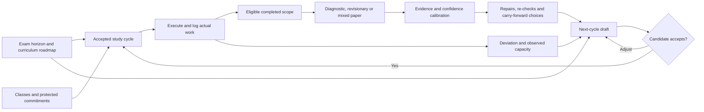
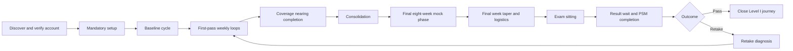

# Roadmap — End-to-End Enhancement and Candidate Lifecycle Programme

**Date:** 26 September 2026  
**Status:** Canonical product improvement proposal, to be reviewed before implementation  
**Scope:** Product logic, candidate experience, connected feature behavior, content operations, AI boundaries, quality, launch readiness and the complete CFA Level I lifecycle  
**Companion audit:** `docs/CURRENT-STATE-AUDIT-AND-END-TO-END-USER-FLOW-2026-09-26.md`

---

## 1. Why this document exists

Roadmap now contains most of the visible parts of a serious application: authentication, mandatory onboarding, Home, Calendar, Curriculum, Tests, results, weekly closure, Coach and Settings. The remaining challenge is not to add more disconnected pages. It is to make every part participate in one reliable operating system for a CFA Level I candidate.

This document establishes:

1. the product position Roadmap can credibly own;
2. the complete candidate journey from first setup to exam day and results;
3. the behavior of every customer-facing feature;
4. the phases in which the product should be corrected and expanded;
5. how the experience changes for self-study, class-led, hybrid, retaking, time-constrained and accelerated candidates;
6. the revision, mock and final-week systems that are currently missing;
7. the AI, question-bank, legal and operational work needed to make the promise trustworthy;
8. measurable release conditions so a polished interface cannot conceal a broken loop.

This is not a new PRD that replaces every earlier decision. It consolidates the current code audit, the founder decision register, the Pulse calendar plan, the diagnostic-engine specification, the effort model, the question-bank limits report and the latest Claude/Antigravity implementation context.

---

## 2. Context reconciliation: what is now canonical

The following decisions are treated as settled unless the founder explicitly changes them.

| Area | Canonical direction | Consequence |
|---|---|---|
| Product role | Roadmap plans, organises, tests, analyses and adapts; it does not teach the CFA curriculum | No lectures, chapter explanations or generic AI tutor behavior |
| Core dependency | The app works from its controlled 2027 curriculum intelligence | No source or material upload in the current product |
| Access | Verified identity first; onboarding is mandatory before `/app/*` | Onboarding is a setup gate, never a feasibility or worthiness gate |
| Self-study cycle | Monday–Saturday execution; Sunday paper and closure | Sunday is not automatically filled with new learning |
| Class-led cycle | Recurring classes define the cycle; paper sits before the next cycle | A generic Monday–Sunday week cannot be forced on these candidates |
| Paper type | New scope = diagnostic; revisited scope = revisionary; both = mixed with separate evidence semantics | Paper labels and analysis must reflect why each item was included |
| Test eligibility | Only completed, curriculum-mapped scope is eligible | Planned, opened or self-confident scope is not testable evidence |
| Weekly closure | Paper plus resolved/unknown logs produce a preview; the student accepts the next week | No permanent Weekly Review tab and no silent rollover |
| Preparation status | Four separate signals: curriculum position, demonstrated understanding, execution and confidence calibration | No opaque pass probability or vanity readiness percentage |
| Pressure | Calm, factual warnings with choices | Never deny access or shame a candidate because the plan is compressed |
| Coach | Explains state, identifies opportunities and proposes changes; the user confirms changes | The model never writes directly to the Calendar and never becomes a tutor |
| First week | A conservative baseline-calibration week | Week two must use observed behavior; one bad week must not permanently define capacity |
| Internal content operations | Review, verification and manifest tools belong behind staff authorization | No operations console in the student Tests experience |
| Current design work | Claude/Antigravity is actively overhauling shared dialogs and the visual system | Product-logic implementation should avoid conflicting parallel UI rewrites |

### Reconciliation of the effort model with “do not prescribe hours”

Roadmap still needs an internal estimate of remaining work. Without it, it cannot identify pressure, protect the final phase or compare alternatives. But an internal estimate is not a weekly study-hours command.

The product should therefore keep three quantities separate:

- **Remaining effort range:** an internal, curriculum-derived range that becomes more accurate with actual duration history.
- **Observed capacity range:** what the candidate has sustainably completed across recent comparable weeks.
- **Available placement windows:** the current week’s real calendar boundaries.

Roadmap may explain that the current target creates pressure and show why. It must not turn a generic 300-hour convention into a personal truth, pad tasks to reach a target or deny access. When the three quantities do not fit, the app offers choices: protect more time, reduce near-term scope, change sequencing, accept a compressed strategy or move the intended exam window.

---

## 3. Product thesis and defensible position

### The job Roadmap should own

> Roadmap tells a CFA Level I candidate what to do next, when it fits, why it matters, what the evidence says, and what must change when real life does not match the plan.

Roadmap is not a content library with a planner attached. It is a neutral learning-control layer that can sit above CFA Institute materials, a coaching institute, a third-party course or a candidate’s own study method.

### The closed loop

Every major page should either provide an input to this loop, show its current state or let the candidate resolve an exception. A feature that does none of these should not occupy primary navigation.

### What Roadmap must not claim as its unique advantage

“Personalized planning,” “adaptive study,” “question analytics,” “mock exams,” “weak-area identification” and “AI help” are already offered by established products. CFA Institute’s Learning Ecosystem includes a custom study planner, 1,000+ practice questions, progress support and official mocks; UWorld advertises a day-by-day planner that adjusts to performance plus LOS-level analytics; Kaplan combines weekly tasks, QBank, instruction and performance tracking; Salt offers a weekly pacer, quiz builder, analytics and a Learn-to-Focus phase. Sources: [CFA Institute Learning Ecosystem](https://www.cfainstitute.org/programs/cfa-program/learning-ecosystem), [UWorld Level I QBank and planner](https://finance.uworld.com/cfa/level-1/question-bank/), [Kaplan Schweser Level I packages](https://www.schweser.com/cfa/level-1/study-packages?pid=876000), [Salt Solutions products](https://west.saltsolutions.com/products/).

### The position Roadmap can build

Roadmap’s potential differentiation is the combination of:

- class-aware and self-study-aware operational cycles;
- calendar-level execution, not merely topic completion ticks;
- a paper whose scope is derived from what was actually completed;
- evidence that distinguishes accuracy, timing, confidence, coverage and freshness;
- repairs that return to the Calendar and later require re-checking;
- explainable deviation handling rather than a silent regenerated schedule;
- a Coach that changes the plan only through visible, confirmed proposals;
- long-range roadmap control without forcing the candidate to use Roadmap as the teacher;
- one auditable weekly contract from planned work to next-week acceptance.

This is a **potential moat**, not a current one. It becomes defensible only when the loop works reliably and accumulated longitudinal execution-and-evidence data improve the plan better than static rules can.

---

## 4. Practical competitive audit

### 4.1 What established products currently do better

| Capability | Market strength | Roadmap’s current position | Required response |
|---|---|---|---|
| Curriculum authority | CFA Institute owns the official curriculum, practice content and exam format | Roadmap has a structured 2027 spine but must not imply official authority | Maintain versioned curriculum mapping, visible provenance and clear non-affiliation |
| Question-bank scale | CFA Institute includes 1,000+ questions; FinQuiz advertises 3,800+; large providers have years of reviewed inventory | 262 approved items, concentrated in Ethics and FSA | Treat bank breadth, originality, review and calibration as a launch-critical content operation |
| Explanations and teaching | UWorld, Kaplan, Salt and coaching providers offer deep explanations, lectures and live support | Intentionally out of scope | Do not chase them; give precise learning-location guidance and method guidance instead |
| Mobile and offline access | Mature providers offer polished mobile use and, in some cases, offline study | Responsive web only | Make mobile execution, quick logging and paper continuity excellent before considering a native app |
| Mock inventory and exam simulation | Providers offer multiple full mocks and established interfaces | Mock lifecycle is incomplete | Support Roadmap mocks where licensed/original and external mock-result capture without copying content |
| Psychometric history | Mature banks have far more response data | Difficulty labels are authored, not calibrated | Collect item statistics, confidence/timing behavior and challenge outcomes; never market unvalidated readiness |
| Operational reliability | Mature products have billing, support, analytics, notifications and content release processes | Several are not built | Launch operations must be a planned phase, not an afterthought |

FinQuiz’s current official site, for example, advertises six mocks, a customizable timeline and a 3,800+ item bank. Roadmap should assume candidates can already buy abundant content and compete on coordination and evidence-to-action quality instead. Sources: [FinQuiz Level I](https://www.finquiz.com/cfa/level-1/), [FinQuiz question bank](https://www.finquiz.com/cfa/level-1/question-bank/).

### 4.2 Where Roadmap can be meaningfully better

| User problem poorly handled by content-first products | Roadmap opportunity |
|---|---|
| “My coaching class covered different material than the provider’s schedule.” | Log the real class, map coverage, generate consolidation work and move the cycle without corrupting history |
| “I completed less than planned, so the test scope and next week are now wrong.” | Build paper scope from completed mapped work and carry incomplete work through an explicit closure |
| “My score improved because I guessed confidently or repeated familiar questions.” | Separate accuracy, confidence, exposure, timing, freshness and item reuse |
| “The app tells me I am behind but not what trade-off to make.” | Explain the cause and offer bounded options with consequences |
| “The schedule constantly changes and I no longer trust it.” | Version drafts, show deltas, require acceptance and preserve an audit trail |
| “I use CFAI, a coaching institute and my own routine.” | Stay provider-neutral and coordinate execution without trying to replace all learning sources |
| “I finished the syllabus once, but the planner still behaves like first-pass study.” | Transition deliberately into consolidation, revision, mocks and tapering |
| “I missed a concept, reviewed it, and the app forgot to verify the repair.” | Maintain repair threads until a later independent re-check closes them |

### 4.3 Table stakes versus differentiation

**Table stakes before a paid launch**

- reliable authentication, recovery and mandatory onboarding;
- responsive, conflict-safe Calendar;
- complete 2027 curriculum mapping;
- sufficient reviewed question coverage for any scope the product promises to test;
- stable test-taking and challenge flows;
- revision and mock support;
- reminders, support, payments, privacy and deletion;
- real browser E2E coverage and observability.

**Differentiation to invest in**

- weekly evidence contract;
- class-aware cycle boundaries;
- explainable deviation and pressure engine;
- confidence calibration;
- repair lifecycle with re-checks;
- phase transitions driven by curriculum position and evidence, not dates alone;
- safe planning Coach with confirmed actions;
- eventually, empirically calibrated effort and risk models.

---

## 5. The complete candidate lifecycle

### Stage 0 — Before the first plan

The candidate should understand within one minute that Roadmap will not teach the curriculum. The promise is: connect an exam target, real weekly constraints, curriculum progress and testing into an adaptive execution plan.

The acquisition flow must show one realistic weekly loop, not a generic dashboard. A public read-only demo should show a seeded Calendar, a completed paper, its analysis and the resulting next-week proposal.

### Stage 1 — Mandatory onboarding and baseline setup

Onboarding captures only information needed to draft the first cycle:

- intended 2027 sitting: February, May, August or November;
- registered versus tentative; exact exam date only when booked or later in Settings;
- preparation route: self-study, live classes, self-paced course or hybrid;
- recurring class pattern and times where applicable;
- broad starting position and recently touched topics, explicitly marked self-reported;
- protected commitments and realistic study windows;
- maximum focused sitting length;
- minimal notification preference if delivery exists.

It does not ask for timezone, study materials, essays about motivation, a desired weekly-hour target or a readiness claim. The first plan preview states its assumptions and explains that week one is calibration.

### Stage 2 — Baseline cycle

Week one should be smaller and easier to recover than a mature plan. Its purpose is to observe:

- which study windows are actually used;
- how long comparable tasks take;
- how often work is started, completed, split, deferred or unreported;
- what classes actually cover;
- how the candidate performs under timed questions;
- whether confidence is calibrated;
- whether the candidate logs activity reliably.

At closure, Roadmap should say what it learned in plain language and what changed for cycle two. It must not label one difficult week as the candidate’s permanent capacity.

### Stage 3 — First curriculum pass

Each cycle repeats the closed loop:

1. accepted Calendar plan;
2. execution and class capture;
3. completed scope becomes paper-eligible;
4. diagnostic/revisionary/mixed paper;
5. evidence, SWOT-style interpretation and repairs;
6. missing logs resolved or marked unknown;
7. next-cycle preview and acceptance.

The long-range roadmap is a projection, not a promise. It changes when the candidate consistently moves faster or slower, classes change, the exam date changes, or repeated evidence suggests more consolidation is needed.

### Stage 4 — First-pass completion transition

“Syllabus complete once” must be a real state transition, not a 100% progress celebration. It occurs only when every in-scope learning outcome is at least exposed and required exceptions are explicitly classified. It does **not** mean the candidate has demonstrated mastery.

The transition page should show:

- outcomes exposed but never tested;
- weak or unstable outcomes;
- evidence that has gone stale;
- subjects with thin question coverage;
- time remaining before the final phase;
- proposed consolidation order.

### Stage 5 — Consolidation and revision

The planner changes from coverage acquisition to retrieval, mixed application and stability building:

- fewer long learning blocks;
- more spaced recall and timed question sets;
- revisionary papers weighted toward weak, stale and high-exam-weight scope;
- mixed-subject sessions to reduce context dependence;
- repair threads requiring later re-checks;
- periodic cumulative checks without exhausting the bank;
- continued Ethics rotation rather than a one-time block.

The system should choose revision targets using evidence need, not simply “oldest topic first.” Priority combines exam weight, evidence weakness, instability, staleness, prior exposure, unresolved repairs and bank sufficiency.

### Stage 6 — Final eight weeks

The official Learning Ecosystem releases two official mocks approximately 60 days before the exam, so Roadmap’s protected eight-week phase should coordinate—not replace—official practice. Roadmap can schedule those attempts and ingest the candidate’s manually entered section/topic results without reproducing official questions. Source: [CFA Institute Learning Ecosystem](https://www.cfainstitute.org/programs/cfa-program/learning-ecosystem).

The phase should operate as repeated **mock → analysis → repair → re-check → next mock** loops. A mock is useful only when its review and repairs can be completed before another full simulation.

Suggested default policy, always adapted to capacity and recovery:

| Period | Default intent | What Roadmap should schedule |
|---|---|---|
| Weeks 8–7 before exam | Establish full-syllabus baseline | One full mock or two-session equivalent; deep analysis; repair plan; no panic response to one score |
| Weeks 6–5 | Stabilise high-impact gaps | Targeted repair and mixed timed sets; next full mock only after prior analysis closes |
| Weeks 4–3 | Build exam pacing and cross-topic switching | Approximately one full simulation per cycle when capacity permits, plus pacing/error-type analysis |
| Week 2 | Confirm, do not overload | One final full simulation or split simulation if appropriate; focus on remaining high-impact instability and Ethics |
| Final week | Protect performance | No late heavy catch-up; short recall, selected re-checks, calculator/interface familiarity, sleep and logistics |

This is a default policy, not a mandated number of mocks. A candidate with a job, classes or fatigue may need fewer well-analysed mocks; a full-time candidate may handle more. The invariant is that every mock produces analysis and closed repair work.

### Stage 7 — Final week and exam readiness

The final-week experience should be a distinct mode:

- freeze large roadmap changes unless the candidate explicitly overrides;
- stop scheduling new large curriculum areas in the final days;
- surface only the highest-value unsettled items that can realistically improve;
- lower total cognitive load and protect sleep and logistics;
- provide an exam checklist, approved-calculator reminder, test-centre logistics and session pacing plan;
- show confidence as evidence-backed patterns, not motivational fiction;
- keep Coach responses calm and action-limited.

Roadmap should schedule the required Practical Skills Module separately from exam-tested study. CFA Institute states that the PSM is required before results are released and advises planning 10–20 hours. This belongs in the long-range roadmap but must never be counted as diagnostic scope. Source: [CFA Level I quick-start guide](https://www.cfainstitute.org/sites/default/files/docs/programs/cfa-program/cfa-program-quick-start-guide-level-1-cbt.pdf).

### Stage 8 — After the exam

The product should not abruptly end on exam day.

**While awaiting results**

- mark the sitting complete;
- preserve the plan, evidence and reflection without continuing exam-pressure notifications;
- track PSM completion if outstanding;
- let the candidate record an optional short post-exam reflection.

**If the candidate passes**

- close the Level I roadmap cleanly;
- export a personal preparation summary;
- retain or delete data according to preference and policy;
- offer a future Level II waitlist without pretending Level II is supported.

**If the candidate retakes**

- create a new exam attempt linked to, but not overwriting, the old one;
- ask what changed: result band if the user wishes to enter it, time away, curriculum year, new class plan and intended window;
- expire stale curriculum mappings where the syllabus changed;
- start with a broad retake diagnostic only where bank sufficiency supports it;
- reuse prior execution and evidence as context, never as unquestioned current mastery.

---

## 6. Candidate modes and how planning must differ

### 6.1 Self-study candidate

- Cycle: Monday–Saturday study, Sunday paper and closure.
- Roadmap owns topic sequencing.
- New scope is introduced according to prerequisites, weight and remaining horizon.
- Saturday should contain consolidation and paper preparation rather than a desperate overflow by default.
- Missed work is considered during Sunday closure and carried only after explicit consequence preview.

### 6.2 Weekend coaching candidate

Example: classes Saturday and Sunday.

- Cycle starts with the first weekend class and closes before the next class cycle; the paper is normally Friday.
- The student logs what was actually covered after each class.
- Monday–Thursday consolidates class material, adds retrieval and closes repairs.
- Friday verifies eligible completed scope.
- Roadmap does not independently race ahead of the coaching sequence unless the candidate explicitly enables supplemental self-study.

### 6.3 Weekday class candidate

Example: classes Tuesday and Thursday.

- The deterministic longest-gap rule defines the cycle, in this example Tuesday–Monday.
- Work after Tuesday consolidates the first class; work after Thursday integrates the second.
- The paper closes the cycle before the next Tuesday class.
- A moved or cancelled class creates a visible recalculation proposal; history remains unchanged.

### 6.4 Hybrid candidate

- Coaching/class coverage remains one input, not the entire roadmap.
- Roadmap maintains a separate self-study lane for uncovered scope.
- The paper distinguishes newly learned class scope, new self-study scope and revisionary scope.
- Duplicate learning tasks are avoided when both lanes cover the same outcome.

### 6.5 Variable or irregular classes

- The recurring template may be absent or incomplete.
- The candidate adds, moves or cancels real classes in Calendar.
- Roadmap derives the upcoming boundary only from confirmed class events and shows the proposal.
- It never guesses a recurring schedule from a single event.

### 6.6 Full-time employee or constrained candidate

- Prefer shorter, protected sessions on workdays and longer windows only where the candidate has actually shown they can use them.
- Do not punish an unavailable weekday by stacking the same volume on the next evening.
- Offer a minimum viable cycle that preserves continuity, paper scope quality and one recovery buffer.
- Pressure warnings show trade-offs rather than “you must study 20 hours.”

### 6.7 Student or flexible-schedule candidate

- Flexibility does not automatically mean unlimited capacity.
- Use more day-preferred tasks and allow the candidate to pull work forward.
- Accelerated completion updates the long-range projection; it does not create filler work.
- Extra capacity should first improve verification density and consolidation, not inflate new-content volume without evidence.

### 6.8 Retaker

- Begin with prior-exposure mapping and evidence refresh rather than a complete beginner schedule.
- Use revisionary and diagnostic papers carefully: previously studied material is revisionary, but genuinely changed/new 2027 scope is diagnostic.
- Give more weight to method errors, pacing, confidence mismatch and repeated failure patterns.
- Do not assume the prior attempt’s scores are current.

### 6.9 Late-start or compressed candidate

- Never deny access.
- State that the full ideal sequence may not fit and show the assumptions.
- Protect a smaller final mock window only with explicit trade-off if eight weeks are no longer available.
- Prioritise foundational dependencies, high-weight scope, Ethics continuity and evidence collection.
- Offer a “compressed strategy” badge as a plan condition, not a judgment about the person.

### 6.10 Faster-than-plan candidate

- Pull the roadmap projection forward after repeated evidence, not one productive day.
- Increase mixed practice, spaced retrieval and verification before simply adding new scope.
- Preserve recovery time and final-phase quality.
- Let the candidate accept an accelerated proposal; do not silently fill every empty window.

---

## 7. Feature-by-feature target state

### 7.1 Landing, authentication and access

**User job:** Understand the product, create a trustworthy account and recover access without confusion.

**Fixes and improvements**

- Replace feature-list marketing with one clear loop demo: plan → do → paper → evidence → adapted week.
- Clearly state “works with your classes or self-study” and “does not replace your teacher or curriculum.”
- Provide a read-only sandbox with no production writes.
- Verify email before onboarding; preserve a safe intended destination after sign-in.
- Complete password reset, expired-link, OAuth cancellation, account-linking and deletion flows.
- Add a future paywall boundary without mixing payment status into onboarding completion.
- Remove any development preview link that creates an authentication loop.

**Connections:** `/`, `/signup`, `/login`, `/auth/confirm`, `/auth/callback`, `/forgot-password`, `/update-password`, `/auth/error`, `/terms`, `/privacy`, public demo route.

**Done when:** fresh, returning, expired-link and OAuth users each reach the correct state in browser E2E tests with no manual database intervention.

### 7.2 Onboarding

**User job:** Give Roadmap enough context to draft a safe first cycle with minimal effort.

**Fixes and improvements**

- Keep the six-step structure but use selection, calendar gestures and templates rather than free text.
- Offer the four 2027 windows and distinguish tentative month from booked exact date.
- Derive the class-cycle boundary and explain it; do not ask the candidate to invent a checkpoint day.
- Show why each availability input matters.
- Treat position and recency as self-report, not mastery.
- Produce an assumption summary before activation.
- Activate roadmap, cycle and first blocks atomically and idempotently.
- When activation fails, preserve answers and show retry/support diagnostics—not a false empty Home.

**Connections:** `/onboarding/exam`, `/onboarding/route`, `/onboarding/position`, `/onboarding/week`, `/onboarding/checkpoint`, `/onboarding/plan`, Settings edit routes, first Calendar cycle.

**Done when:** every saved input has a named downstream consumer and changing it later triggers an explainable proposal rather than silent historical rewrites.

### 7.3 Home

**User job:** Know what to do now, what requires a decision and whether the plan is behaving honestly.

**Fixes and improvements**

- Make the next action authoritative and deterministic.
- Show today’s ordered sequence and a compact quick-log control.
- Surface paper, closure, pending plan acceptance and blocked integrity states before low-priority analytics.
- Show the four preparation signals with scope and freshness.
- Replace placeholder milestone/projection/trajectory values with real state or an explicit unavailable label.
- Explain every pressure warning and link directly to the resolution surface.
- Show one contextual Coach entry, not an open-ended “ask anything” prompt.

**Connections:** `/app`, task action endpoints, `/app/calendar`, `/app/tests`, `/app/review-week`, `/app/curriculum`, `/app/coach`.

**Done when:** for every supported operating state, Home has exactly one valid primary next action and never fabricates zeroes or readiness.

### 7.4 Calendar

**User job:** See, execute and safely adjust this cycle in the context of real life.

**Fixes and improvements**

- Mobile day, tablet three-day, desktop seven-day, agenda everywhere.
- Display class, protected commitment, study, practice, repair, re-check, paper and mock blocks distinctly without visual noise.
- Keep floating work visible without horizontal searching.
- Add class, move/cancel class, add commitment and quick-log learning from Calendar.
- Support start, pause, complete, partial, split, move, defer, skip and mark unknown with reason where needed.
- Detect conflicts before confirmation.
- Version every accepted plan and preserve prior states.
- Feed completion into both execution history and curriculum exposure; remove competing truths.
- Learn duration ranges only after enough comparable observations.
- Never create tests during a page render.

**Connections:** `/app/calendar`, `/app/calendar/log-class`, task/commitment/class APIs, Curriculum coverage, Tests scope, weekly closure and Coach proposals.

**Done when:** any Calendar action produces the expected downstream state exactly once and a page refresh shows the same truth.

### 7.5 Curriculum

**User job:** Understand where they are in the syllabus and record real learning without being taught by the app.

**Fixes and improvements**

- Keep progressive drill-down: subject → reading → outcome/LOS.
- Show four different ideas separately: exposure, practice, demonstrated evidence and confidence.
- Mark learning from Curriculum or the quick Home/Calendar capture using the same canonical service.
- Show source-agnostic method guidance: read, retrieve, solve, compare, revisit—not lesson content.
- Display evidence count, freshness and coverage gaps.
- Provide notes/flashcards only as candidate-owned tools; they do not prove mastery.
- Transition to consolidation only through a defined coverage rule.
- Version the curriculum by exam year and flag changed scope.

**Connections:** `/app/curriculum`, `/app/curriculum/[subject]`, `/app/curriculum/[subject]/[reading]`, flashcards, quick capture, Tests, roadmap and Coach.

**Done when:** a completed mapped task and a manual curriculum log create the same exposure truth and never double-count it.

### 7.6 Tests index and assembly

**User job:** Take the right verification at the right time and understand why it exists.

**Fixes and improvements**

- Separate weekly paper, reading diagnostic, subject diagnostic, repair re-check and full mock.
- Make weekly scope immutable at paper generation time and show its source.
- Weight questions by eligible scope, exam weight and scope size while maximising outcome coverage.
- Require a confidence response per question and capture response time.
- Cap every paper at 90 questions; use sections when mixed semantics require it.
- Use unseen, approved items where possible and disclose when controlled reuse occurs.
- Refuse unsupported assembly honestly and provide a practice-only or external-check fallback.
- Remove all staff review/generation links from the student product.
- Add resume, interruption recovery and clear timing rules.

**Connections:** `/app/tests`, `/app/tests/[paper]`, `/app/tests/[paper]/attempt`, Calendar paper block, Curriculum scope, question bank and result analysis.

**Done when:** a test manifest can always answer which outcomes were eligible, why each item was selected, whether it was seen before and which quality gates it passed.

### 7.7 Results, SWOT and evidence

**User job:** Understand what the paper changed and what will happen next.

**Fixes and improvements**

- Score and write evidence atomically.
- Show accuracy, time, confidence and coverage before interpretation.
- Implement SWOT carefully:
  - strengths = directly supported outcomes from correct evidence;
  - weaknesses = missed outcomes and diagnosed error types;
  - opportunities = adjacent or prerequisite outcomes where supported relationships exist;
  - threats = unresolved, high-impact or repeatedly unstable outcomes—not arbitrary “correlations.”
- Never infer an adjacent topic relationship unless the curriculum graph explicitly defines it.
- Distinguish high-confidence wrong, low-confidence right, high-confidence right and low-confidence wrong.
- Open or update one repair thread per concept; do not multiply duplicates.
- Challenged/invalid items must void their evidence and cancel dependent repairs with an audit trail.
- Link each action to Calendar, Curriculum history or Coach explanation.

**Connections:** result route, evidence events, concept summaries, repair threads, Calendar proposals, weekly closure, Home signals and Coach.

**Done when:** challenging one item recomputes every affected view consistently and a repeated miss updates one repair lifecycle rather than creating duplicates.

### 7.8 Weekly closure

**User job:** Reconcile the week honestly and approve the next one.

**Fixes and improvements**

- Open contextually after the weekly paper; do not add a permanent navigation tab.
- Require every due block and class to be completed, skipped, deferred or unknown before final generation.
- Show planned versus actual, without moral language.
- Explain carried, dropped, repaired, re-checked and newly planned work.
- Generate a preview only after resolutions are final; invalidate an old preview when inputs change.
- Use a fingerprint/idempotency key and atomic acceptance.
- Feed rolling completion and actual-duration history into the next composer.
- Distinguish one-off disruption from repeated capacity mismatch.

**Connections:** `/app/review-week`, paper result, Calendar logs, observed capacity, repair threads, roadmap projection, next plan draft and Home.

**Done when:** accepting twice cannot duplicate a cycle or blocks, and the preview exactly matches the accepted plan.

### 7.9 Coach

**User job:** Ask “what should I do about my plan?” and receive a grounded, bounded answer.

**Fixes and improvements**

- Build responses from a server-produced evidence pack, not unrestricted conversation memory.
- Support intents: explain next action, explain signal, analyse weak areas, analyse SWOT, recover a missed block, move a class, reduce pressure, accelerate carefully, plan a repair, prepare for a mock and interpret a deviation.
- Point to subject/reading/outcome and learning method, not provide curriculum lessons.
- Return typed proposals; deterministic code validates conflicts and consequences.
- Require confirmation before Calendar mutation.
- Save proposal, decision and outcome for audit and later evaluation.
- Add adversarial tests for teaching requests, hallucinated citations, pass predictions and silent plan changes.
- Expand action types gradually; do not give the model general database tools.

**Connections:** `/app/coach`, Operating State, Calendar proposal API, Curriculum identifiers, evidence summaries and result pages.

**Done when:** every Coach claim is grounded in the supplied state, every mutation is previewed, and every unsupported teaching request is redirected helpfully.

### 7.10 Settings, notifications and account controls

**User job:** Update real-life facts without damaging plan history.

**Fixes and improvements**

- Edit exam window/date, route, class pattern, commitments, session length and notification preferences.
- Preview roadmap and Calendar consequences before accepting a material change.
- Support calendar export first; two-way calendar sync only after conflict ownership is defined.
- Deliver reminders for upcoming protected blocks, unreported work, paper due and closure—not generic streak pressure.
- Add data export, conversation deletion and account deletion.
- Show plan/curriculum version and last successful sync for support.

**Connections:** `/app/settings`, onboarding-derived profile, roadmap recalculation, Calendar, notification worker and legal/privacy controls.

**Done when:** a changed exam date or class pattern produces one understandable proposal and never rewrites historical weeks.

### 7.11 Internal curriculum and question operations

**User job served indirectly:** Receive original, relevant, correct and sufficiently varied tests.

**Fixes and improvements**

- Separate internal role-protected routes from the student app.
- Maintain a versioned 2027 curriculum graph with prerequisite/adjacency relationships.
- Use source hierarchy: official LOS/curriculum/errata first; Schweser only as rights-cleared internal guidance, never copied output.
- Blueprint before generation; generator cannot approve its own work.
- Run independent conceptual solver, deterministic numeric solver, overlap/originality checks and human review.
- Maintain gold and known-wrong evaluation sets.
- Calibrate difficulty from live response data only after minimum sample thresholds.
- Track exposure and enforce reuse policy.
- Expand bank by actual product sequence, not raw item-count vanity.

**Done when:** every live item has provenance, blueprint role, independent verification, human approval, version, exposure history and challenge lifecycle.

---

## 8. Phase-by-phase enhancement programme

### Phase 0 — Freeze truth and establish release evidence

**Goal:** Stop further surface expansion until the current app has one state model, a recoverable history and real browser verification.

**Work**

- Put the project under version control and create a known-good baseline.
- Designate canonical ownership for profile, roadmap, cycle, blocks, curriculum exposure, evidence, repairs and Coach proposals.
- Remove or adapt duplicate legacy state and placeholder producers.
- Make the route/state matrix executable as contract tests.
- Install browser test runtime and replace placeholder Playwright tests.
- Add production-safe error tracking, request correlation and health checks.
- Publish database migration/seed/runbook and use a separate test environment where possible.
- Record Claude/Antigravity’s active design-system scope to avoid parallel file conflicts.

**Exit criteria**

- no page render mutates business state;
- all supported routes pass desktop and mobile smoke tests;
- errors can be traced across request, user, cycle, paper and proposal;
- state ownership has no known competing truth.

### Phase 1 — Make onboarding produce a trustworthy baseline

**Goal:** Turn minimal setup into a fully connected first-cycle activation.

**Work**

- Complete exam-window/date behavior and stale-date cleanup.
- Complete deterministic class-cycle boundary logic, including mixed and irregular cases.
- Ensure availability/commitments and session limits flow into the composer.
- Label all starting-position data self-reported.
- Produce an assumption summary and conservative baseline cycle.
- Make activation atomic, idempotent and recoverable.
- Add E2E matrices for self-study, weekend classes, weekday classes, hybrid and tentative exam date.

**Exit criteria**

- every onboarding answer is consumed;
- no answer is collected only for display;
- first plan activation cannot partially succeed;
- week-one purpose is visible to the candidate.

### Phase 2 — Repair the Calendar-to-Curriculum-to-Test spine

**Goal:** One action creates one consistent truth everywhere.

**Work**

- Make block completion update canonical curriculum exposure exactly once.
- Unify manual learning capture with Calendar completion.
- Finalise class logging, mapping certainty and class-generated consolidation preview.
- Complete conflict, partial, split, move, defer, skip and unknown flows.
- Ensure completed eligible scope alone feeds the weekly paper.
- Feed real prior completion and duration history into cycle planning.
- Complete responsive Calendar and agenda behavior after the active design-system migration settles.

**Exit criteria**

- completing, reopening or invalidating a mapped block updates Calendar, Curriculum, paper scope and Home correctly;
- refresh and concurrent action tests do not duplicate events;
- no test contains unfinished scope.

### Phase 3 — Make the diagnostic engine launch-worthy

**Goal:** Transform the strongest product idea into a safe, scalable content and evidence system.

**Work**

- Finish bank policy and minimum coverage thresholds by outcome.
- Add second independent solver and known-wrong regression set.
- Fix verifier blind spots and numeric reserved-word failures.
- Build reviewer workflow, staff authorization and content-release manifests.
- Expand beyond Ethics/FSA in curriculum sequence; target at least 8–12 approved variants for core outcomes before promising repeated diagnostics.
- Implement controlled re-serve only after a defined gap and disclose it in the manifest.
- Finish attempt interruption/resume, mandatory confidence and time capture.
- Make challenge invalidation transactional across score, evidence and repairs.

**Exit criteria**

- any advertised paper scope has sufficient approved inventory;
- no unreviewed item reaches a student;
- bank exhaustion fails honestly;
- item selection is reproducible from its manifest;
- the full paper/result/challenge loop passes browser tests.

### Phase 4 — Close the weekly adaptation loop

**Goal:** Make week two genuinely more informed than week one.

**Work**

- Complete weekly closure gating and stale-preview invalidation.
- Build rolling observed-capacity logic with outlier handling.
- Use execution, paper evidence and repair priority in next-week generation.
- Add calm pressure states with explicit choices and consequence previews.
- Deduplicate repairs and keep them open until re-checked.
- Update long-range projections from repeated pace changes.
- Surface the closure and draft acceptance correctly on Home.

**Exit criteria**

- a missed week, accelerated week and normal week produce materially different, explainable next cycles;
- plan acceptance is atomic and idempotent;
- historical cycles never move.

### Phase 5 — Build the post-first-pass revision system

**Goal:** Stop treating all preparation as new-content completion.

**Work**

- Define the first-pass completion state and transition experience.
- Add evidence freshness and staleness.
- Build revision priority from exam weight, weakness, instability, staleness, unresolved repair and bank sufficiency.
- Schedule mixed retrieval, revisionary papers, cumulative checks and Ethics rotation.
- Protect question-bank inventory from unnecessary repetition.
- Show why a topic returns to the Calendar.

**Exit criteria**

- a candidate with 100% exposure receives a revision plan, not an empty or repeated learning plan;
- every scheduled revision block has a reason and intended verification;
- correct-but-low-confidence outcomes are not treated the same as stable evidence.

### Phase 6 — Build mocks, final eight weeks and exam week

**Goal:** Deliver a different operating mode for final preparation.

**Work**

- Add mock scheduling, two-session support, interruption rules and external mock-result capture.
- Add mock-analysis workflow: subject, outcome where available, timing, confidence, error type and stamina.
- Convert analysis into bounded repairs and re-checks before another mock.
- Add pacing trend and repeated-error views without pass probability.
- Implement tapering, final-week freeze and exam logistics checklist.
- Schedule PSM independently from exam-tested scope.
- Add exam-sitting completion and notification shutdown.

**Exit criteria**

- the final phase never becomes empty;
- a mock always has analysis and repair capacity reserved;
- final-week behavior is calmer and lighter than ordinary cycles;
- Roadmap supports official/external mocks without copying their content.

### Phase 7 — Complete the Coach as a controlled planning interface

**Goal:** Let candidates operate the system conversationally without surrendering truth or control.

**Work**

- Expand the evidence pack and supported intents.
- Add typed proposals for move/split/defer, class change, pressure reduction, repair scheduling and mock recovery.
- Add deterministic validation and preview for each proposal.
- Build prompt/evaluation suites from owned examples, including refusal/redirect cases.
- Measure groundedness, action validity, confirmation compliance and user correction rate.
- Fine-tune only after a large, reviewed, rights-cleared corpus and benchmark demonstrate an advantage over retrieval plus prompting.

**Exit criteria**

- the Coach cannot teach, predict a pass or mutate silently;
- every accepted proposal is auditable and reversible;
- evaluation thresholds gate prompt/model releases.

### Phase 8 — Convenience, launch and commercial readiness

**Goal:** Make the product viable for real Indian candidates, not just functionally impressive.

**Work**

- Product analytics based on funnel and loop completion, not screen views alone.
- Notifications and reliable delivery controls.
- Calendar export and, later, carefully scoped sync.
- Subscription/paywall, trial, invoices, failed payment and entitlement handling.
- Support console, data correction and content-incident response.
- Legal review for India and intended markets; privacy, terms, cookies, AI limitations, deletion and CFA non-affiliation.
- CFA Institute Prep Provider strategy and content-rights review.
- Performance, accessibility and mobile QA.

**Exit criteria**

- a real candidate can pay, use, recover, get support, export/delete data and complete the lifecycle safely;
- core loop and bank health are visible to the team daily;
- legal and content claims match actual operation.

### Phase 9 — Empirical adaptation and expansion

**Goal:** Turn longitudinal data into defensible product intelligence.

**Work only after sufficient data exists**

- calibrate task effort by subject, task type and candidate history;
- estimate item difficulty and discrimination;
- identify sustainable capacity ranges and disruption recovery patterns;
- improve revision interval selection;
- compare proposed versus accepted versus successful reschedules;
- extend to later CFA levels or other exams only with separate curriculum, assessment and lifecycle validation.

**Rule:** Do not call a heuristic “machine learning” and do not deploy predictive readiness claims before outcome-linked evaluation, bias review and calibration.

---

## 9. Cross-feature state and connection contract

| Event | Authoritative write | Required downstream effect | Must never happen |
|---|---|---|---|
| Onboarding completed | profile + roadmap + first cycle transaction | Calendar opens with baseline plan; Home shows valid next action | partial activation or fabricated dashboard |
| Study block completed | execution event + curriculum exposure transition | eligible scope updates; Home execution updates; closure sees completion | test evidence created merely from completion |
| Class logged | class event + confirmed/uncertain curriculum mapping | consolidation proposal; cycle recalculation if timing changed | silent mapping or silent Calendar mutation |
| Paper generated | immutable paper manifest | paper block and Tests agree on scope | adding unfinished scope after generation |
| Answer submitted | response with item/version, time and confidence | attempt can resume; no evidence until final scoring | losing progress on refresh |
| Paper submitted | transactional score + evidence + repair update | Home, Curriculum, Results and closure agree | split-brain score and evidence |
| Item challenged successfully | evidence void transaction | score recomputed; dependent repair cancelled/updated visibly | deleting history without explanation |
| Weekly closure resolved | resolution set + next draft fingerprint | exact preview shown | preview generated from stale logs |
| Draft accepted | atomic new cycle and blocks | Calendar and Home switch once | duplicate cycles on repeat click |
| Coach change confirmed | proposal execution record | validated Calendar mutation and audit trail | model writes database directly |
| Exam date changed | new profile fact + roadmap proposal | future cycles/projection update after acceptance | rewriting completed history |

---

## 10. AI and model strategy

### What to build now

- retrieval from a verified curriculum registry;
- deterministic planning and state reducers;
- structured model outputs with schemas;
- independent item verification and numeric execution;
- human review;
- prompt regression sets and adversarial evaluation;
- model/version logging;
- safe fallbacks when the model is unavailable.

### What not to build yet

- a general tutor trained on uploaded books;
- fine-tuning before owned training/evaluation data exists;
- autonomous Calendar-writing agents;
- pass-probability prediction;
- difficulty calibration without response volume;
- recommendations trained on outcomes without checking survivorship and selection bias.

### Rights and provenance

The 2027 curriculum changed materially in Quantitative Methods and Equity Investments, so curriculum versioning cannot be treated as static. Source: [CFA Institute 2027 curriculum announcement](https://www.cfainstitute.org/about/press-room/2026/cfa-institute-announces-updates-to-cfa-program-curriculum).

Roadmap should pursue appropriate licensing/Prep Provider guidance before launch. Internal access to Schweser does not grant the right to reproduce its wording, examples, questions or derived close paraphrases. Live questions and guidance must be original, mapped and reviewable. CFA Institute’s Prep Provider program and trademark/copyright conditions should be treated as a commercial workstream, not merely an engineering disclaimer: [CFA Institute Prep Provider program](https://www.cfainstitute.org/programs/cfa-program/prep-providers/prep-provider-program).

---

## 11. Convenience principles for the user experience

1. **Ask once, infer carefully, confirm consequences.** Do not repeatedly ask for data the system already has.
2. **Default to the next action.** Do not make the candidate interpret five dashboards before studying.
3. **Keep edits where reality changes.** Classes and commitments belong in Calendar; exam facts belong in Settings.
4. **Make logging faster than forgetting.** A completed session should be recordable in a few taps, with deeper detail optional.
5. **Never hide uncertainty.** Unknown execution, uncertain mapping and insufficient bank coverage are valid states.
6. **Do not reschedule silently.** Show what moved, why and what it displaced.
7. **Use pressure, not panic.** Describe the plan constraint and available choices.
8. **Explain why work returned.** Every revision or repair block should name its evidence source.
9. **Protect recovery.** A missed week should create a recoverable plan, not an impossible pile-up.
10. **Change modes visibly.** First pass, consolidation, final eight weeks and final week should feel operationally different.
11. **Never confuse activity with knowledge.** Completion affects exposure and execution; valid questions affect demonstrated understanding.
12. **Do not manufacture confidence.** Show evidence, patterns and limits.

---

## 12. Metrics that measure whether the product works

### Core loop metrics

- verified signup → onboarding completion;
- onboarding completion → first-cycle activation;
- accepted blocks with a final status;
- completed mapped scope successfully included in the correct paper;
- weekly paper completion;
- closure completion and next-cycle acceptance;
- repair threads later re-checked and closed;
- percentage of next-cycle changes explained and accepted;
- time from real-life deviation to a stable accepted plan.

### Evidence-quality metrics

- approved unseen items available per active outcome;
- paper blueprint coverage and reuse rate;
- challenged item rate and upheld-challenge rate;
- confidence calibration over time;
- timing outliers by outcome and task type;
- evidence freshness and subject breadth;
- item difficulty stability after adequate samples.

### User-value metrics

- candidate can identify the next action without navigation;
- reduction in unreported blocks over the first four cycles;
- reduction in repeatedly deferred work;
- proportion of mocks with completed analysis and repairs;
- candidate-reported reduction in planning effort and panic;
- retention through first-pass completion and final-eight-week transition.

### Guardrail metrics

- no unsupported paper assembly;
- no unapproved item served;
- no silent Coach mutation;
- no duplicate cycle after retry;
- no false mastery from activity logs;
- no readiness/pass claim without validated model support;
- no private material/content leakage.

---

## 13. What to remove, defer or refuse

### Remove from the current customer experience

- Sources/Materials navigation and onboarding inputs;
- internal item-review and generation operations;
- generic readiness rings and false precision;
- dead routes and “coming soon” surfaces that interrupt the core loop;
- generic chatbot prompts suggesting curriculum teaching;
- automatic mutations triggered by viewing a page.

### Defer until the core loop is proven

- user material upload;
- native mobile apps;
- peer comparison and social features;
- elaborate streaks, points and gamification;
- two-way external calendar sync;
- multi-exam expansion;
- predictive pass probability;
- broad fine-tuning programmes.

### Refuse as product policy

- copied or closely paraphrased proprietary questions;
- unreviewed AI questions in live papers;
- access denial based on feasibility;
- shaming language;
- silent rescheduling;
- treating confidence, notes or hours as mastery;
- presenting AI output as official CFA Institute guidance.

---

## 14. Recommended implementation order from the current build

The next work should follow dependency, not page order:

1. **Phase 0 truth and browser evidence.** Version control, canonical state, real E2E and observability.
2. **Calendar/Curriculum execution spine.** Fix the current broken truth transition.
3. **Weekly adaptation.** Make history affect the next plan.
4. **Question-bank safety and breadth.** Do not promise tests beyond supported subjects.
5. **Revision state and final-eight-week engine.** Complete the lifecycle before polishing more dashboards.
6. **Home and Calendar experience refinement.** Use the now-real states to drive the design.
7. **Coach expansion.** Add action types only after their deterministic services exist.
8. **Launch operations.** Payments, support, notifications, legal and analytics.

This order deliberately avoids another full visual rebuild over incomplete logic. The active Claude/Antigravity design work can continue at the shared component level, but each page should be considered finished only when its state transitions and downstream effects pass browser tests.

---

## 15. Decisions recommended now

These recommendations close remaining product ambiguity without blocking the programme:

1. **External mocks:** allow manual topic/section score, timing and confidence import; do not ask users to upload protected question papers.
2. **Roadmap mocks:** offer only where an original, reviewed and sufficiently broad bank supports a valid 180-question simulation.
3. **Revision frequency:** evidence-driven, with minimum subject rotation guardrails; do not use a fixed “review every X days” rule for every outcome.
4. **Final eight weeks:** protect by default, but permit an explicit compressed-plan trade-off for late starters.
5. **PSM:** track as a non-exam requirement in the roadmap, never in preparedness evidence.
6. **Notifications:** begin with block reminders, unreported work, paper due and closure ready; avoid motivational spam.
7. **Calendar integration:** ship one-way ICS export before any two-way sync.
8. **Preparedness language:** retain the four signals; introduce a plain-language band only after multi-subject, multi-paper evidence thresholds are calibrated.
9. **Question-bank target:** keep 20,000 as a long-term content ambition, not a launch headline. Launch coverage should be measured by approved variants per outcome and sustainable paper assembly.
10. **Commercial position:** sell Roadmap as the execution and accountability layer that works with the candidate’s chosen learning source—not as another coaching institute or content bundle.

---

## 16. Definition of the first genuinely complete version

Version 1 is not complete merely because every sidebar tab renders. It is complete when a real candidate can:

1. verify an account and complete minimal onboarding;
2. receive and understand a conservative baseline cycle;
3. log classes and real study from Calendar or Curriculum;
4. see completed mapped scope become eligible for the correct paper;
5. take a timed, quality-controlled paper with confidence capture;
6. receive consistent evidence, SWOT interpretation and non-duplicated repairs;
7. reconcile missing logs and accept an explainable next cycle;
8. experience a plan that adapts from observed history;
9. finish first-pass coverage and move into a materially different revision mode;
10. enter an eight-week mock-and-repair phase;
11. receive a calm, limited final-week plan and exam checklist;
12. close or restart the journey after the result;
13. complete all of this without Roadmap teaching the curriculum, fabricating evidence or changing the plan without consent.

That is the product Roadmap should build. Everything else is secondary until this lifecycle is trustworthy.

