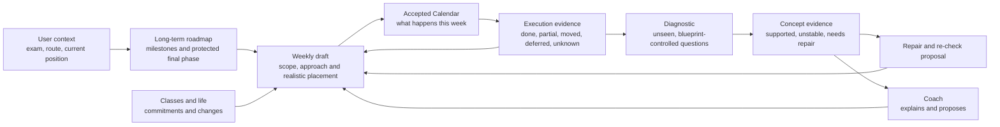
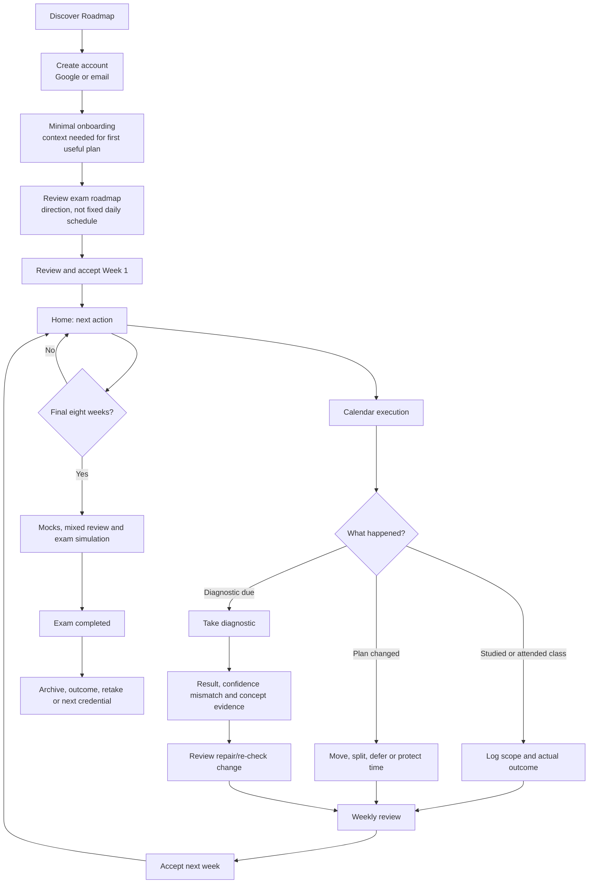

# Roadmap: end-to-end product system blueprint

**Scope:** CFA Level I candidates from 2027 onward  
**Purpose:** the non-technical and product source of truth for what Roadmap is, how every major feature connects, and how the experience continues from first setup through the exam

## Context reconciled for this blueprint

This document reconciles the current repository, the founder vision, the existing Calendar system plan, the latest diagnostic build/status documents, the rendered localhost journey, and the recent locally stored Antigravity/Claude project session. That recent session adds an important update: Calendar Editing is actively being built around optimistic revision checks, protected-conflict refusal, alternative slots, weekly recurring commitments with one-off exceptions, scope-preserving task splits, task history and keyboard equivalents for drag actions. Those are retained here as required behaviors, but they are not treated as finished until the post-change browser regression passes.

Claude Desktop itself required a fresh sign-in during this review. No account settings were changed. Relevant project-session records stored locally were reviewed instead; unrelated personal conversations were not used.

## The product in one sentence

Roadmap is an evidence-led study operating system that turns a candidate's exam path, classes, real-life constraints and diagnostic results into a realistic weekly plan—and keeps repairing that plan as reality changes.

It is not a PDF chat app, a content library, a prep provider or a generic calendar. Its answer is not “here is the chapter.” Its answer is “here is what to work on next, where to learn it, when it fits, why it matters, and how a later diagnostic will prove whether it held.”

## The core promise

The user buys relief from four recurring uncertainties:

- What should I study now?
- How should I approach it?
- How do I fit it around classes, college, work and life?
- How do I know whether I actually understand it?

Roadmap answers those questions through a continuous loop, not a one-time timetable.

## Three planning horizons

### 1. Exam roadmap

This is strategic, not an hourly nine-month calendar. It maps the candidate from today to one of the February, May, August or November sittings.

- First-pass learning or class coverage.
- Consolidation and cumulative retrieval.
- Revision and mixed practice.
- Final eight weeks reserved for mocks, exam simulation and targeted repair when the available horizon permits.

For a nine-month self-studier, the initial projection should aim to finish first-pass scope within roughly seven months, leaving the final two months protected. This is a projection, not a guarantee. If evidence or execution shows a different pace, Roadmap redraws milestones and explains the trade-off.

### 2. Weekly plan

This is the commitment unit. Roadmap uses the near-term roadmap milestone, expected class coverage, protected commitments, confirmed windows, incomplete work and current diagnostic evidence to propose one week.

The student reviews and accepts it. Roadmap does not fill every free minute. It may leave work day-preferred or floating when no exact window is known.

### 3. Execution

This is what actually happened today: started, partial, completed, moved, skipped, deferred or unreported. Actual behavior updates future estimates and plans. It does not become a moral score.

## End-to-end student journey

## Page system

### Authentication and onboarding

Collect only what changes the first roadmap and first weekly draft:

- target sitting: February, May, August, November, with year and tentative/registered status;
- route: self-study, coaching-led or hybrid;
- current position by topic/module: not started, learning, completed once, revising, uncertain;
- classes and expected coverage where known;
- protected recurring commitments and next-week exceptions;
- exact available windows where the user is confident, plus maximum comfortable sitting length;
- immediate changes or special constraints for the coming week;
- preferred weekly review/diagnostic day and a genuinely available window;
- optional source names or pointers, without upload.

Onboarding never rejects access and never assigns a permanent study-hours target. If the timeline is compressed, Roadmap states the trade-offs honestly and still lets the user proceed.

### Home

The operating console: next action, today's sequence, urgent decisions, this week's execution, evidence changes and roadmap trajectory. Its complete specification is in `HOME-PAGE-END-TO-END-BUILD-SPEC.md`.

### Calendar

The accepted truth for one week:

- Week view on desktop and Agenda view on mobile.
- Timed, day-preferred and floating tasks.
- Protected life commitments and classes.
- Drag/move, resize, split, partial, complete, defer, skip and undo.
- Conflicts with protected time are refused; valid alternatives are offered.
- Recurring commitments support one-off cancellations and moves.
- Draft differences are previewed before changing an accepted week.
- Each task explains scope, why now, how to approach it, source pointer and what done means.

The Calendar is not the long-term syllabus plan. It executes only the active week.

### Curriculum Roadmap

Replace “Syllabus completion” with an evidence-aware curriculum graph:

- topic → learning module → concept/LOS relationships;
- prerequisites and connected concepts;
- exposure, practice evidence, recency and confidence shown separately;
- current milestone and projected ranges;
- class coverage and self-study coverage;
- open repair threads and next verification;
- source pointers where the system has a verified mapping.

A checkbox cannot make a topic “complete.” The page distinguishes covered once, practised, supported by evidence, unstable and stale.

### Tests

Diagnostics are the accountability mechanism and the product's quality moat:

- post-module diagnostic;
- short concept probe;
- weekly cumulative check;
- repair re-check;
- phase review;
- full mock and mock analysis in final preparation.

Every diagnostic begins with a blueprint controlling curriculum targets, cognition, difficulty, item form, misconception type and exposure. Randomness prevents predictable repetition only after the blueprint is valid.

Results produce:

- attempt-level score as secondary context;
- unique concept evidence with sample size and recency;
- confident-wrong and right-but-unsure mismatches;
- tentative misconception hypotheses;
- answer-by-answer explanations;
- challenge/void process;
- a reviewable repair and re-check proposal.

No valid bank means no fake test. The UI offers an honest narrower scope or practice-only fallback.

### Coach

Coach is a natural-language control and analysis layer over the same product services. It has no private shadow calendar and no authority to invent state.

In scope:

- “What should I do today, and why?”
- “How should I approach this task?”
- “What did my last test change?”
- “Where are my strengths, weaknesses, opportunities and threats?”
- “Make Wednesday lighter.”
- “My class moved to Sunday.”
- “I finished FSA faster than expected.”
- “I am falling behind—what are the honest options?”
- “I do not feel confident.”
- “Where in my source should I revisit this LOS?”

Out of scope:

- teaching an entire topic or subject from scratch;
- pretending to have read an inaccessible portal;
- generating unsupported pass probabilities;
- silently changing an accepted plan;
- interpreting low activity as laziness, ability or mental health.

Coach first retrieves current account state, separates facts/inferences/unknowns, recommends the smallest useful change, and produces a preview when an action is requested. Deterministic services validate and execute confirmed changes.

### Log Learning

Captures classes and work completed outside Roadmap:

- class, self-study, revision or external practice;
- module/LOS scope, confirmed or uncertain;
- actual duration and partial scope;
- optional confidence;
- class notes such as “teacher covered X and plans Y next.”

This updates coverage and planning context. Only eligible diagnostics update demonstrated understanding.

### Settings and premium sources

Source management belongs in Settings, not primary navigation. The core product works without uploads.

Core source mode:

- name the prep source;
- paste a permitted link/pointer;
- record chapter, module, lesson or class reference;
- Roadmap points the student back to that source without claiming it read the content.

Premium source mode can later support private resumable uploads and selected-file Drive access, with rights, consent, processing status, revocation and deletion controls. It enhances pointer precision; it never becomes a dependency for Calendar, diagnostics or evidence history.

### Notifications

Notifications are consented execution support:

- task starting soon;
- diagnostic window approaching;
- plan change waiting for review;
- overdue re-check;
- weekly review ready;
- conflict caused by a changed commitment.

Avoid shame, generic streak warnings and excessive reminders. Quiet hours and channel preferences are explicit.

### Admin and content operations

This is essential, even if students never see it:

- curriculum manifest authoring and sign-off;
- question review queue and defect labels;
- verifier–human agreement metrics;
- bank sufficiency by topic/purpose/window;
- challenge resolution and downstream evidence repair;
- model/prompt/version comparisons;
- unsafe or unsupported capability shutdown;
- audit log and reviewer authorization.

## The weekly operating loop

### Before the week

Roadmap proposes scope and placement. The student sees what changed from the roadmap, why, what remains floating, and which trade-offs were made. Nothing becomes accepted without review.

### During the week

- Home points to the next accepted action.
- Classes and external study are logged.
- Tasks can be shortened, split or moved without losing their meaning.
- Protected commitments remain protected.
- A midweek change creates a minimal proposal, not a total replan.

### At the diagnostic

The test measures selected content across earlier and current coverage. It does not merely repeat the last chapter. Confidence is optional and interpreted separately.

### After the diagnostic

- Evidence is updated at unique-concept level.
- Invalid or challenged evidence stays provisional.
- Repairs point to the specific distinction and source location.
- Re-checks are spaced and blueprint-matched.
- The user previews the change.

### At weekly review

Roadmap summarizes completed, partial, deferred and unknown work; evidence gained/lost; open repairs; roadmap variance; and next-week choices. It asks only for missing information that can change the draft.

## Deviation engine

Deviation is a diagnosis of what changed, not a binary ahead/behind label.

### Faster than projected

Example: FSA and Corporate Issuers are completed in the three weeks originally projected for FSA.

Offer:

1. Advance the next dependency-ready milestone.
2. Consolidate and strengthen weak/stale evidence.
3. Reclaim time while preserving the original exam path.

Do not assume one strong period is permanent capacity.

### Slower than projected

Identify whether the issue was oversized scope, long sittings, bad placement, a changed life commitment, class order, avoidance of tests, or missing reporting. Offer a smaller scope, shorter sittings, placement change, method change or milestone revision. Do not copy every missed task into the next week.

### Class schedule changes

Change only tasks whose rationale depended on that class. Preserve unrelated work and evidence-based repairs. Keep a one-off calendar exception separate from the recurring series.

### Missing week or return after absence

Create a recovery week with the smallest valid restart, an optional diagnostic to re-establish state, and an explicit roadmap consequence. No shame and no impossible backlog.

### Diagnostic quality challenge

If an item is voided, remove its evidence, recompute the attempt, update the concept summary, and revise any repair/re-check plan it caused. Tell the user what changed and why.

## Confidence model

Roadmap helps build justified confidence, not synthetic reassurance.

Track separately:

- **felt confidence:** optional self-report on a task or answer;
- **demonstrated understanding:** eligible diagnostic evidence;
- **consistency:** whether relevant actions happen across weeks;
- **recency:** how old the evidence is;
- **breadth:** how much of the curriculum has eligible evidence;
- **test comfort:** change in voluntary starts, completions and confidence calibration.

The product can say “your confidence is lower than your recent evidence suggests” or “your confidence is high but this distinction has failed twice.” It cannot infer intelligence, discipline or guaranteed exam readiness.

## AI and machine-learning strategy

“Train the AI” is not one model project.

### Now: specialist prompts + retrieval + deterministic policies

Create bounded roles for curriculum mapping, roadmap proposal, weekly composition, diagnostic blueprinting, item writing, formula extraction, item critique, diagnostic analysis, SWOT and Coach response planning. Each role has structured inputs/outputs, forbidden claims and an evaluation set.

Retrieve only from a versioned, rights-cleared curriculum graph and approved source-pointer catalogue. Use code for dates, conflicts, scoring, exposure, state transitions, proposal application and permissions.

### Next: evaluation and reviewed data

Store model/prompt version, blueprint cell, verifier results, reviewer decision, challenge outcome and downstream item statistics. Build gold sets from original, human-reviewed examples. Model output is never automatically training truth.

### Later: fine-tuning

Fine-tune only where evaluation shows prompting/retrieval has plateaued and the dataset is rights-cleared. Separate datasets for item writing, error taxonomy, planning cases and Coach action selection. Never train shared models on private user materials without explicit, revocable consent.

### Later: predictive ML

With sufficient real usage, estimate task-duration ranges, placement completion likelihood, appropriate re-check spacing and likely roadmap deviations. These predictions advise the planner and show uncertainty. They never deny access, secretly set required weekly hours or overwrite a student's accepted plan.

## Feature ownership and data truth

| Domain | Source of truth | Writes from | Reads by |
|---|---|---|---|
| Identity/context | profile + onboarding context | user/settings | all planning surfaces |
| Curriculum | versioned manifest graph | authorized reviewers | roadmap, tests, coach |
| Roadmap | roadmap revision + milestones | roadmap engine after approval | Home, Curriculum, composer |
| Week | planning cycle + accepted revision | plan acceptance | Home, Calendar, Coach |
| Task execution | task events | Calendar/Home/Log | composer, weekly review |
| Demonstrated evidence | valid evidence events + concept reducer | diagnostic scoring/review | Tests, Home, Curriculum, Coach |
| Felt confidence | confidence observations | user | analysis, never scoring alone |
| Repair | unique repair thread + proposals | diagnostics/weekly review | Home, Calendar, Coach |
| Sources | account-scoped pointers/mappings | user/premium processing | tasks, coach directions |
| Coach actions | proposals + receipts | Coach after confirmation | Calendar, audit, Home |

## Commercial shape

The complete planning loop must exist in the core paid product: roadmap, weekly plans, Calendar, diagnostics, evidence, repairs and Coach guidance. Otherwise the product cannot demonstrate its central value.

Potential premium expansion:

- private large-file ingestion;
- selected-file Google Drive connection;
- source-specific page/lesson mapping;
- external calendar sync;
- advanced cohort or mentor reports;
- deeper model-generated planning alternatives;
- exportable evidence and revision reports.

Do not make uploads, portal access or external calendar consent a prerequisite.

## Delivery phases

### Phase 1 — Restore the closed loop

Fix the diagnostic findings: unique concept evidence, bank exhaustion, repair identity, correct cycle placement, applied state, challenge invalidation and executable calendar tasks. Rebuild Home on the shared operating-state service.

### Phase 2 — Finish Calendar as an editor

Complete placement, conflict alternatives, recurring commitments, partial execution, defer, split, undo and draft differences. Retest the full diagnostic-to-calendar journey after the parallel Calendar Editing work lands.

### Phase 3 — Build the full curriculum roadmap

Create the verified 2027 graph, four exam windows, phases, milestone projections and self-study/coaching/hybrid sequences. Protect the final eight weeks where the horizon permits.

### Phase 4 — Build week two and deviation handling

Compose the next week from execution, classes, commitments and evidence. Demonstrate faster, slower, disrupted and changed-class journeys without duplication or punishment.

### Phase 5 — Operational Coach

Expose the same read/action services to Coach with typed tools, proposal previews and evidence-linked SWOT. Prove every Coach action also works through non-chat UI.

### Phase 6 — Full diagnostic scale and quality

Expand all CFA Level I topics, build bank-supply operations, expert review metrics, psychometric monitoring, full mocks and challenge-driven evidence correction.

### Phase 7 — Premium sources and integrations

Add rights-safe private ingestion, selected Drive files, external calendars and notifications only after the native loop is stable.

### Phase 8 — Release qualification

Verify desktop/mobile accessibility, two-account isolation, auth/recovery, concurrency, slow/offline behavior, timezone/DST, cost/latency limits, privacy/export/deletion and two complete study cycles.

## Product guardrails

- No access denial based on preparation state or timeline.
- No fixed 300-hour or hidden weekly-hours prescription.
- No fabricated progress when data is unknown.
- No mastery from task completion alone.
- No diagnostic evidence from invalid, repeated or insufficiently trusted items.
- No calendar timestamp from a vague preference.
- No automatic mutation of an accepted plan.
- No teaching whole chapters; direct the student to the right LOS/source and method.
- No claims of reading inaccessible sources.
- No pass guarantee or unsupported readiness probability.
- No PlannrAI code, calendar or Coach-script reuse.

## North-star invariant

Every meaningful user event must have one coherent consequence:

- a class changes the relevant consolidation plan;
- a completed task changes execution history, not mastery;
- a diagnostic changes concept evidence;
- concept evidence creates or closes one repair thread;
- an accepted repair appears as an executable calendar task;
- execution and evidence change the next weekly draft;
- the long-term roadmap explains the consequence without becoming a brittle daily schedule.

If any page calculates its own competing answer, the system is not complete.
