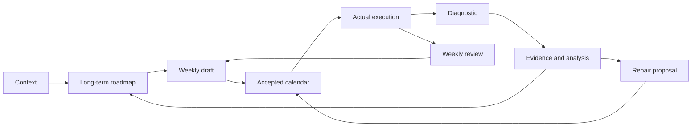
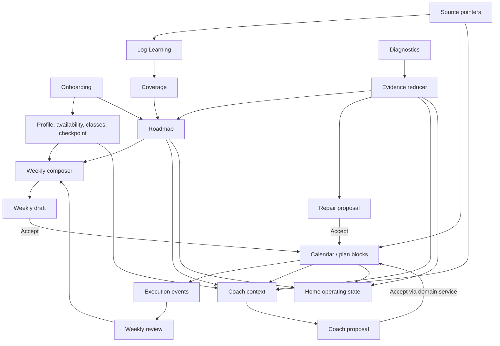

# Roadmap — Page-by-Page End-to-End Product Build Plan

**Version:** 1.0  
**Date:** 18 September 2026  
**Scope:** CFA Level I candidates sitting from 2027 onwards  
**Purpose:** Define the complete student experience, feature logic, routes, state transitions, cross-feature connections, failure handling, and phased build sequence.

---

## 1. Product definition

Roadmap is a competitive-exam learning control system. It answers:

- What should I work on now?
- When does that work realistically fit?
- Why is this task in my plan?
- Did I actually complete it?
- Do I understand and apply what I covered?
- Where is my confidence unreliable?
- What should change next week because of the evidence?
- Am I progressing through the full syllabus in time for the exam?

Roadmap does not teach CFA Level I from scratch. It may identify the relevant topic, learning module, LOS, prerequisite, source pointer, question type, or revision method, but it must direct the student back to their provider or authorised source for substantive learning.

The product loop is:



No page should create a second version of these facts. Every page is a view or command surface over the same server-owned operating state.

---

## 2. Non-negotiable product rules

1. **Onboarding is mandatory.** A signed-in user must complete it before entering any `/app/*` route.
2. **Onboarding is not selective.** Every user can complete it. No feasibility, capacity, confidence, background, or readiness result can deny access.
3. **Availability is a boundary, not an assigned study-hours target.** The user tells Roadmap when study can happen and their maximum sitting length. The system proposes work inside those boundaries.
4. **Accepted plans are explicit.** Roadmap proposes a week; the student reviews and accepts it. Page renders never write plan blocks.
5. **Evidence comes from valid diagnostics.** Self-report and task completion affect planning context, not demonstrated understanding.
6. **The Coach proposes; the user accepts.** Calendar or roadmap changes are previewable, attributable, and reversible.
7. **Partial means partial.** The product never rounds incomplete work up to completed.
8. **One student, one truth.** Home, Calendar, Curriculum, Tests, Coach, and Settings read the same state model.
9. **No hidden curriculum teaching.** Topic preparation guidance is in scope; whole-chapter instruction is not.
10. **No unlicensed reproduction.** Schweser-aligned systems must store structured mappings and generate original items without quoting or reconstructing protected passages.

---

## 3. Canonical route architecture

### 3.1 Public and authentication routes

| Route | Purpose | Links to |
|---|---|---|
| `/` | Product explanation and conversion | `/signup`, `/login`, legal pages |
| `/signup` | Email/password or Google account creation | `/check-email`, `/auth/callback`, `/onboarding` |
| `/login` | Returning-user authentication | requested safe route, `/onboarding`, or `/app` |
| `/check-email` | Email-verification holding state | mail client, `/login` |
| `/auth/confirm` | Verify email token | `/onboarding` |
| `/auth/callback` | Complete OAuth/recovery exchange | safe `next` destination |
| `/auth/error` | Expired/invalid authentication recovery | `/login`, `/forgot-password` |
| `/forgot-password` | Request password reset | email provider, `/update-password` |
| `/update-password` | Set a new password from recovery session | `/login?reset=success` |
| `/terms` | Terms | `/signup` |
| `/privacy` | Privacy policy | `/signup` |

### 3.2 Mandatory onboarding routes

| Route | Step | Required outcome |
|---|---|---|
| `/onboarding` | Resume router | Sends user to first incomplete step |
| `/onboarding/exam` | Exam target | One supported exam window selected |
| `/onboarding/route` | Preparation route | Self-study, self-paced, live classes, or hybrid |
| `/onboarding/position` | Starting position | Candidate stage and topic-level coverage context |
| `/onboarding/week` | Real-life week | Availability, maximum sitting, classes/commitments |
| `/onboarding/checkpoint` | Accountability | Study-week closing day and diagnostic preference |
| `/onboarding/plan` | Confirmation | Roadmap preview, consent, initial-week draft trigger |

`/onboarding/preview?demo=1` remains development-only and must not be linked in production.

### 3.3 Student workspace routes

| Route | Product ownership |
|---|---|
| `/app` | Action-first Home and attention queue |
| `/app/calendar` | Accepted week, execution, commitments, deviations |
| `/app/curriculum` | Long-term roadmap, phases, milestones, drift |
| `/app/tests` | Diagnostic selection, history, evidence summary |
| `/app/tests/[attemptId]` | Test-taking experience |
| `/app/tests/[attemptId]/result` | Evidence, confidence, SWOT, repair proposal |
| `/app/coach` | Evidence-grounded planning and analysis assistant |
| `/app/log` | Record classes, external study, and external practice |
| `/app/settings` | Setup and account overview |
| `/app/settings/profile` | Name and basic account preferences |
| `/app/settings/exam` | Exam target and registration state |
| `/app/settings/study` | Preparation route, class timetable, coverage context |
| `/app/settings/availability` | Availability and protected commitments |
| `/app/settings/accountability` | Week boundary and reminder preferences |
| `/app/settings/sources` | Provider/source pointers and premium material processing |
| `/app/settings/notifications` | Email/reminder controls |
| `/app/settings/account` | Password, export, sessions, deletion |

### 3.4 Internal operations routes

These routes require an explicit staff/reviewer role and must not appear in student navigation.

| Route | Purpose |
|---|---|
| `/admin/diagnostics/items` | Item generation/review queue |
| `/admin/diagnostics/items/[id]` | Full item provenance and review |
| `/admin/diagnostics/runs` | Generation yield, rejection and bias metrics |
| `/admin/curriculum` | Curriculum manifest/version management |
| `/admin/curriculum/[manifestId]` | Topic, LM, LOS and concept coverage |
| `/admin/support/users/[id]` | Audited support view; no answer keys |

### 3.5 Routes to retire or redirect

| Current route | Decision |
|---|---|
| `/app/week` | Temporary 308 redirect to `/app/calendar`; remove after migration window |
| `/app/syllabus` | Temporary 308 redirect to `/app/curriculum`; remove after migration window |
| `/app/materials` | Temporary 308 redirect to `/app/settings/sources`; never show in navigation |
| `/app/tests/review` | Move to `/admin/diagnostics/items` |
| `/app/tests/manifest` | Move to `/admin/curriculum/[manifestId]` |
| `/check/result` | Remove if no active supported journey consumes it |
| `/api/feasibility` | Replace with roadmap projection service or remove |
| `/api/materials/analyze` | Premium-only asynchronous ingestion; remove synchronous student endpoint |

---

## 4. Global access and routing flow

```mermaid
flowchart TD
  V[Visitor] -->|Create account| S[/signup]
  V -->|Sign in| L[/login]
  S --> E[Email or Google verification]
  L --> A{Authenticated?}
  E --> A
  A -->|No| L
  A -->|Yes| O{Onboarding complete?}
  O -->|No| R[/onboarding → first incomplete step]
  R --> P[/onboarding/plan]
  P -->|Confirm setup| W[/app]
  O -->|Yes| W
```

Rules:

- Proxy refreshes the Supabase session and blocks unauthenticated protected routes.
- `/app/layout` enforces `profiles.onboarding_status = complete`.
- `/onboarding` reads saved step state and resumes safely.
- A completed user visiting onboarding may edit a named step from Settings; they are returned to Settings or the relevant review surface rather than forced through all steps again.
- If onboarding data is corrupted or a required row is missing, the user is resumed at that step with their valid answers preserved.

---

## 5. Shared system state and services

### 5.1 Operating State

`getCurrentOperatingState(userId)` becomes the canonical server read model for Home and a shared source for all pages.

It contains:

- candidate and exam identity;
- onboarding version/completion;
- active curriculum manifest;
- active roadmap, phase, milestone and drift;
- current planning cycle and draft revision;
- today's accepted tasks and protected commitments;
- execution summary and recent deviation events;
- latest diagnostic, next eligible diagnostic and bank sufficiency;
- concept summaries and open repair threads;
- notification/reminder status;
- attention items with action route and severity.

### 5.2 Core command services

| Service | Commands |
|---|---|
| Auth | sign up, sign in, OAuth exchange, reset, sign out |
| Onboarding | save step, resume, finalise |
| Roadmap | generate, reproject, preview change, accept change |
| Weekly planning | compose draft, revise load, accept draft, close cycle |
| Tasks | start, complete, partial, defer, skip, move, resize, split, undo |
| Commitments | create, edit occurrence, edit series, skip occurrence, archive |
| Learning log | log class/study/practice, map scope, create coverage event |
| Diagnostics | create attempt, respond, submit, score, challenge, resolve |
| Evidence | reduce concept history, invalidate, reopen, re-verify |
| Repairs | preview, accept, schedule, verify, reopen |
| Coach | ask, generate proposal, validate proposal, accept/reject/undo |
| Settings | update preferences, source pointers, notifications, account lifecycle |

### 5.3 Cross-feature event stream

Important domain events should be recorded append-only:

- onboarding_completed;
- roadmap_generated / roadmap_reprojected;
- week_drafted / week_accepted / week_closed;
- task_started / partial / completed / deferred / skipped / moved / split;
- learning_logged;
- diagnostic_started / submitted / scored / challenged / voided;
- evidence_updated;
- repair_proposed / accepted / verified / reopened;
- coach_proposal_created / accepted / rejected / undone;
- exam_window_changed.

These events power audit history, weekly review, analytics, recovery, and future machine-learning features.

---

## 6. Page-by-page product specification

## 6.1 Landing page — `/`

### User outcome

The visitor understands that Roadmap is a planner and accountability system, not another content library.

### Required sections

1. Clear promise: plan the path, execute the week, verify understanding, adapt from evidence.
2. Visual product loop: Plan → Do → Test → Repair → Re-plan.
3. Who it is for: CFA Level I 2027+ candidates across self-study, classes and hybrid routes.
4. What it does not do: no full-course teaching, no guaranteed outcome, no CFA Institute endorsement.
5. Feature proof: real calendar, cumulative diagnostics, concept evidence, deviation recovery.
6. Trust and privacy: source handling, evidence definitions, account control.
7. Primary CTA `/signup`; returning-user CTA `/login`.

### Connections

- No authenticated dashboard data.
- Product analytics only after consent.
- Legal links remain visible in footer.

### Success criteria

- A new visitor can accurately explain the product after one screen.
- CTA does not imply upload-first or AI-tutor positioning.

---

## 6.2 Authentication — `/signup`, `/login`, recovery routes

### Signup process

1. User chooses Google or email/password.
2. Email signup collects name, email, password and legal consent.
3. Account is created; profile bootstrap occurs idempotently.
4. Email user sees `/check-email`; Google user completes `/auth/callback`.
5. First successful session checks onboarding status and sends user to `/onboarding`.

### Login process

1. Validate credentials without revealing whether an account exists.
2. Resolve only a safe internal `next` path.
3. If onboarding is incomplete, onboarding overrides the requested workspace route.
4. If complete, return to the requested route or `/app`.

### Password recovery

1. `/forgot-password` always returns a neutral success message.
2. Recovery link opens `/auth/callback?next=/update-password`.
3. `/update-password` validates strength and confirmation.
4. Successful change revokes sessions according to the chosen security policy and returns to login.

### Error states

- expired token;
- reused token;
- OAuth denied;
- provider misconfiguration;
- offline/network timeout;
- rate limited attempts;
- existing email on signup;
- session established but profile bootstrap delayed.

### Connections

- Auth success → onboarding gate.
- Settings Account → password recovery, session management and deletion.
- No client-exposed service-role key.

---

## 6.3 Onboarding shell — `/onboarding/[step]`

### User outcome

Roadmap obtains the minimum context required to build a useful roadmap and first weekly draft without overwhelming the candidate.

### Shell behaviour

- Six named steps with progress and save status.
- Back and forward preserve data.
- Refresh and device changes resume from the database.
- Required fields are clearly marked; conditional fields appear progressively.
- No material upload.
- No feasibility verdict, candidate rejection, or prescribed target hours.
- “Save and exit” returns to the same step after next login.
- Completed users editing from Settings see `Save changes`, not `Start studying`.

### Validation strategy

- Client validation for immediate feedback.
- Server schema validation as authority.
- Per-step transactional/idempotent writes.
- Finalisation checks all required outcomes, not merely `onboarding_step = 6`.

---

## 6.4 Onboarding Step 1 — Exam target `/onboarding/exam`

### Information collected

- CFA Level I exam window: February, May, August or November for supported years.
- Registration state: registered / planning to register.
- Exact booked exam date, only when the candidate is registered.

Timezone is detected automatically and stored. It is editable later in Settings but is not presented as an onboarding question unless detection fails.

### Process

1. Load future verified/indicative exam windows.
2. User selects one window.
3. Show whether the sitting window is confirmed or indicative.
4. If registered, require the booked appointment date. If not registered, use only the selected month/window and do not invent an exact date.
5. Save `exam_window_id`, year, sitting, registration state, optional booked date and detected timezone.
6. Invalidate only unaccepted roadmap drafts that depend on a different exam target.

### Connections

- Curriculum horizon and phase boundaries.
- Exam countdown on Home.
- Eight-week final-preparation reserve.
- Mock scheduling and diagnostic cadence.
- Changing later invokes roadmap reprojection preview.

### Required outcome

One exam window must be selected. The user cannot continue without it because every roadmap needs a horizon.

---

## 6.5 Onboarding Step 2 — Preparation route `/onboarding/route`

### Information collected

- self-study;
- self-paced course;
- live instructor-led classes;
- hybrid classes plus independent study.

Conditional for class-led routes:

- recurring class weekdays and times;
- known start/end dates, optional;
- topic order source: teacher-led by default.

Conditional for self-paced course:

- no timetable unless the user explicitly adds one later.

Provider/source details are deferred to Settings or Log Learning because they do not change the initial plan.

### Process

- Route determines sequencing authority, not access or capability.
- Live class slots become protected recurring commitments.
- Provider names create source pointers, not content ingestion jobs.
- Editing replaces only onboarding-owned class series and preserves manual exceptions.

### Connections

- Curriculum order: roadmap-led versus class-led.
- Calendar protected commitments.
- Log Learning defaults to the chosen provider and activity type.
- Coach references the provider when directing the student back to a source.

---

## 6.6 Onboarding Step 3 — Starting position `/onboarding/position`

### Information collected

- Candidate stage: fresh, actively studying, returning, revision, retaker.
- Topic-level state for all ten topics: not started, studying now, covered earlier, covered recently.
- Prior attempt count for retakers.
- Relevant background signals, optional.

### Process

- Provide “Start fresh” and bulk actions.
- Store self-report separately from evidence.
- Never mark a concept or module verified.
- Use self-report only to avoid obviously re-planning completed exposure and to select the first diagnostic scope.

### Connections

- Curriculum remaining scope and starting milestone.
- Initial weekly draft.
- Diagnostic recommendation: baseline check for previously covered topics.
- Coach language and risk framing.

### Required outcome

Stage is required. Topic states can default coherently from the selected stage and then be edited.

---

## 6.7 Onboarding Step 4 — Real-life week `/onboarding/week`

### Information collected

- Weekly availability windows by day and day-part, expandable to exact times.
- Maximum productive sitting length.
- Work, commute, family, travel and other protected recurring commitments.
- Class commitments carried forward from Step 2.

### UX

- Fast presets such as weekday evenings and weekends.
- Availability grid shows total possible window range, not “required study hours”.
- Calendar preview overlays classes and commitments.
- Conflicts and impossible windows are resolved inline.

### Process

- Write all availability states explicitly so “unavailable” differs from “not answered”.
- Convert available day-parts to validated local windows.
- Commitments become protected calendar series.
- Maximum sitting length controls splitting, not total assigned effort.

### Connections

- Weekly composer placement ceiling.
- Calendar visible working boundaries.
- Deviation recovery and alternative-slot suggestions.
- Home overload warnings.

### Required outcome

At least one availability window and one sitting-length choice are required. The system may warn when time is limited but must still allow completion.

---

## 6.8 Onboarding Step 5 — Accountability `/onboarding/checkpoint`

### Information collected

- Day that closes the student's study week.
- Preferred checkpoint/diagnostic time.
- Primary plan-breakdown pattern: falling behind, low retention, avoidance, or uncertainty.
- Reminder channel preference only if reminders are operational.

### Process

- Closing day defines the seven-day study-cycle boundary.
- Weekly cumulative diagnostics are proposed for that boundary only when studied scope and eligible questions exist.
- A test completed on the boundary creates repair proposals for the following cycle.
- Failure pattern changes Coach emphasis, not roadmap facts.

### Connections

- Calendar week start/end.
- Weekly review timing.
- Tests cadence.
- Coach recovery prompt.
- Notifications.

---

## 6.9 Onboarding Step 6 — Confirm and initialise `/onboarding/plan`

### User outcome

The user sees what Roadmap understood, what it will build, and what remains an assumption before entering the app.

### Page contents

- Exam target and phase horizon.
- Preparation route and class schedule.
- Starting position.
- Availability and protected commitments.
- Study-week boundary.
- Initial roadmap phases and first milestone—not a fully populated nine-month calendar.
- First weekly draft summary: scope, proposed sessions, diagnostic eligibility and unresolved conflicts.

### Actions

- Change any section.
- Build/rebuild preview.
- Confirm setup and accept the first week.
- If the first week cannot yet be composed, confirm onboarding and enter a guided Calendar state that requests the single missing planning input. This should be exceptional because prior steps are required.

### Transaction

Finalisation must atomically:

1. validate required onboarding data;
2. set onboarding version and completion timestamp;
3. activate one roadmap;
4. create one versioned weekly draft;
5. accept the draft only after the user confirms it;
6. write audit events;
7. redirect to `/app`.

Revisiting the final step must be idempotent and must not duplicate roadmaps, cycles, or tasks.

---

## 6.10 Home — `/app`

### Primary question

What should I do now, why, and what needs my attention?

### Information hierarchy

1. **Next action:** the nearest executable accepted task.
2. **Today:** timed and day-preferred blocks, plus protected commitments.
3. **Attention:** overdue work, pending repair proposal, plan conflict, diagnostic due, stale draft.
4. **Week pulse:** planned, completed, partial, deferred, remaining core work.
5. **Roadmap pulse:** current phase, topic milestone, projected drift.
6. **Evidence pulse:** latest diagnostic, open weaknesses, confidence calibration.

### Working actions

- Start task → task becomes `in_progress`; Calendar updates immediately.
- Mark done/partial/defer → task service writes event; Home and Calendar revalidate.
- Open diagnostic → correct attempt route or create-attempt confirmation.
- Review repair → result/proposal page.
- Review week → weekly close flow.
- Adjust plan → opens draft revision, not Settings.

### Empty/special states

- First entry after onboarding: explain the accepted first week.
- No task today: show next dated/floating action and recovery-free rest message.
- Week complete: prompt weekly review, not generic celebration.
- No deliverable diagnostic bank: explain that no test was scheduled and offer evidence-neutral practice/logging.

### Connections

- Reads only Operating State.
- Commands use task/plan/diagnostic services.
- No local storage and no duplicated readiness calculation.

---

## 6.11 Calendar — `/app/calendar`

### Primary question

When will the work happen, what is protected, and how can the week adapt without losing scope?

### Views

- Week grid as desktop default.
- Agenda as mobile/default accessibility alternative.
- Today shortcut.
- Previous/next study week using the student's boundary, not calendar Sunday assumptions.
- Optional month/roadmap overlay later; not required for MVP.

### Calendar layers

- live/self-paced class;
- protected life commitment;
- study/exposure;
- consolidation/review;
- diagnostic;
- repair;
- recheck;
- mock;
- floating unscheduled task.

### Study block detail

- title and duration;
- topic, LM and LOS reference;
- why now;
- source/provider pointer;
- suggested approach;
- focus distinction or common trap;
- what completion means;
- how it will be verified;
- provenance: roadmap, class, diagnostic, Coach, or student.

### Mutations

- move, resize, split, start, partial, complete, defer, skip, remove student-created task;
- add/edit recurring or one-off commitment;
- edit one occurrence or full series;
- undo recent change;
- resolve protected conflict with alternatives;
- accept soft overlap only after warning.

### Weekly plan controls

- Build draft when no cycle exists.
- Preview changes before replacing an accepted cycle.
- “Make lighter” and “Make heavier” adjust the draft fill ratio/scope—not a fixed hours target.
- “Unexpected change” opens deviation flow: lost day, gained time, class moved, illness/travel.
- Weekly close records actual execution and creates the next draft.

### Critical process rules

- Rendering is read-only.
- Weekly diagnostic is created during accepted-plan construction, never during Calendar rendering.
- No diagnostic is scheduled without eligible studied scope and bank sufficiency.
- Accepted history is immutable; revisions supersede rather than rewrite.

### Connections

- Curriculum supplies the current milestone.
- Tests supplies eligibility and repair/recheck needs.
- Coach creates previewable calendar proposals.
- Home reads the same accepted blocks.
- Settings supplies availability and commitments.

---

## 6.12 Curriculum — `/app/curriculum`

### Primary question

What is my path through the full CFA Level I syllabus, where am I now, and has the forecast changed?

### Page structure

1. Exam target, days/weeks remaining and phase.
2. Timeline: first pass, consolidation, revision, final eight weeks.
3. Ten-topic roadmap with milestones and prerequisites.
4. Topic drill-down: modules, LOS/concepts, self-reported coverage, diagnostic evidence.
5. Planned versus actual progress and deviation explanation.
6. Current milestone and action to build/review the week.

### State distinctions

- not exposed;
- in progress;
- exposure completed;
- needs diagnostic;
- supported;
- unstable;
- needs repair;
- recheck due.

No single “complete” badge should erase the difference between coverage and understanding.

### Roadmap logic

- Self-study follows prerequisite-aware canonical order.
- Live classes follow actual teaching order with prerequisite warnings and consolidation tasks.
- Final eight weeks are reserved for mocks/final checks when the horizon permits.
- Short horizons are transparently compressed, never rejected.
- Faster or slower actual progress changes forecast and next milestones through a proposal.

### Actions

- Change exam target → Settings Exam with reprojection preview.
- Mark exposure through Log Learning, not a direct “mastered” checkbox.
- Start diagnostic for a studied module.
- Open current week's tasks.
- Review roadmap change proposal.

### Connections

- Onboarding creates initial roadmap inputs.
- Learning logs update coverage.
- Diagnostics update evidence overlays.
- Calendar consumes only current near-term milestone.
- Coach explains drift and proposes next steps.

---

## 6.13 Tests index — `/app/tests`

### Primary question

What should I test, what evidence do I have, and which weaknesses require action?

### Test types

- concept check;
- module diagnostic;
- weekly cumulative;
- repair recheck;
- milestone check;
- full or half mock analysis in later release.

### Test recommendation logic

- Offer only scopes with studied/claimed exposure.
- Explain why the test is recommended.
- Show estimated questions/time and evidence tier.
- Check unseen eligible bank sufficiency before enabling Start.
- Never expose internal labels such as “gold” without student-friendly explanation.

### Page sections

- Recommended next diagnostic.
- Scheduled diagnostics linked to Calendar.
- Browse by purpose/scope.
- Open attempts to resume.
- Recent results.
- Concept evidence summary.
- Repair and recheck queue.

### Connections

- Calendar links scheduled blocks to attempt creation.
- Curriculum supplies studied scope.
- Result creates repair proposal.
- Home shows next diagnostic/attention item.
- Coach reads summaries, never answer keys.

---

## 6.14 Test-taking — `/app/tests/[attemptId]`

### Experience

- Distraction-free three-option CFA-style interface.
- One question at a time or reviewable section, depending purpose.
- Confidence selection per item.
- Timer appropriate to purpose.
- Flag/review navigation.
- Autosaved responses and safe resume.
- Clear submit confirmation with unanswered count.
- Accessibility for keyboard and screen reader.

### Process

- Server assembles and locks a versioned form before delivery.
- Client never receives answer keys or private rationales.
- Responses are idempotently saved.
- Submission invokes one atomic scoring/evidence transaction.
- Expired or challenged items follow defined replacement/void policy.

### Failure handling

- Network loss retains local pending response and retries.
- Duplicate submit returns existing result.
- Insufficient bank prevents attempt creation, not mid-attempt failure.
- Item challenge is available without revealing correctness during an active test.

---

## 6.15 Test result — `/app/tests/[attemptId]/result`

### Primary question

What did this test reveal, and what should change next?

### Result structure

1. Score and completion facts.
2. Confidence calibration: correct/sure, correct/unsure, wrong/sure, wrong/unsure.
3. Concept and LOS map.
4. Error analysis: knowledge gap, prerequisite gap, calculation process, misread detail, application error, confidence error.
5. SWOT:
   - Strengths: supported concepts;
   - Weaknesses: valid misses;
   - Opportunities: high-leverage prerequisites or quick repairs;
   - Threats: repeated misses, avoidance, time pressure, overconfidence.
6. Original feedback and source pointers without reproducing protected text.
7. Repair and recheck proposal with target week.

### Actions

- Accept all repair work.
- Edit proposed timing/scope before acceptance.
- Decline/defer with reason.
- Challenge an item.
- Ask Coach to explain the planning consequence.
- Return to Tests, Calendar, or Curriculum concept.

### Process

- Result is stable and reproducible from stored form/responses.
- Concept reducer calculates current state using validity, recency, confidence and repeated evidence.
- Accepted repair proposal creates one thread per concept and deduplicated blocks.
- Challenge resolution invalidates dependent evidence and cancels/supersedes dependent tasks with visible history.

---

## 6.16 Coach — `/app/coach`

### Primary question

What does my current state mean, and what is the best planning action I can take?

### Supported intents

- What should I do next?
- Why is this in my calendar?
- What changed after my test?
- Give me a SWOT analysis.
- Help me recover from a missed day/week.
- Make next week lighter/heavier.
- Move work around a class or commitment.
- Should I learn, review, test, repair, or recheck?
- Where should I study this from?

### Explicitly unsupported

- Teach me an entire topic/chapter.
- Give me copyrighted source text.
- Answer live diagnostic questions.
- Claim readiness without evidence.
- Change the plan invisibly.

### Response contract

Every actionable response should contain:

- observed facts;
- interpretation with uncertainty;
- one recommended next action;
- why it is recommended;
- relevant topic/LM/LOS/source pointer;
- verification method;
- optional proposal card if a product change is suggested.

### Proposal process

1. Coach reads permissioned Operating State.
2. Model selects a supported tool/intention.
3. Deterministic service builds and validates proposal.
4. UI shows affected blocks, conflicts and rationale.
5. User accepts/rejects/edits.
6. Transaction executes and writes audit record.
7. Undo remains available where safe.

### Connections

- Reads Home/Calendar/Curriculum/Tests truth through Operating State.
- Uses source pointers from Settings.
- Writes only coach proposals; domain services execute accepted changes.
- Conversation history is account-scoped and exportable/deletable.

---

## 6.17 Log Learning — `/app/log`

### Primary question

What did I cover outside Roadmap, and how should the planner respond?

### Entry points

- Home persistent action.
- Calendar class/study block.
- Curriculum module.
- Coach suggestion.

### Information collected

- activity type: class, self-study, course session, external questions, mock;
- date and actual duration;
- provider/source pointer;
- topic/module/LOS mapping;
- what was covered;
- perceived confidence, optional and clearly labelled self-report;
- whether a verification test should be proposed.

### Process

- Save learning activity and coverage event.
- If mapping is uncertain, suggest candidates and require confirmation.
- Never create supported evidence from the log.
- Update roadmap exposure/progress.
- If the activity changes current-week scope, create a plan-difference proposal.
- Offer an appropriately scoped diagnostic when eligible.

---

## 6.18 Settings overview — `/app/settings`

### Purpose

Show every input that affects planning, its last-updated state, and the consequence of changing it.

### Sections

- Profile.
- Exam target.
- Preparation route and classes.
- Current coverage context.
- Availability and commitments.
- Accountability and reminders.
- Sources and premium material handling.
- Notifications.
- Privacy, export and account.

Each card deep-links to a dedicated settings route. Reusing onboarding components is acceptable only if the wording, return path and change-impact preview are appropriate for an existing user.

### Change-impact rules

- Profile change: no plan effect.
- Exam change: roadmap reprojection required.
- Route/class change: roadmap order and calendar revision proposal.
- Coverage change: context update; never evidence.
- Availability change: calendar revision proposal.
- Week boundary change: next-cycle boundary change; never silently rewrite closed weeks.
- Source change: pointer availability only unless premium processing is invoked.

---

## 6.19 Sources — `/app/settings/sources`

### Core/free experience

- Add provider, book, course, portal or link as a pointer.
- Add exact chapter/lesson/page reference manually.
- Attach a pointer to learning logs and study blocks.
- Archive and restore sources.
- Roadmap works without any user-provided source.

### Premium processing

- Upload authorised files or connect supported Drive files.
- Asynchronous processing with progress, failure and deletion controls.
- Entitlement, size/type limits, malware scanning, encryption and retention policy.
- Structured extraction maps concepts and source pointers; raw source text is not reproduced in student-generated questions.
- Unsupported portals remain pointers; Roadmap never asks users to bypass access controls.

### Connections

- Calendar task source pointer.
- Log Learning defaults.
- Coach “where to learn” references.
- Diagnostic provenance remains internal and distinct from user sources.

---

## 6.20 Notifications and reminders

### Surfaces

- Settings route for preferences.
- In-product notification centre may be added after core loop; it should not become a primary nav tab in MVP.

### Events

- today's first task;
- upcoming class/commitment conflict;
- weekly diagnostic due;
- unaccepted next-week draft;
- repair/recheck due;
- exam-window confirmation/change;
- account/security events.

### Rules

- Never claim reminders are active before delivery infrastructure is configured.
- Timezone-aware and quiet-hour aware.
- User controls channel and event type.
- Deduplicate and suppress stale reminders after task changes.

---

## 6.21 Post-exam lifecycle

### User states

- exam approaching;
- exam completed, result pending;
- passed;
- retake planned;
- archived.

### Experience

- After exam date, ask whether the sitting was completed.
- Freeze the completed roadmap and preserve evidence/history.
- Result is user-entered; Roadmap does not infer pass/fail.
- Passed: archive and offer export.
- Retake: create a new exam attempt/roadmap using prior evidence with decay rules; never overwrite the prior journey.

---

## 7. Cross-feature connection map



---

## 8. Primary API and service routes to build

Exact internal names may change, but responsibilities must remain separate.

### Read models

- `GET /api/operating-state`
- `GET /api/calendar?week=YYYY-MM-DD`
- `GET /api/roadmap`
- `GET /api/tests/summary`
- `GET /api/evidence/concepts`
- `GET /api/settings`

### Onboarding

- `GET /api/onboarding`
- `PUT /api/onboarding/exam`
- `PUT /api/onboarding/route`
- `PUT /api/onboarding/position`
- `PUT /api/onboarding/week`
- `PUT /api/onboarding/checkpoint`
- `POST /api/onboarding/finalise`

### Weekly planning

- `POST /api/plans/drafts`
- `GET /api/plans/drafts/[id]`
- `PATCH /api/plans/drafts/[id]`
- `POST /api/plans/drafts/[id]/accept`
- `POST /api/planning-cycles/[id]/close`
- `POST /api/planning-cycles/[id]/deviation`

### Tasks and commitments

- `POST /api/tasks`
- `PATCH /api/tasks/[id]`
- `POST /api/tasks/[id]/split`
- `POST /api/tasks/[id]/undo`
- `POST /api/commitments`
- `PATCH /api/commitments/[id]`
- `POST /api/commitments/[id]/exceptions`

### Diagnostics

- `POST /api/diagnostics/attempts`
- `GET /api/diagnostics/attempts/[id]`
- `PUT /api/diagnostics/attempts/[id]/responses/[itemId]`
- `POST /api/diagnostics/attempts/[id]/submit`
- `GET /api/diagnostics/attempts/[id]/result`
- `POST /api/diagnostics/attempts/[id]/challenge`
- `GET /api/diagnostics/attempts/[id]/repair-proposal`
- `POST /api/diagnostics/attempts/[id]/repair-proposal/accept`

### Coach

- `POST /api/coach/messages`
- `GET /api/coach/conversations/[id]`
- `GET /api/coach/proposals/[id]`
- `POST /api/coach/proposals/[id]/accept`
- `POST /api/coach/proposals/[id]/reject`
- `POST /api/coach/proposals/[id]/undo`

### Sources and account

- `GET/POST /api/sources`
- `PATCH/DELETE /api/sources/[id]`
- `POST /api/sources/[id]/processing-jobs` (premium)
- `GET/PATCH /api/notifications/preferences`
- `POST /api/account/export`
- `POST /api/account/deletion-request`

All mutation routes require authentication, schema validation, ownership checks, idempotency where repeat submission is possible, and an audit event.

---

## 9. Build phases and page order

## Phase A — Access, authentication and onboarding foundation

Build and verify:

1. Proxy/auth route matrix.
2. Mandatory onboarding gate.
3. All authentication and recovery states.
4. Six onboarding steps and finalisation transaction.
5. Completed-user edit mode.
6. Browser tests for redirect loops, refresh/resume and duplicate finalisation.

**Exit condition:** A new user can create an account, verify it, complete onboarding once, receive a roadmap/first-week draft, and enter Home. An incomplete user cannot enter `/app/*`; no user can be rejected.

## Phase B — Weekly composer and Calendar

Build and verify:

1. Read-only Calendar query.
2. Deterministic weekly draft composer.
3. Draft review and acceptance.
4. Study block semantics.
5. Commitments, conflict handling and deviations.
6. Execution actions and task history.
7. Weekly close and next-draft loop.

**Exit condition:** The week can be generated, reviewed, accepted, executed, changed and closed without invisible writes or contradictions.

## Phase C — Home operating dashboard

Build after Calendar commands are authoritative.

**Exit condition:** Every Home action updates the same object on Calendar and every alert routes to a real resolution surface.

## Phase D — Curriculum and deviation roadmap

Complete manifest coverage, long-term roadmap visualisation, progress/drift and reprojection proposals.

**Exit condition:** Every current weekly scope traces to an active roadmap milestone and every deviation has an explained forecast effect.

## Phase E — Diagnostics and accountability

Complete item bank, generation QA, attempt delivery, scoring, evidence, challenge, result, repair and recheck loops.

**Exit condition:** One valid test causes one atomic evidence update and one deduplicated, reviewable repair proposal.

## Phase F — Coach

Remove browser-local demo state, add server conversations, permissioned context, supported intents and proposal tools.

**Exit condition:** Coach responses are grounded in current account evidence and no Coach action bypasses preview/acceptance.

## Phase G — Settings, sources, premium processing and notifications

Build dedicated settings routes, source pointer CRUD, premium ingestion jobs, reminder infrastructure and account lifecycle.

**Exit condition:** Every planning input can be safely changed and its downstream effect is previewed.

## Phase H — Internal operations and release hardening

Build reviewer/admin tools, bias/yield analytics, curriculum version operations, security review, accessibility, observability and full synthetic-candidate E2E.

---

## 10. QA matrix required for every page

Each page must pass:

- unauthenticated access behaviour;
- incomplete-onboarding behaviour;
- authorised happy path;
- empty/loading/error/offline state;
- refresh and back/forward behaviour;
- keyboard and screen-reader operation;
- 375px, 768px, 1024px and 1440px layouts;
- console errors/warnings;
- database ownership/RLS;
- duplicate-submit/idempotency;
- cross-page state consistency;
- no mutation during server render or GET;
- analytics event correctness without private content leakage.

Synthetic user journeys:

1. Fresh self-study candidate with nine months.
2. Live-class candidate with weekday classes.
3. Hybrid candidate with variable work commitments.
4. Candidate already in revision.
5. Retaker with prior evidence.
6. Candidate who misses an entire week.
7. Candidate who finishes two topics ahead of plan.
8. Candidate with a three-month horizon.
9. Candidate with insufficient diagnostic items.
10. Candidate who changes exam sitting.

---

## 11. Founder decision register

These decisions should be resolved page by page before implementation reaches the affected phase. Recommended defaults are included so work can continue without reopening settled architecture.

### Authentication

- Recommended: require email verification before onboarding for email/password accounts.
- Decide later: whether password changes revoke all sessions or only other sessions.

### Onboarding

- Recommended: six steps as specified; exam, route, stage, one availability window, sitting length and week boundary are required.
- Recommended: final step previews and accepts the first week rather than dumping the user into an empty Calendar.
- Recommended: sources are not asked during onboarding.

### Home

- Recommended: next action and attention queue outrank preparedness scores.
- Decide later: whether a single composite readiness number appears at all.

### Calendar

- Recommended: Week and Agenda for MVP; no month view until weekly execution is proven.
- Recommended: user acceptance for initial and materially revised weeks; routine task-status changes are immediate.

### Curriculum

- Recommended: preserve the final eight weeks where possible, but show transparent compression for shorter horizons.
- Decide later: whether topic ordering can be manually overridden by self-study users or only proposed through Coach.

### Tests

- Recommended: confidence is mandatory for diagnostic evidence but optional for routine practice.
- Recommended: weekly cumulative is only scheduled when there is studied scope and sufficient reviewed unseen items.
- Decide later: whether students see item-level correct-answer feedback immediately or after a delay/review stage.

### Coach

- Recommended: proposals require explicit acceptance; simple explanations do not.
- Recommended: Coach can point to sources and LOS but cannot teach whole readings.
- Decide later: conversation retention period and whether users can disable history.

### Sources and premium

- Recommended: source pointers free; file ingestion premium.
- Decide later: supported file-size limits, retention period and Drive integration timing.

### Notifications

- Recommended: email and in-product first; push/mobile later.
- Decide later: default reminder policy after onboarding.

---

## 12. Definition of the desired complete experience

A candidate signs up, completes a focused mandatory setup, reviews a credible roadmap and first week, and enters Home knowing exactly what to do next. Their Calendar reflects classes, life commitments, study work, tests and repairs. Completing or missing work changes the weekly review honestly. Diagnostics measure unseen application and confidence, produce concept-level evidence, and propose—not silently impose—repair work. Curriculum shows the full path and explains deviations. Coach can interpret this state and create reviewable proposals but cannot become a substitute tutor. Settings keeps every assumption editable. The system closes one week, learns from actual execution, and opens the next with a better plan until the exam is complete.
