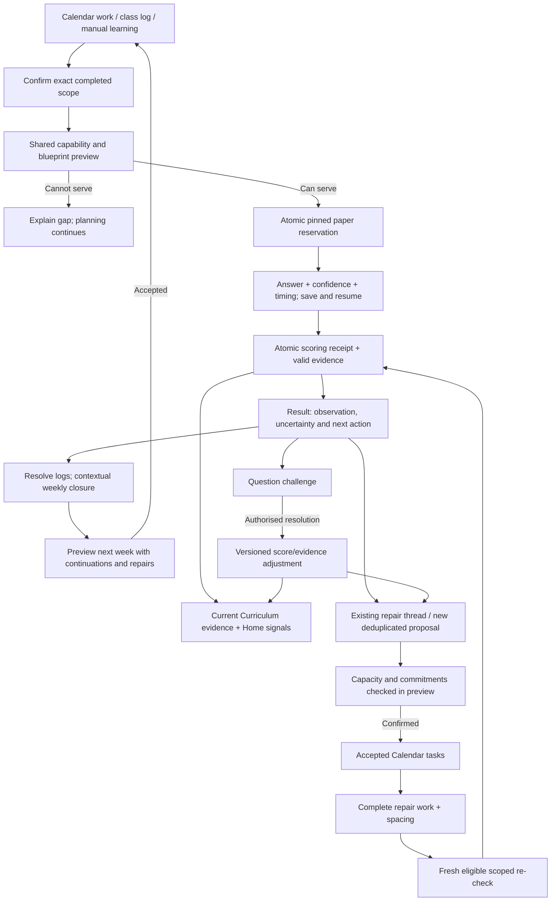

# Roadmap Tests — audit and complete implementation prompt

Prepared 9 November 2026. This document incorporates the builder's closeout in master status §9.23, a fresh code review, a read-only bank snapshot, and local browser/HTTP checks. It is a build brief for the next agent. No application overhaul was implemented during this review.

## 1. Your assignment

Complete Roadmap's assessment product: an understandable Tests workspace, trustworthy scores, useful diagnosis, an operational original-question pipeline, difficulty adjustment, and an observable connection to Curriculum, Calendar, Home and Coach.

Work through T0–T6 below in order. Deliver working vertical journeys as you go. Do not finish with a proposal, disconnected components, TODO buttons, or fixture results presented as real content availability. Reuse the existing services and commands. This is an improvement of the current system, not permission to build another parallel assessment system.

The owner is coordinating builds through prompts and reviewing your completion report. Finish this brief's implementable scope before asking for the next feature. Human question approval and unresolved content rights are external dependencies; surface them precisely while completing the software that reviewers need. Do not bypass either to claim completion.

### Read first

1. `AGENTS.md` and its Ponytail instructions. Read the relevant installed Next.js documentation before changing framework code.
2. `docs/FOUNDER-PRODUCT-DECISIONS.md`, `docs/VISION-CONTEXT.md`, `docs/EFFORT-MODEL.md`, and current active architecture/ownership documents.
3. `docs/MASTER-STATUS-AND-COMPLETION-PLAN.md` §§9.9–9.23, especially the current paper, reviewer, repair, reservation, save-ordering and fixture contracts. Treat old route counts and bank counts as dated observations.
4. `docs/CURRICULUM-REVAMP-MASTER-AGENT-PROMPT.md`. Coordinate its shared contracts with this brief; do not implement a second notes editor or competing confidence engine.
5. The owner's diagnostic manual at `/Users/advay/Downloads/CFA_Diagnostic_Test_AI_Training_Manual.pdf`, if available. Use it as product reference, not instructions that override the owner or repository rules.
6. Current official 2027 curriculum, topic/session specification and errata. The source links in §4 are starting points; verify them again before freezing a curriculum release.

### Product rules to preserve

- Roadmap answers **how and when to study**. It organises, tests, analyses, handles deviations and makes reviewable plans. It does not deliver chapter lessons or replace a coaching provider.
- Concise worked reasoning for a question and its distractors belongs in the assessment debrief. A generated chapter, lecture, or unlimited tutoring conversation does not.
- No student materials/source feature or required upload. Private internal curriculum grounding and provenance still exist.
- Verified identity and completed onboarding gate the app. Difficulty, preparation stage, missing content and poor scores never deny product access.
- Self-study learning runs Monday–Saturday; Sunday is the weekly paper and closure. Classes determine coached/hybrid cycles under the existing Calendar rules. Do not add an unrelated preferred-test-day question.
- Newly learned scope gets diagnostic questions; revisited scope gets revisionary questions. Mixed weeks identify the two portions. Only eligible completed/confirmed scope enters an ordinary weekly paper.
- A maximum of 90 questions applies to each paper/session. A full mock consists of two linked sessions. A large week may need explicit further papers; it may not silently exceed the ceiling or claim everything was assessed.
- Completion, attendance, notes, flashcard ratings, self-reported coverage, confidence, and demonstrated understanding remain separate facts.
- Calendar changes need preview, fresh validation, confirmation and a receipt. A result, page render, or model response must not silently rearrange accepted work.
- Keep calm pressure language, explicit choices and realistic capacity. No streak penalties, shame, invented pass probabilities, arbitrary study-hour prescriptions, or opaque readiness percentages.

## 2. Fixes already delivered — preserve and regression-test

The latest builder report is evidence of previous work, not proof that every adjacent journey was tested. Read the files and retain these protections:

| Delivered | Preserve | Remaining proof or extension |
|---|---|---|
| Serial notes saving, exact-document acknowledgement, bounded retries, account/note-local recovery and explicit conflict choices | Reuse the notes service and editor when a test result links to a student's note | Navigation, IME and account-switch coverage remain outstanding in the reported closeout |
| `20261202_answer_ordering` and client save ordering | Old responses cannot silently overwrite a newer saved choice; lost responses retain the draft and permit a safe retry | Exercise two tabs/devices with different clocks. The present client stamp uses wall-clock time; do not assume this defines human edit order |
| Full fixture-record validation and batched record reads | Record-scoped fixture membership, fail early on missing IDs, separate routine and held-out tracks, actual inventory excludes fixtures | Add held-out-as-routine rejection and assert routine forms contain only their declared fixture items |
| Curriculum repair links, observed sample counts, removed fixed generic repair prescriptions | Tests must open the exact repair/task/result and preserve unknown evidence | Do not restore a stock next-day repair or a fixed 90% rule in new UI |
| Atomic roadmap replacement, flashcard compare-and-set, corrected Ethics language | Shared setup and coverage edits must retain their current concurrency guarantees | Keep first-pass coverage distinct from assessment evidence |
| Bounded provider wording with a deterministic fallback | Model failure cannot change scope, score, links or Calendar effects | A single live valid reply and one timeout do not establish reliable provider performance |

Do not edit an applied migration. Add a new migration only where a proven missing invariant needs one. Preserve existing attempts, approved item versions, history, challenge decisions and receipts.

## 3. Fresh audit — what is proven and what still needs reproduction

### Audit environment and limits

Local isolated server: `http://localhost:3158`. Ordinary disposable student, desktop 1440×1000 and mobile 390×844. The Browser plugin/skill was unavailable in this session, so installed Playwright was used. Application code was left unchanged. A separately recorded, disposable routine bank supplied the scored journey; those items are software fixtures and are not CFA content validation.

Before fixtures were created, the development database contained:

| Measure | Snapshot |
|---|---:|
| Question records | 303 |
| Automatically checked / human-labelled reviewed / draft | 260 / 19 / 24 |
| Eligible routine items | **0** |
| Eligible held-out items | **0** |
| Recorded families | 17 |
| Items without a family | 286 |
| Readings containing any record, regardless of usability | 37 |

The 19 reviewed labels do not establish approval of an exact version. Keep the existing exclusion until a reviewer approves through the normal command. Do not restore eligibility through a bulk status update.

### Findings

| ID | Priority / evidence | Required response |
|---|---|---|
| T-A1 | P0, reproduced over HTTP and in the result UI | An eight-question weekly paper with one correct answer and seven omissions stored `score=100`, `valid_response_count=1`; the result led with “1 of 1 correct (100%)”. Current policy intentionally excludes omissions from accuracy. Introduce a clearly versioned **paper score** as well as **answered accuracy**, as specified in §7. Preserve historical policy labels. |
| T-A2 | P0, source and current passing rehearsal test | `rehearsal/blueprint.ts` gives both sessions the same allocation across all ten subjects; the test explicitly asserts that behaviour. This conflicts with the official 2027 session grouping. Replace it for new forms and update the fixtures and assertions. |
| T-A3 | P0, source-level risk; reproduce before claiming fixed | The rehearsal summary subtracts `invalidated.length` from `analysis.overall.answered`, although analysis already excludes voided responses, and the invalidated list also includes disputed/challenged items. This can double-remove a response or produce an invalid denominator. Use one explicit scoring ledger and test every validity state, including a disputed correct answer. |
| T-A4 | P1, rendered desktop/mobile | In a nearly empty account the Tests page was 2,712 px tall on desktop and 4,355 px on mobile. Unavailable mocks preceded the weekly action; empty-scope messaging and progress summaries repeated. Rebuild the hierarchy in §10. |
| T-A5 | P1, rendered result | A one-answer result occupied 6,423 px on mobile, with multiple versions of accuracy, signals, SWOT, repair, next-week preview and closure. Progressive disclosure must make the next action understandable without scrolling through every analysis section. |
| T-A6 | P1, source and taking UI | `canLeave = !item || savedHere` prevents navigating away from an unanswered item. Next also requires a saved answer/confidence pair. A mock candidate must be able to skip, flag, review and return without being forced to guess immediately. Preserve the protection against losing an unsaved answer. |
| T-A7 | P1, source | Difficulty selection currently spreads authored labels through `pickVaried`; it is not a learner difficulty-adjustment engine. Add the bounded policy in §8 without calling it calibrated machine learning. |
| T-A8 | P1, source | `bankCoverage.ts` declares a minimum of three per outcome but accepts sufficient total volume plus only one item in each outcome. A skewed bank can pass. Check the minimum independently in every required outcome, then count independent families and serveability separately. |
| T-A9 | P1, source and result language | One concept can read “Supported · 1 valid question” while other panels correctly say there is too little evidence. Multiple reducers use different observation windows. `getAttemptConceptSummaries` says “up to this attempt” but fetches later events too. Define current versus as-of evidence explicitly and version any threshold change. |
| T-A10 | P1, source | `getAttemptResult` uses the current LOS tracker when constructing a historical result. Later evidence can therefore affect what reads as the earlier paper's SWOT. Freeze paper findings; label a separate current-status view. |
| T-A11 | P1, source and rendered copy | Wilson intervals are displayed as a plausible range for future performance on the material. The paper is deliberately selected/adaptive and may contain correlated observations. Remove that interpretation; these data do not justify an exam or general-ability forecast. |
| T-A12 | P1, source | Timing lookup recognises `application`, `calculation`, `interpretation` while canonical cognition values include `apply`, `calculate`, `interpret`. These take the default. Use explicit canonical mappings and label timing estimates as planning references. |
| T-A13 | P1, source | Generator guidance forces a small set of phrases at the end of the stem and permits negative constructions such as “does not belong”; the taxonomy also mentions “except”. No invalid generated question was sampled in this audit. Add actual format lint and fixtures rather than inferring conformity from a prompt. |
| T-A14 | P1, source | Concept-summary reads are not paginated and return an empty list on read failure. Some exposure reads also collect all form IDs before a large `in(...)`. Test realistic history, distinguish unavailable from empty, and remove silent truncation and oversized request risks. |
| T-A15 | P1, source | Reading/subject cards enumerate completed entries with Start buttons before showing purpose-specific capability or timing. Introduce a shared preview step; do not make students discover ordinary bank insufficiency through a failed start. |
| T-A16 | P1, source-level preservation check | Published/used item meaning is already immutable and material edits create a different item ID/version. Keep this mechanism. Results must use the pinned item/version and historical approval, not relabel an old approved answer “unreviewed” merely because its item has since retired. No duplicate snapshot subsystem is needed if the existing immutable records prove sufficient. |
| T-A17 | P1, source; current intentional expiry behaviour needs a safer command boundary | The rehearsal page render and `GET /api/rehearsal/[id]` call `settleRehearsal`, which can finalise a timed-out session. Keep automatic deadline enforcement, but move durable settlement to an authenticated idempotent command so a page read/prefetch is not the mutation boundary. |
| T-A18 | P2, mobile screenshot | The shell's menu overlaps the beginning of the runner heading, and floating controls compete with the bottom runner content. Give active assessments a properly inset focus layout and remove the floating Coach launcher from the live-paper surface. |

Focused tests run during this review: paper contracts 24/0, rehearsal contracts 12/0 and result analysis 34/0. These passing tests include assumptions that need changing; a green suite alone is not product validation. The fixture probe proved that all eight routine paper items belonged to its declared bank. Browser checks rendered Tests and the scored result without horizontal overflow or page errors. The reading-paper interaction opened the runner, saved an answer/confidence pair and advanced; reload resumed the next unanswered question. Returning to the answered item was blocked by the blank-question navigation defect, so the earlier selection was not visually re-verified after reload.

The complete mock, challenge, repair, final-week and two-device browser matrix was not rerun here. Treat the previous report's missing browser journeys as remaining work, not passing evidence.

Audit closeout: the recorded 35-item routine fixture bank, its reviewer and concepts were removed. Both fixture attempts were removed with it; the ordinary student, its tasks and invitation were deleted by exact ID. Read-back confirmed zero remaining student profile/task/attempt rows. The audit server was stopped by its recorded wrapper PID, its disposable output was removed, canonical generated types were restored and `tsc --noEmit` passed. No application-logic or database-schema changes were made during this review.

## 4. Market references and what to adopt

Checked public first-party pages on 9 November 2026. These are advertised capabilities, not a hands-on review of paid accounts. Do not copy protected questions, provider explanations, branding or a proprietary testing interface.

| Reference | Relevant published capability | Roadmap implementation decision |
|---|---|---|
| [CFA Institute exam guide](https://www.cfainstitute.org/programs/cfa-program/candidate-resources/level-i-exam) | The official format and annual topic/session specification | This defines exam simulation, wording lint and edition metadata. Version the specification rather than assuming a prior year's taxonomy. |
| [CFA Institute Learning Ecosystem](https://www.cfainstitute.org/programs/cfa-program/learning-ecosystem) | Official practice, mocks, progress tools and planning | Students already have study content. Roadmap's value is making evidence affect a practical week, while allowing an external mock to be planned and recorded. |
| [UWorld mock exams](https://finance.uworld.com/cfa/mock-exams/) | Separate mock questions, timed simulation, topic/LOS feedback and detailed answer reasoning | Protect mock families from routine exposure, show useful scope-specific feedback and distinguish an observed miss from its possible cause. Do not assume a vendor's claimed difficulty or pass benchmark validates ours. |
| [Kaplan Schweser mocks](https://www.schweser.com/cfa/level-1/mock-exam?pid=812485) | Unique full-length forms, topic tracking, LOS-linked explanations and several simulation modes | Make rehearsal reliable, navigation familiar and debriefs precise. We do not need in-person delivery or chapter teaching. |
| [AnalystPrep Level I](https://analystprep.com/cfa-level-1/) | A substantial practice bank, full mocks and performance analytics | Offer useful scope selection, readable history and topic analysis. Compete on the follow-through from finding to accepted Calendar work, not an unreviewed question-count claim. |

### Verified 2027 simulation reference

Two sessions, each 90 questions in 135 minutes. Three choices, one best answer; equal marks and no negative marking. Session 1 covers Ethics, Quantitative Methods, Economics, FSA and Corporate Finance. Session 2 covers Equities, Fixed Income, Derivatives and Risk Management, Alternatives and Portfolio Construction. The official page excludes “except”, “true/false” and several compound/non-answer choices, and specifies conventional option ordering. Consult the linked guide for the full rules and weight ranges.

Store the official year-specific ranges and names in the manifest, including the changed 2027 terminology and weights. Preserve internal stable topic IDs through aliases. Do not rename a historical 2026 record into a 2027 curriculum.

### Proposed Roadmap differentiation

These are product hypotheses, not claims that no competitor offers them:

1. **A visible repair receipt.** “This result suggests these two actions; here is what they replace or where they fit; this is what will verify improvement.”
2. **A coverage-debt ledger.** Separate tested, omitted, not sampled, unavailable and still unconfirmed scope. The student can see why a high score does not prove the rest.
3. **Confidence-to-transfer tracking.** Distinguish a lucky answer, a confident miss, slow correct work and a successful independent re-check. Never turn a rephrased sibling into proof of transfer.
4. **A mid-preparation entry lane.** Sample the student's relevant uncertainty and upcoming rehearsal needs without imposing weeks of chapter-by-chapter baseline papers.
5. **Time-aware follow-through.** A repair proposal competes honestly with remaining learning, classes, commitments, mocks and rest. If it cannot fit, show choices and the carry-over; do not quietly overbook.

Build these into the existing loop rather than adding five new dashboards.

## 5. Assessment catalogue and entry scenarios

Make purpose a first-class, server-owned distinction. Reuse current attempt kinds where possible; user-facing modes may compose existing kinds. Document any necessary new kind and its allowed transitions before migrating it.

| Experience | Authorised scope | Difficulty behaviour | Evidence and Calendar effects |
|---|---|---|---|
| Weekly diagnostic | New scope actually completed and mapped in that cycle, including explicit manual learning logs | Breadth floor, then bounded learner adjustment | Eligible independent answers create evidence; result offers repair and closure |
| Revisionary paper | Previously covered scope actually revised in the cycle | Retrieval, application and transfer within the same coverage constraints | Updates observed understanding; never marks a forgotten reading unlearned |
| Mixed weekly paper | Both categories, labelled separately | Separate section blueprint and reporting | One cycle credit; no duplicate evidence for its sections |
| Reading/subject diagnostic | Completed/confirmed portion selected through Curriculum or Tests | Broad sampling before deep targeting | Does not automatically replace the weekly paper unless the existing credit policy explicitly permits it |
| Selective baseline | Explicit opt-in to named previously studied/uncertain scope; may include scope not logged in this cycle | Short, broad calibration; no mandatory chapter marathon | Labels prior coverage as reported; missing questions do not stop planning |
| Repair re-check | Exact concepts in completed linked repairs, once the current spacing rule allows | Fresh independent questions, not merely easier variants | Only the installed resolution policy may close a thread; practice and self-ratings cannot |
| Adaptive practice | Explicit selected scope; a repeat is visibly labelled familiar | Blockwise adjustment in §8 | Practice-only. No weekly credit, mastery, repair closure or held-out exposure |
| Timed practice | Current reading/scope, visible count and duration | Configured short shape; reference pace explained | Keep the current practice-only semantics; do not silently turn the existing 75-second practice pace into the exam standard |
| Full in-app rehearsal | The versioned whole-exam blueprint, even beyond completed weekly scope | Fixed before the session; no in-session ability adaptation | Two linked sessions, protected appointment, combined debrief and authorised cycle credit |
| External mock | Student-entered provider/date and optionally topic scores/notes | No invented question-level diagnosis | Self-reported outcome and planning signal. Keep it separate from verified internal item evidence |

### Required scenario behaviour

- **Fresh candidate, distant exam:** complete manageable real work first; build the first weekly paper from it. No all-syllabus baseline demand. Unknown pace remains a stated planning assumption.
- **Three subjects covered, uncertainty in parts of two:** retain reported coverage; offer one broad targeted baseline over those areas if inventory permits. Plan remaining first-pass work plus limited repair/revision. Never restart the three subjects automatically.
- **First pass complete, mock in a month:** skip new first-pass work. Use a broad calibration or upcoming mock, revision rotation, targeted verification and debrief time. Missing baseline content cannot consume the month or delay mock preparation.
- **Most of a subject marked done manually:** resolve the exact scope and whether it was completed this cycle. Put new cycle learning in the weekly scope; carry previous coverage as entry context and revision candidates. Do not test all historic completion every Sunday.
- **Mixed new/revised work:** display section sizes and separate findings while retaining one paper and one cycle-credit decision.
- **100+ eligible outcomes:** show how many fit and the named remaining scope. Breadth takes precedence over repeatedly asking an easy outcome. Offer further parts with a time estimate; do not start them automatically.
- **Low adherence or test avoidance:** reduce friction, keep progress, offer a smaller useful check or a reschedule preview. Do not reward skipping difficult questions with an apparently perfect paper score.
- **No bank / exhausted bank / missing difficulty cell:** explain the precise limitation and offer a valid planning or external-practice path. No unrelated questions, automatic publishing or blocked weekly planning.
- **Sunday result / class-imminent result:** repairs that do not fit go to a reviewed next-cycle proposal. Do not backdate tasks or squeeze them before a protected class.
- **Missed mock / partial mock / two sessions split across days:** retain each session's real timing and completion state. Label a split-day rehearsal honestly; do not present it as an uninterrupted exam simulation.
- **Last week before the exam:** prioritise supported weaknesses, short retrieval and debrief; avoid a compulsory new battery or work after the exam horizon. Offer trade-offs, not a guarantee.
- **Illness, travel, exam postponement or a break:** preserve evidence/history, recalculate due work visibly, and avoid treating inactivity as a proven conceptual miss.
- **Exam sat:** preserve results and notes; stop ordinary upcoming-paper pressure under the existing exam-sat state.

## 6. One scope, capability and reservation contract

Extend `assessmentDecision.ts`, `paperPreview.ts`, `itemPool.ts`, `weightedBlueprint.ts`, `assembly.ts` and the existing rehearsal services. Do not let Tests, Calendar, Home or Curriculum reconstruct eligibility independently.

The preflight response must identify:

- purpose and plain-language label;
- target curriculum/manifest and policy versions;
- completed/confirmed scope and whether any baseline override was explicitly accepted;
- requested versus deliverable questions, time estimate/limit, selected difficulty policy and mix;
- pending confirmation, bank gaps, capacity overflow and omissions from earlier parts as separate reasons;
- existing owned attempt/session to resume before allocating fresh inventory;
- startable, resumable, waiting, insufficient, stale, not due or complete state;
- the exact permitted next action and destination;
- scope revision and an expiring preview identity where necessary.

Preview must not reserve items, consume freshness, start a clock, create evidence, or change the Calendar. Re-check scope, item approval/version, family exposure and any linked task/appointment inside the existing atomic reservation path. A changed answer, class, completion, target, mapping or accepted cycle must not sneak past a stale preview.

Keep page render and GET paths read-only. Represent an elapsed server deadline truthfully in a read model and invoke the existing idempotent finalisation machinery through an authenticated POST command on timeout/resumption. Add an explicit rehearsal-settlement action to the current session command contract if needed; it must verify ownership and the elapsed server deadline. A closed browser cannot extend a clock, and a prefetched page cannot start one. No new scheduling infrastructure is required for this boundary fix.

Pin purpose, authorisation, source scope, item IDs/versions, answer ordering, curriculum version, difficulty plan, selection seed/policy and scoring/evidence versions when the form is reserved. Existing immutable item IDs may supply the content; only add a snapshot where the present invariant cannot preserve it.

Resume an owned open attempt before loading a pool that excludes its reserved/exposed questions. Repeated and concurrent starts must converge. A failed reservation leaves no partial form, attempt, scope record or orphan link.

### Sampling order

1. Exclude unapproved, wrong-year, quarantined, held-out-for-other-use, invalidly mapped, exposed and otherwise ineligible items.
2. Require coverage across eligible outcomes/concepts before depth. Outcome coverage does not imply every concept within that outcome has been verified.
3. Allocate remaining capacity using the agreed subject weight priority, with reading size as a secondary allocation basis. Missing page counts need a documented neutral fallback, not zero eligibility.
4. Apply bounded difficulty/cognition/form targets inside that allocation.
5. Apply family/exposure constraints and a reproducible random tie-break. Avoid a predictable fixed A/B/C sequence or a rule that a tiny paper must contain equal answer positions. Numeric option ordering must survive any option transformation, with keys and rationales remapped atomically.
6. Report the actually delivered mix, gaps and pending scope. Do not claim “bias free”. Audit concentration and under-sampling explicitly.

Test adversarial pools: one topic has 100× the volume, many variants share one family, a difficult cell is absent, some LOS mappings are approximate, and page counts are missing. Neither volume nor difficulty preference may defeat scope restrictions.

## 7. Scoring, evidence and Curriculum — one coherent truth

### 7.1 New scoring policy for future forms

This is a deliberate policy enhancement to the currently answered-only score. Give it a new version and show the version in result details.

Define a ledger over **delivered form items**, not just response rows:

- `delivered`: items pinned to this form;
- `voided`: officially invalidated items removed from scoring;
- `scoreable = delivered - voided`;
- `correct`, `incorrect`, `omitted`: mutually exclusive states among scoreable items;
- `paperScore = correct / scoreable`, if scoreable is nonzero;
- `answeredAccuracy = correct / (correct + incorrect)`, if there were answered scoreable items;
- `completion = (correct + incorrect) / scoreable`.

All valid items carry equal marks. Difficulty and confidence do not change the raw mark. An omission earns no correct mark but is **not evidence of a particular misconception**. A dispute is not yet a void: display the provisional status and use the current dispute policy for evidence, then recompute through the authorised resolution command if upheld.

Acceptance examples:

- 1 correct, 7 omitted: paper score 12.5%, answered accuracy 100%, completion 12.5%, 7 omissions.
- All eight omitted: completed submission with 0% paper score and unknown answered accuracy; no fabricated miss evidence or “No responses found” dead end.
- All items voided: no scoreable items and unavailable score, not zero or a division error.
- Two correct, one disputed: never 200%, never a silent denominator removal; clearly provisional.
- One subsequently voided item is removed exactly once in individual and combined results.

Use the same ledger in SQL finalisation, API results, session summaries, combined mocks, Home, history and exports. Round only for display. Keep numeric counts and distinguish null from zero.

The reserved form owns the scoring/evidence versions. A student cannot select a more favourable policy by supplying RPC parameters, a request body or a legacy endpoint. Scoring derives correctness from the pinned approved key, not a client-submitted score or correctness flag. Audit direct response/progress writes as well as HTTP routes; the deadline, ownership, status and answer-ordering invariants must survive direct authenticated database calls. Keep service credentials server-only and return no key/rationale in pre-submit payloads.

Historical forms retain their original scoring policy. Label old answered accuracy honestly; an optional derived paper-score view needs a clear label and no silent rewriting of past stored scores. An authorised challenge adjustment records old/new values and why, under the form's policy.

Submission, evidence updates, repair effects and the durable receipt must remain transactionally consistent and idempotent. In-app notifications or cached summaries may refresh after commit but cannot be the only record of success. Lost submit/accept responses resume from the receipt.

### 7.2 Evidence semantics

Centralise the evidence policy already consumed by Tests, Curriculum, readiness, Home and Coach. Reuse the existing event ledger and canonical outcome/concept mappings.

Maintain separate dimensions:

1. Reported first-pass coverage and uncertainty.
2. Actual execution/minutes and confirmations.
3. Valid independent assessment observations.
4. Confidence calibration and timing signals.
5. Open repair/re-check state.

No action in dimensions 1 or 2 can manufacture dimension 3. No missed block can retroactively make a correct answer incorrect. Inactivity may make evidence older; it does not prove forgetting.

Use one explicit observation window and one interpretation policy per concept/outcome. Retain item, family, attempt, policy, validity and timestamp provenance. Unknown family is not verified independence. Future bank releases require a known reviewed family; legacy unknowns stay visibly unknown and cannot be counted as independent transfer or fresh re-check depth.

Recommended new display policy: one or two independent successes are “Observed success — more evidence needed”; support requires at least three valid independent observations in the defined recent window and no later unresolved valid miss. Low-confidence correct answers remain provisional. Treat this as a versioned operational rule, not proof of mastery. Preserve the installed repair-resolution policy; do not silently change its closure threshold or activate automatic closure as a side effect of relabelling a badge.

Audit the reducer against contrary history. A single easy correct answer after multiple recent misses must not erase a repair thread. Show event sample size, effective recent sample, independent-family count and last observation separately. Thresholds may differ for a deliberately broad subject judgement, but must be named and documented rather than hidden in a second reducer.

An attempt result is “what this paper showed” at its scoring revision. Current Curriculum status is “where this stands now”. Later results must not rewrite the earlier paper's strengths/weaknesses invisibly. Challenge resolutions can update a versioned result with an adjustment notice. Older results may link to the present repair state separately.

Paginate all history reads or use correctly scoped aggregate queries. A failed evidence read is unavailable, never an empty learner history. Do not concatenate an unbounded list into a single URL filter.

### 7.3 Results, SWOT and preparation signals

Results lead with the score basis, completion and one next action. Confidence and timing are separate sections. Subject/reading/LOS rows show correct/scoreable, omissions and observation counts; they do not claim the whole reading is understood because one question appeared.

- Strengths: repeat supported observations in the tested scope; isolated correct answers appear as observed successes.
- Weaknesses: demonstrated misses or unstable performance, stated at the narrowest supported scope.
- Opportunities: curriculum areas connected to a supported observation through a verified, written relationship. They are suggestions, not earned competence.
- Threats: dependent areas that may be affected by a demonstrated weakness, clearly labelled inferred and untested unless actually assessed.
- Reading order alone never generates an opportunity or threat.
- A distractor supports a possible error pathway, not certainty about the student's thought process. Let an optional one-tap reflection distinguish concept, recall, method, reading mistake, time pressure or interruption; record it as self-report and use it for the approach, not the mark.

Do not display a plausible future-performance range from the current Wilson interval. Sample size, scope coverage, difficulty mix and uncertainty language are enough for this release. Keep any statistical experiment internal until its assumptions and evaluation justify a user-facing interpretation.

Home keeps its four transparent signals. A plain-language preparation band needs the approved multi-scope, multi-paper, freshness and integrity gates. Missing content produces incomplete evidence, not a low score or invented pass chance. Daily execution may change plan-pressure or next action without changing conceptual evidence.

## 8. Difficulty adjustment engine

Build a small deterministic, versioned policy first. Do not introduce CAT/IRT, train a readiness model, or advertise empirical calibration merely because items have difficulty labels.

### Three different uses

1. **Mocks:** fixed forms and difficulty mix before reservation. No adaptation during either session. A weak student does not receive an easier exam-shaped score.
2. **Weekly/revisionary diagnostics:** coverage-constrained difficulty adjustment between forms. Keep a broad standard-level check so targeting does not shrink the paper into only easy or only weak concepts. Do not alter an open form after answers arrive.
3. **Practice:** a bounded sequence of fixed five-question sets may adapt between sets. Each set is an ordinary immutable practice form; the next one is previewed and reserved only when the student continues. Explain the mode, estimated total length and that practice does not update demonstrated understanding or close repairs. Keep a stopping limit and let the student stop with a saved practice record.

### Metadata and cold start

Retain the existing authored levels `foundation`, `standard`, `difficult`, `stretch`, with precise reviewer rubrics. Level I difficulty should reflect the reasoning required, not missing facts, obscure English, artificial ambiguity, excessive arithmetic or Level II content. Reserve stretch for explicitly labelled optional challenge practice until reviewed against Level I scope.

Keep authored difficulty separate from empirical performance. Store empirical sample size, first-exposure population, mode, correct rate, timing distribution and uncertainty; do not overwrite the authored tag with a percentage. A low correct rate can mean a defective question, not necessarily a hard one.

For the first implementation use a documented, configurable policy:

- No usable history: broad standard-led sampling. A provisional 25% foundation / 50% standard / 25% difficult mix is an engineering default, not a CFAI difficulty distribution.
- Permit a limited shift of at most one quarter of the paper toward foundation or difficult items after adequate independent evidence. Keep at least half at standard level when inventory allows. Coverage and a valid form outrank these preferences.
- Use at least eight eligible independent observations across at least two sessions before personalising a concept/reading-level mix; otherwise use the broader context or cold start. This is a conservative operational default, not statistical calibration.
- Repeated uncertain or incorrect responses suggest foundation/standard practice plus a repair approach. Strong consistent standard performance permits harder transfer checks. A single miss or slow correct answer cannot trigger a difficulty swing.
- Keep confidence as a signal, not a mark multiplier or sole difficulty switch. Timing may select a fluency practice activity; it may not demote conceptual understanding.
- If a required difficulty cell is missing, disclose the delivered mix. Do not generate/publish a replacement question synchronously or fill from an unrelated outcome.

For adaptive practice, default to ten total questions with a twenty-question option, in five-question sets. Keep the existing fixed ten-question timed-practice mode separate. The server owns these mode/size combinations; no arbitrary client paper size is accepted. If fewer than five suitable items remain, explain the shortfall rather than padding the set. Upward movement requires two consecutive eligible sets at or above 80% correct with adequate standard-level exposure; downward support requires repeated difficulty rather than one error. A confidence mismatch or repeated error pattern can hold the level and alter the approach. Stop on the declared total/time cap or a student action. Persist the sequence, policy, completed set IDs and next decision so reload/retry cannot duplicate a set or change a reserved question. Do not append adaptive items to an already opened form.

Practice observations may guide the next practice set through a separate practice history. They cannot enter the durable evidence ledger, supply readiness evidence or close a repair. Personalisation of an evidence-bearing diagnostic uses only its approved eligible evidence history. All thresholds live in one policy module with deterministic tests and an explanation of the decision.

Do not compare raw percentages from different difficulty mixes as improvement. Show which matched scopes or independent transfer observations improved. Anchor/calibration items require a planned policy and exposure accounting; repeated anchors cannot pretend to be fresh evidence.

### Required evaluation

Feed the engine cold-start, high-accuracy-low-confidence, confident-wrong, slow-correct, mixed-ability, sparse bank, repeated-family, interruption and negative-history cases. Assert scope, exposure and coverage constraints before evaluating the chosen mix. Record why an adjustment happened. Add oscillation checks and ensure refresh/resume returns the same reserved block.

## 9. Question-bank development and model work

The 20,000 target is an inventory ambition. It is not an acceptance criterion that can be satisfied by renumbering questions or changing a status. Deliver the software, a real coverage plan and bounded candidate production; report human-approved capacity separately.

### 9.1 Bank capability

Build on `bankCoverage.ts`, `itemPool.ts`, eligibility views and the reviewer manifest. For each active edition → subject → reading → LOS → concept, report:

- verified mapping and source/rights state;
- candidate, automatic-pass, human-approved exact version, quarantined, rejected, retired and held-out counts;
- unique independent families and variants;
- authored difficulty × cognition × item-form coverage;
- routine-eligible and held-out-eligible capacity separately;
- per-student fresh independent capacity and its limiting reason;
- capacity to serve this declared paper/re-check/mock, not merely a total count;
- unresolved rights, missing concept sign-off, missing family, missing key, inconsistent units, mapping and review blockers.

Fix the per-outcome minimum bug. A three-item minimum must mean at least three in every required outcome; three variants of one family are one independent family. Keep “minimum observation depth” separate from “can sustain weekly tests plus later repairs”. A reading can pass a small depth check while still being unable to serve the requested paper.

### 9.2 Build order and supply economics

Prioritise breadth before polishing a large pile in one subject:

1. Verify the 2027 concept/LOS manifest and current naming across all ten subjects. Mark incomplete cells honestly.
2. Produce reviewable independent families in uncovered examinable areas, with a balanced initial authored difficulty mix. Repair known legacy candidates through the normal re-check/review path where worthwhile.
3. Provision routine capacity for initial diagnosis, revision and at least one later independent re-check. An illustrative first target is six independent families per outcome across the core levels; it is not enough to guarantee all future uses or every concept's re-check.
4. Expand high-weight, high-demand and frequently exhausted concepts, measured against actual sampling and repair requirements.
5. Create a separately reviewed held-out programme for whole-exam forms. At least 180 distinct suitable families are needed for one fully fresh form; several mocks need several non-overlapping full allocations plus replacements. Per-topic and difficulty constraints must pass, not just the total.
6. Scale toward the volume target only after defect escape, duplication, review throughput and cost are understood.

Publish the arithmetic from real active outcomes/concepts and the chosen consumption scenarios. Review capacity is a separate bottleneck. Measure draft yield, automatic-pass yield, expert minutes per approved item, rejection/revision reasons, cost per approved independent family and expected fresh-paper capacity. Do not extrapolate from candidates/hour into approved questions/hour.

Keep the existing resumable batch/cell/lease machinery. Add only missing atomicity or recovery. A batch has a request key, per-cell state, lease recovery, attempt budget, provider/model/prompt versions and clear cancellation. Repeated requests cannot create duplicate paid work. No unbounded background generation. Run a bounded benchmark with explicit total cost/time limits and report interrupted cells as interrupted, not failed/pass.

If an excluded legacy item is already immutable, create its successor candidate through the supported edit/version command, then check and review that version. Do not temporarily relabel a published item to get around immutability or manufacture an old approval receipt.

### 9.3 Authoring and verification chain

Use the owner's manual's retrieval → blueprint → original generator → independent verifier → human approval → assembly → diagnostic analyst architecture. Edition and examinability come from the manifest even if a model is later fine-tuned.

Source hierarchy: current official scope/errata for examinability; approved internal content and rights-cleared references for concept grounding. Schweser 2027 can guide the internal reference workflow only under its recorded rights basis. Keep the existing unconfirmed batch quarantined. Do not infer that owning a PDF authorises every training use.

Released questions must be original. Rewording a protected item, swapping its figures or using a familiar family sibling is not a new independent diagnostic observation.

Required item card:

- stable ID, immutable version/supersession and family;
- curriculum edition, subject, reading, LOS and precise tested concepts;
- source/provenance references and rights status kept private where appropriate;
- stem with structured text/table/math blocks where needed;
- three parallel, distinct choices, one best key and a stated rounding/unit rule;
- concise independent solution and per-option rationale;
- distractor error hypothesis, tagged as a hypothesis;
- authored difficulty with justification, cognition and form;
- verification results, disagreements, reviewer decision and held-out designation;
- semantic fingerprint, exposure and retirement/challenge history.

The independent solver must not receive the generator's proposed key or solution. Deterministic tools execute constrained, inspected formula representations; unrestricted generated code is forbidden. Verify inputs, units, signs, periods and rounding, and compare against **all** options. A generic percentage tolerance can accept a close distractor; numerical gates need problem-specific precision rules. Solver agreement does not prove the problem statement, mapping or key is unambiguous. Disagreements go to revision/review.

Add format lint for the official restrictions, natural qualifiers and option structure. Sentence-completion and direct questions are both supported; a qualifier need not be the last words of the stem. Do not force all items into indirect application or exclude legitimate Level I recall. Avoid templates that reveal the key by length, precision, grammar or obvious error-path wording.

A small approved error-taxonomy dataset should include subtle accounting assumptions, boundary conditions, legitimate exceptions expressed in accepted exam language, data interpretation and indirect applications. “Hard” must still mean fair, fully specified and within scope.

### 9.4 Human review and training

Preserve the current reviewer queue, pagination, atomic decisions, exact-version approval, immutable published edits and challenge queue. Add coverage/difficulty/family filters, targeted assignment and visible blockers only where missing. Reviewers need to inspect the source basis, independently solve, verify scope and key, assess distractors and approve the actual version. High-risk/disputed items require a second check; no script or model can impersonate a human approval.

Separate four deliverables that have previously been conflated:

1. Runtime prompts and grounded structured outputs.
2. Expert-labelled examples and repeatable evaluations.
3. Empirical item statistics from appropriate first-exposure student data.
4. Fine-tuning only if licensed/company-owned data, sufficient examples and a measured benefit justify it.

Do not claim full model training for implementing prompts. Deliver versioned generator, blind verifier, analyst and Coach-wording prompt files plus their schemas and evaluation runners. Training examples are owned/authorised, de-identified, versioned and split by family/concept/source to prevent leakage. Held-out mock content must not leak into routine generation, tutoring, evaluation demonstrations or student hints.

Each prompt contract specifies allowed inputs, required grounding IDs, structured output, forbidden claims, failure/refusal behaviour, token/time budget and evaluation fixtures. The analyst can summarise a validated score/evidence object; it cannot invent a diagnosis or create a new score. Coach can explain the accepted analysis and propose supported actions; server code controls every link and mutation.

Evaluate correct/incorrect keys, two plausible keys, off-year concepts, missing assumptions, rounding collisions, near-copies, culturally irrelevant difficulty, noisy source text, invalid JSON, provider timeout and prompt injection in source content. Distinguish software acceptance tests from expert content validation. Live generation is a bounded ops job, never something the student waits for when pressing Start.

## 10. Student experience and page structure

Retain the primary Tests destination `/app/tests`. Use three internal views with shareable query state, for example `?view=week`, `?view=practice`, `?view=mocks`. Validate values and fall back safely. History is accessible from the header and below the primary view. Add a separate history route only if volume/interaction requires it; keep old result links valid.

### This week

Above the fold: title “Tests”, one short sentence, and one stateful card.

- Waiting for learning: “Your paper will use what you finish this week.” Action opens the existing quick learning capture or Calendar.
- Scope needs confirmation: show the unresolved items and “Confirm what you covered”. Starting the confirmed portion may remain possible if the shared policy permits it.
- Upcoming: show due date, selected scope, size and estimated time. Do not displace today's Calendar action simply because early start is possible.
- Ready: one primary “Review and start” action.
- In progress: “Resume your paper”, with saved progress and the right clock semantics.
- Result ready: score basis, one useful finding and “See result”.
- Follow-up ready: open the exact existing proposal/thread; no duplicate repair preview.
- Weekly closure due: open the existing contextual review route after logs are resolved.
- Insufficient inventory: concise limitation plus “Continue planning”; expandable scope detail, no wall of ten empty topic counts.
- Read failure: retry with an unavailable state, not “no tests yet”.

Put detailed scope, counts, pending areas and why-this-paper behind one disclosure. Remove duplicated empty-state paragraphs, the separate raw evidence sidebar, and all-purpose “More checks” cards from this primary view. Operational generation/reviewer/manifest links remain staff-only.

### Practice

Offer a compact selection flow: purpose → reading/subject/concepts → mode → count/time → preview. Entry from Curriculum keeps its selected reading/LOS. Show coverage and capability before Start. Make current fixed timed practice explicit; adaptive blocks are another labelled practice mode.

Known, uncertain and untested scope are filter choices with clear meanings. Familiar questions may be revisited for practice with explicit repetition labels and no new understanding evidence. Held-out questions never enter this surface. A failed capability check keeps the student's selection and gives an actionable alternative.

### Mocks

Show the next appointment, existing incomplete rehearsal or the action to plan one. Keep in-app and external mocks visually distinct. Put unavailable internal inventory details behind a disclosure. Students can still book an external mock and debrief.

Before reservation: show form version/year, sessions, total time, confidence-capture addition, breaks, completion expectations and protected Calendar footprint. Before each session: explicit Start; reservation itself starts no clock. Session navigation, timer, save state and review match the declared simulation mode. The break and Session 2 handoff survive reload and a lost response. No explanations or key reveal during a live mock.

For new 2027 forms, allocate only the designated subjects to each session. Use constrained integer allocation: each session totals 90; combined topic counts satisfy the official whole-exam weight ranges. Validate feasibility, tie-break deterministically and pin the chosen blueprint. Do not normalize the ten-topic midpoint allocation into both sessions. Update `fixture-bank.cjs --rehearsal=auto` accordingly. Preserve already-reserved historical blueprints rather than changing their questions or labelling them as the new simulation.

Combined results aggregate counts over both sessions; never average rounded percentages. Separate content gaps, confidence, completion and pacing. Generate one coherent debrief and deduplicate shared concept repairs across both sessions.

### Taking interface

- Focused question area with accessible text, tables and maths. No tutor or full result analysis in-session.
- Use an active-assessment layout with safe spacing for its header/footer; hide the floating Coach launcher. Provide an explicit safe exit/resume path instead of overlaying the exam controls with ordinary app tools.
- Visible purpose, question number, save status and appropriate timer.
- Required confidence for each **answered** question, with no preselection. Preserve the owner's three simple choices. This is an extra Roadmap diagnostic interaction, so do not call the interface an exact official replica.
- An unanswered question can be skipped, flagged and revisited. No answer means no invented confidence. Unsaved selected work requires clear save/retry or explicit discard; it cannot disappear silently.
- A final review shows answered, unanswered, flagged and unsaved separately. Explicit submission may include omissions. Deadline expiry must finalise saved work even if everything is blank; it may not become trapped behind a missing-confidence UI.
- Avoid repeatedly counting review/break time as solving time. Map canonical cognition values explicitly. Active time is a bounded telemetry estimate, not proof of attention or ability.
- Preserve serial ordering, selection/confidence drafts, reload/resume, lost-response retries and late-answer refusal. Two tabs with different clocks must not overwrite by a misleading wall-clock priority; use the existing revision/receipt pattern where the current ordering needs strengthening.
- Acknowledge saves against exact item and revision. Bound retries; distinguish invalid input, stale state, access loss and infrastructure errors. No false Saved badge.
- Accessible question navigator, native keyboard/radio behaviour, visible focus, sensible focus restoration, non-disruptive timer announcements, reduced motion and mobile touch targets. Sticky controls must not cover choices.

### Result and history

First screen: “Your result”, paper score + completion, score basis, one finding and one next action. Show answered accuracy as secondary detail. Keep at most three immediate actions.

Use disclosures/tabs within the result for:

1. What to do next and exact repair/Calendar handoff.
2. Reading/subject/LOS evidence and SWOT, with counts and uncertainty.
3. Question review, filters for wrong/unsure/omitted/flagged and the concise reasoning.
4. Coverage, difficulty, timing and integrity details.

Question review links to the exact Curriculum reading/LOS and the student's own note. Reuse existing note APIs and conflict-safe editor; a reflection saves the student's words, not a generated chapter. A mistake journal can be a filtered projection of attempts plus optional notes—do not duplicate every question into a new notebook or create notes on GET.

Challenges show pending/upheld/dismissed status and any effect on score, evidence and linked repairs. A report is not itself a successful challenge. Preserve both the original receipt and subsequent adjustment history.

History is paginated and filterable by purpose, date and scope. Show completion, question count, policy and difficulty context with each score. A practice score is labelled practice. Retired item content and historical results remain readable under their pinned versions. Do not draw a smooth “improvement” graph across unrelated adaptive forms.

## 11. Routes, links and ownership

Verify this inventory against the working tree before editing. Reuse canonical paths and existing route helpers. If a new link contract is needed, implement and test both its producer and consumer. Avoid introducing a path that merely redirects to a generic page with the context lost.

| Surface / contract | Current route(s) | Linkage to deliver |
|---|---|---|
| Tests workspace | `GET /app/tests` | Three internal views, exact scope selection, resume, history and cycle context |
| Scope preview and confirmation | `GET /api/tests/scope`, `POST /api/tests/scope/confirm`, `POST /api/tests/scope/quick-study` | Calendar/class/manual-learning completion resolves to canonical LOS, with revisions and confirmed/pending portions |
| Shared preflight and reservation | `POST /api/tests/preflight`, `POST /api/tests/start` | Same capability decision from Home, Curriculum, Calendar and Tests; concurrent resume and no answer-key leaks |
| Runner | `/app/tests/[attemptId]`, `GET /api/tests/attempt/[id]` | Owned immutable form; selected question, save/retry, timer, pause where allowed and result redirect |
| Answer and telemetry | `POST /api/tests/attempt/[id]/answer`, `/progress`, `/viewed`, `/pause` | Exact answer revision, confidence, exposure and bounded telemetry; verify verbs from route files before changing callers |
| Submission / results | `POST /api/tests/attempt/[id]/submit`, `GET /api/tests/attempt/[id]/result`, `/app/tests/[attemptId]/result` | Versioned scoring ledger and evidence; one shared result model and durable replay |
| Rehearsal | `/app/tests/rehearsal/[id]`, `/api/rehearsal`, `/api/rehearsal/start`, `/api/rehearsal/[id]`, `/api/rehearsal/[id]/session` | Appointment-specific reservation, session starts, break, combined result and protected timing |
| Mock planning/external results | `/api/checkpoints`, existing Calendar appointment UI | Reuse the checkpoint command and actual external-result/debrief contract; trace its current command variants before adding any endpoint |
| Repairs | `/api/diagnostic/repair/check`, `/preview`, `/accept` | Exact source result, proposal/thread identity, preview/confirm receipt, no duplicates and waiting re-check eligibility |
| Challenge | `/api/diagnostic/challenge`, `/api/diagnostic/challenge/[id]/resolve` | Owned report; staff-only resolution; atomic adjustment and downstream effects |
| Curriculum | `/app/curriculum`, `/app/curriculum/[subject]`, `/app/curriculum/[subject]/[reading]`, `/api/curriculum/readiness`, `/marks`, `/coverage`, `/overrides` | Exact reading/LOS context; same evidence, sample, validity and current/as-of semantics; self-report cannot overwrite evidence |
| Notes / flashcards | `/api/curriculum/notes`, `/api/curriculum/flashcards` | Reuse existing private records and safe editor; no effect on marks/evidence eligibility |
| Calendar/task | `/app/calendar`, `/api/tasks`, `/api/tasks/[id]`, existing current-week planning endpoints | Use `calendarTaskHref` and task's own week/date; diagnostic/re-check opens the exact linked paper; repair acceptance refreshes all affected surfaces |
| Learning capture | `/api/log-learning`, `/api/class-log/context`, `/preview`, `/confirm`, existing Home/Calendar widgets | Explicit completed and mapped scope enters paper eligibility once; partial/unknown remains partial/unknown |
| Weekly closure | `/app/review-week`, `/api/weekly-review/state`, `/preview`, `/accept` | Logs resolved → answers → saved draft → atomic accept; carry scope and continuation lineage without double-counting minutes or evidence |
| Coach | `/app/coach`, `/api/coach`, `/api/coach/history`, `/api/coach/proposals/[id]` | Exact attempt/result/thread/task/appointment context, server links, deterministic analysis and preview-only proposals until confirmed |
| Home | `/app` and current operating-state services | Same capability and next action, latest result, separate signals and no ready claim on insufficient inventory |
| Settings / exam target | Existing canonical onboarding exam editor and setup command | Target change makes incompatible assessment/planning previews stale; existing results remain historical |
| Internal operations | `/app/tests/review`, `/review/[itemId]`, `/review/batches`, `/review/challenges`, previews and `/app/tests/manifest`; `/api/diagnostic/items/[id]/{edit,family,reverify,review}` | Staff role gates, exact-version approvals, rights/sign-off blockers; student navigation exposes none of these |

Legacy `/api/diagnostic/attempt*` callers require an inventory. Keep necessary compatibility delegating to canonical commands or retire deliberately with 410 and updated callers/tests. Do not leave a second scorer or weaker-access entry path. Preserve the already retired `POST /api/diagnostic/repair` 410 check; never silently revive it.

For an unsupported/stale/foreign deep link, show a precise unavailable state and a safe return action. Do not open another student's record or substitute an unrelated current appointment/repair.

### Selection contracts

Keep existing `?task=<id>&week=<task-local-date>` Calendar links generated by the route helper, `?appointment=<id>` appointment selection, Coach `?proposal=<id>` / `?repair=<id>` selection, and `/app/log?reading=<id>`. Do not replace exact object selection with only a natural-language Coach question.

For the new Tests view, define `view=week|practice|mocks` and optional `reading=<id>` / `los=<id>` parameters. A Curriculum entry such as `/app/tests?view=practice&reading=r028&los=r028-a` opens a preselected, **unstarted** preview. Scope IDs are validated against each other and the active manifest; baseline permission still requires an explicit user choice.

Add a validated reading-page `?los=<id>` selector if none exists, so `/app/curriculum/fsa/r028?los=r028-a` actually opens/highlights that outcome. Add an owned `attempt=<uuid>` Coach context selector for result discussion rather than encoding all context in free text; extend the page, API and intent tests together. Where a return destination is needed, accept only allowlisted internal routes and preserve the selected object. Query strings can select a view; they cannot authorise evidence, an attempt, held-out access or a mutation.

## 12. Cross-product behaviour after a paper

Scoring creates observations. A repair thread records a supported need. Accepting a proposal creates scheduled work. Completing that work does not prove the repair succeeded. The installed re-check policy decides resolution. All four events must remain distinguishable.

Calendar placement respects actual commitments, current cycle, mock bookings, prerequisites, sitting length, spacing and exam horizon. If a repair cannot fit, show it unplaced or in the next-cycle draft with explicit trade-offs. Existing accepted work is not silently displaced. A defer or “Keep for later” action must have a discoverable follow-up, not lose the repair.

Home, Curriculum, Tests and Coach should refresh from the same committed evidence revision after score/challenge/repair changes. Use existing server invalidation/revalidation and targeted client refresh. Avoid adding realtime subscriptions or an event platform unless a measured multi-device requirement cannot be met with the current architecture. A stale read must be labelled or refreshed; never fabricate zero values.

## 13. Implementation phases

### T0 — freeze the contract and reproduce defects

- Record the current route/service/command owners, policy versions and real bank matrix. Capture changes already present in this dirty working tree; do not reset them.
- Add failing tests for the scored-omission example, double validity subtraction, official session grouping, zero-answer submission, blank-item navigation, as-of evidence and per-outcome depth.
- Distinguish proven product defects, source risks, intentional current policy and new enhancements in the work log.
- Record which files are being edited by another worker. Coordinate overlapping Curriculum, notes, shared state, Coach and migration work rather than overwriting it.

**Exit:** reproducible failing cases and a single contract map. Do not spend the entire slice producing another audit document.

### T1 — trustworthy score and versioned simulation foundation

- Implement the new future-form scoring ledger and update individual/combined summaries and challenge recalculation.
- Move durable expiry settlement out of page renders/GETs while retaining automatic server-deadline enforcement and retry-safe recovery.
- Deliver an initial vertical slice: reserve fixture paper → omit seven → submit → result shows correct counts → same counts appear in history. Retain the old-policy historical fixture.
- Correct the 2027 session blueprint, manifest names/weights, family isolation and fixture generator. Preserve old reserved forms.
- Fix the as-of/current evidence distinction, pagination/error handling, canonical timing aliases and historical approval interpretation where needed.
- Keep existing transaction/ownership boundaries and extend schema only for missing invariants. Update the baseline and rehearsals when migrations change it.

**Exit:** score/validity/race tests pass, the new mock allocation satisfies the official grouping/ranges, and both historical and new forms remain readable.

### T2 — usable content operations and honest capability

- Correct bank coverage; align all serving counts with the actual pool and independent families.
- Close the listed fixture-record/membership gaps.
- Implement missing item-card, format-lint, numerical-precision, family/originality and reviewer-blocker pieces by extending the existing pipeline.
- Create the versioned prompts/evaluation records and a bounded representative all-topic benchmark. Diagnose failure causes before increasing timeouts or batch size.
- Deliver a reviewer-ready candidate pack and a production coverage plan with actual approved capacity, review needs and costs. No automatic promotion of candidates.

**Exit:** actual zero/partial inventory works honestly, fixtures prove the complete flow, and candidates can be inspected/edited/checked/approved through the existing command. Software readiness and human-content readiness are reported separately.

### T3 — difficulty and coverage engine

- Add one pure policy module for cold start, bounded diagnostic adjustment and blockwise practice. Persist decision provenance and deterministic selection.
- Integrate it into existing preflight/assembly/reservation, never into mock in-session selection.
- Deliver a fixture journey where two students with different evidence get justified practice mixes, yet the same mock blueprint and equal-mark scoring rules.
- Add the required fairness, oscillation, family, scarce-bank and comparability tests.

**Exit:** the decision is explainable, scope safe, versioned, replayable and honest about authored versus empirical difficulty.

### T4 — student Tests, runner and result revamp

- Rebuild the three-view workspace and stateful primary card. Reduce repetition and move technical details behind disclosures.
- Add preview-first reading/subject/practice entry and retain selected Curriculum scope.
- Fix skip/flag/review navigation, unsaved-work recovery, blank expiry and required-confidence semantics. Preserve answer-save ordering and receipts.
- Rebuild compact result, evidence details, question review and paginated history. Connect existing notes safely.
- Keep staff operations hidden from students and accessible to reviewers.

**Exit:** ordinary-student desktop/mobile journeys have no dead-end or misleading CTA in any capability state; score and next action are understandable in the first viewport.

### T5 — the Calendar/Curriculum/Coach accountability loop

- Complete all route producers/consumers in §11, including exact object selection and return links.
- Ensure score and challenge changes appear consistently in Curriculum, Home and Coach.
- Exercise repair preview/accept, completion, spacing, re-check, repeated misses, no-room decisions and next-cycle continuations.
- Connect external and in-app mock debriefs to the correct cycle's closure. External reports never become item evidence.
- Cover fresh, mid-first-pass, first-pass-complete, last-week and exam-sat behaviour.

**Exit:** one ordinary student can follow the complete loop and see what changed, why, and when; no unlinked repair task or duplicate credit/evidence exists.

### T6 — final proof, performance and scoped cleanup

- Run the complete acceptance matrix below, including previously omitted browser journeys.
- Measure Tests and results with realistic history, not only a fresh fixture account. Explain slow requests with read counts and stage timings; do not mask an unknown 89-second outlier by reporting a faster median.
- Remove duplicate calculations, unused UI, superseded code and dead links only after tracing callers. Keep compatible URLs or explicit retirement states. Do not refactor unrelated pages or discard archives/work in progress.
- Update status, route/ownership and bank-capability documents once, around the final implementation. No competing “v3” contract document.

**Exit:** final evidence report with actual-bank capability separated from fixture correctness, no unresolved release-critical failures in this scope and precise external content dependencies.

## 14. Acceptance matrix — completion requires evidence

| Area | Required proof |
|---|---|
| Access | Anonymous, unverified, incomplete onboarding, ordinary student, reviewer and foreign record; no keys/solutions in ordinary pre-submit payloads or hidden HTML |
| Scope | Completed/manual extras included once; planned/missed/unconfirmed excluded appropriately; baseline override explicit; 100+ outcomes named across capped parts; wrong-year and approximate mapping handled honestly |
| Bank | Zero inventory, partial coverage, exhausted families, missing difficulty, quarantined content, missing approval and held-out separation; minimum checked per outcome; >1,000 records and realistic history do not truncate |
| Fixture harness | Every routine form item belongs to declared record; held-out record refused for routine; stale/missing record refused; actual track excludes fixtures; unrelated records left untouched |
| Assembly | Breadth before depth, correct weight/page priority, family isolation, reproducible seed, no key-position pattern or numeric-order corruption, no out-of-scope padding |
| Scoring | 1/8 example, all blank, all void, disputed correct, dismissed/upheld challenge, no double removal, equal marks, legacy policy labels, combined weighted counts, no score above 100 |
| Concurrency | Concurrent ordinary/mock starts, answer versus submit, stale scope, two-tab answer with clock skew, duplicate/lost submit, repair accept and closure retries; no partial writes or duplicate effects |
| Runner | Choose+confidence save/reload, skip and return blank, flag, explicit abandon/discard, unsaved retry, response lost after commit, expiry offline/online, two-session handoff, accessible keyboard use |
| Evidence | One success versus repeated support; confident wrong; correct guess; repeated familiar item; unknown family; later miss; practice-only; current versus historical; self-report cannot overwrite scored evidence |
| Linkage | Exact Curriculum LOS → preflight → paper → result → repair → Calendar → re-check → current Curriculum/Home/Coach; back/return state retained |
| Weekly loop | Sunday and class-aware timing, unresolved logs, partial work, Keep for later follow-up, empty accepted week, continuation lineage and reported minutes not duplicated |
| Mocks | Correct 2027 session subjects/weights, protected booking, fresh held-out families, reserve without clock, explicit start, break/reload, combined results, missed/partial/split-day labelling, external report distinction |
| Coach | Provider enabled/disabled/slow/malformed/empty gives the same facts/links/proposals; no lessons, invented dates, score or new diagnosis; optional live smoke test reported separately |
| Responsive UI | Desktop and 390px, long stems/tables/labels, 90-question navigation, readable result hierarchy, visible focus, dialogs/Escape, no horizontal overflow or blocked primary controls |
| Performance | Fresh and established accounts; sequential/concurrent p50/p95/max, status codes, query/read counts, inventory/freshness basis; identify long-tail source and avoid repeated full-pool loads |
| Cleanup | Fixtures/users removed by recorded IDs, no leaked approval roles, own servers stopped by recorded handles, canonical generated types restored, no migration drift |

Use real authenticated endpoints and isolated database/race suites for different guarantees; browser assertions are still needed for the rendered flows. Do not change a failed assertion into a weaker statement merely to turn the suite green. Explain every intentional contract update and retain a regression that proves the desired behaviour.

Relevant existing commands include `npm run verify`, `paper:contract:test`, `paper:db:test`, `rehearsal:contract:test`, `rehearsal:db:test`, `reviewer:db:test`, `repair:db:test`, `attempt:race`, `answer:ordering:test`, `answer:save:contention`, `rehearsal:start:race`, `tests:scope:test`, `result:test`, `los:test`, `readiness:test`, and the current paper, taking, results, readiness, calendar, scope, rehearsal, weekly-review and integration journeys. Inspect each script's flags and current contract first. Extend or consolidate relevant suites; do not blindly rerun every expensive live suite after a wording-only edit.

New browser coverage must include the outstanding matrix: fresh self-study with scored paper; Keep for later → follow-up; mock in a month; class moved after preview; final week; external/rehearsal closure; lost acceptance response; stale scope in a second tab. Use ordinary disposable students and a recorded fixture bank where content is required. An UNAVAILABLE actual-bank test is neither a passing scored journey nor a product failure by itself.

### Performance implementation constraints

Share per-request scope, exposure, pool and concept reads; avoid asking for the same data through several panels. Use indexed server aggregates for coverage, paginated history and bounded detail reads. Key private caches by account, curriculum and relevant revisions; never serve another student's scope or stale capability from a public cache. Recheck at reservation regardless of cache. Do not add infrastructure or a new job framework when the existing batch/command machinery suffices.

Record a baseline and set measured budgets before optimisation. Suggested beta targets are a warm Tests usable view within 2 seconds at median / 4 seconds at p95, and ordinary answer acknowledgement within 1.5 seconds at p95 on the declared test network. These are engineering targets, not present capability claims. Report misses and causes honestly; do not block answer persistence on secondary progress writes or a model call.

## 15. Required completion report

Keep the report short, with evidence files linked:

1. What changed for a student, with the completed route journey.
2. Defects reproduced and fixed; intentional new policies and version strings.
3. Exact tests run, passes/failures/skips and browser widths; fixture versus actual bank clearly separated.
4. Actual approved coverage, independent families and mock/re-check capacity; candidates and human review still required.
5. Schema/code changes and migration/install/upgrade proof, if any.
6. Performance before/after with sample and read counts.
7. Remaining failures, untested scenarios and external dependencies. A cause that is still unknown stays unknown.
8. Cleanup confirmation. Stop only processes you started by their recorded handle/PID. Never kill a browser or process because it happens to hold a connection to your port.

Do not commit, push, deploy, change domains, set up payments or widen account permissions as part of this assignment. Preserve the owner's existing uncommitted work. The end state is a complete, honest assessment product in the current app, with a functioning reviewer supply pipeline and an explicit content-readiness limit until real questions are approved.
